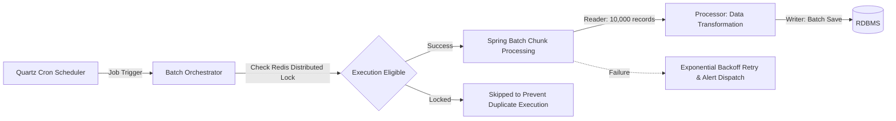

# Batch & Job Scheduler

SyncBoot provides an execution environment based on the **Quartz scheduler and Spring Batch** for high-volume data processing, settlements, and periodic external system integration jobs.

---

## Batch Architecture & Processing Flow



---

## Key Features

1. **Scheduler Configuration**: Configures periodic execution intervals using Cron expressions and passes execution parameters.
2. **Chunk-Based High-Volume Streaming**: Processes large datasets in chunk units (for example, 1,000 to 5,000 records) to manage memory usage.
3. **Duplicate Prevention via Distributed Locks**: Applies Redis-based distributed locks so that identical jobs do not run concurrently across multi-instance environments.
4. **Retries and Failure Alerts**: Retries transient database delays or network errors and dispatches alerts to designated channels when recovery fails.

---

## Batch Job Configuration Example

```java
@Configuration
@RequiredArgsConstructor
public class SettlementBatchConfig {

    private final JobRepository jobRepository;
    private final PlatformTransactionManager transactionManager;

    @Bean
    public Job dailySettlementJob(Step settlementStep) {
        return new JobBuilder("dailySettlementJob", jobRepository)
                .incrementer(new RunIdIncrementer())
                .start(settlementStep)
                .build();
    }

    @Bean
    public Step settlementStep(
            ItemReader<OrderEntity> orderReader,
            ItemProcessor<OrderEntity, SettlementEntity> settlementProcessor,
            ItemWriter<SettlementEntity> settlementWriter) {
        return new StepBuilder("settlementStep", jobRepository)
                .<OrderEntity, SettlementEntity>chunk(5000, transactionManager)
                .reader(orderReader)
                .processor(settlementProcessor)
                .writer(settlementWriter)
                .faultTolerant()
                .retryLimit(3)
                .retry(DeadlockLoserDataAccessException.class)
                .build();
    }
}
```
