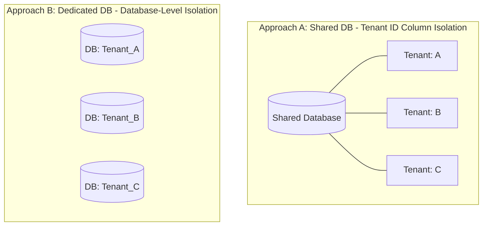

# Multi-Tenant & RBAC Security (IAM)

SyncBoot's security and authorization module provides multi-layered data isolation and access control tailored for enterprise environments.

---

## Multi-Tenant Isolation Approaches

Depending on the operating environment and security requirements, two isolation approaches can be configured.



1. **Shared Database Approach**:
   - Based on the `tenant_id` column in domain tables, a MyBatis-Plus interceptor automatically injects a `WHERE tenant_id = ?` condition into executed queries.

2. **Dedicated Database Approach**:
   - Switches the Dynamic DataSource according to the tenant identifier at request time to connect to physically separated databases.

---

## 4-Tier Access Control Framework (RBAC Matrix)

| Tier | Scope | Control Mechanism |
| :--- | :--- | :--- |
| **1. Menu Access Control** | Web Admin Console menus | Renders only menus authorized for the user's role |
| **2. Feature & Button Control** | Create, Update, Delete, Excel Export | Controls button activation via the `v-hasPermi` directive |
| **3. API Endpoint Control** | Backend REST API paths | Validated via the Spring Security `@PreAuthorize` annotation |
| **4. Data-Level Control** | Row-level and column masking | Automatically injects SQL conditions and applies sensitive-data masking annotations |

---

## Dynamic Data Masking

Sensitive data such as personal information can be processed at the backend response stage according to designated masking rules.

```java
public class UserDetailDTO {

    private Long id;
    private String name;

    @Desensitize(type = DesensitizeType.PHONE) // 010-****-5678
    private String phoneNumber;

    @Desensitize(type = DesensitizeType.EMAIL) // qu***@empasy.com
    private String email;

    @Desensitize(type = DesensitizeType.ID_CARD) // 900101-1******
    private String residentNumber;
}
```
