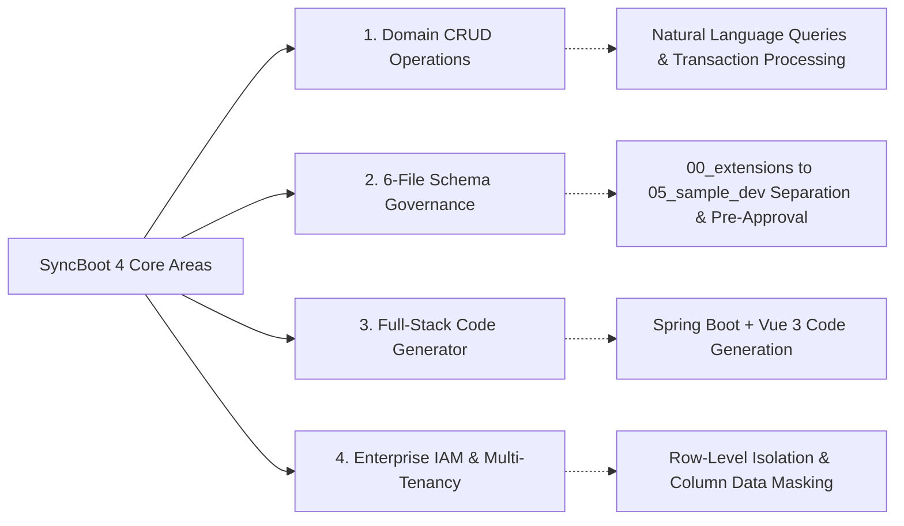
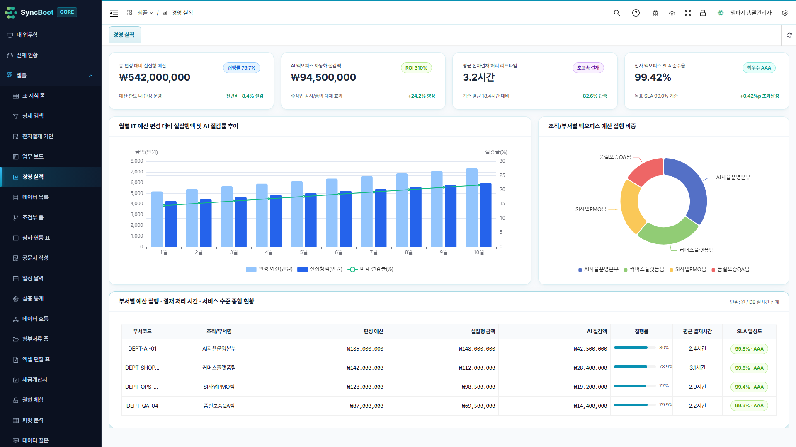
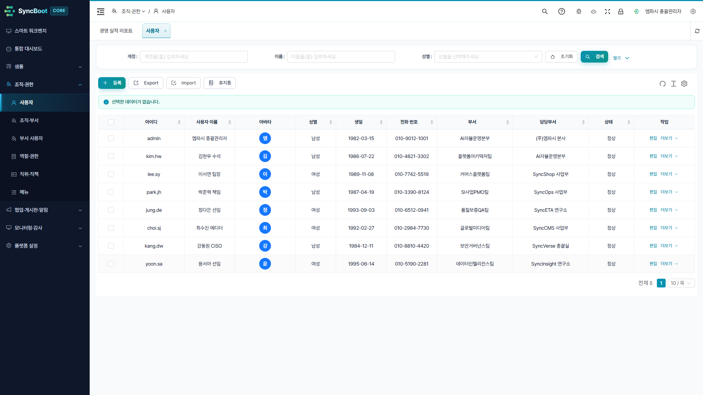
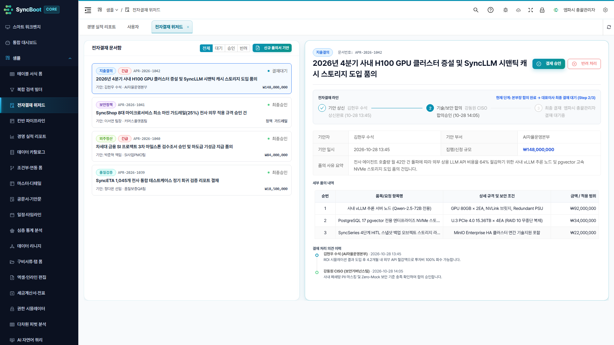
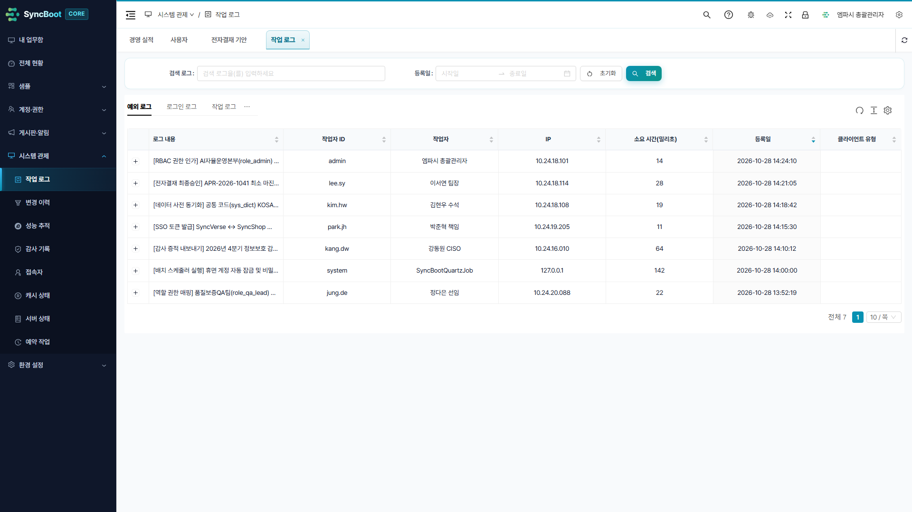

# SyncBoot: Digital Backend Framework Overview

> **Non-Developer & Evaluation Guide**: For a plain-language product introduction, visit the [SyncBoot Product Homepage (empasy.io)](https://empasy.io/en/solutions/sync-boot.html){target="_blank" rel="noopener"}. For an installation-free interactive preview, explore the [Unified Demo Portal](https://demo.empasy.io/en/products/sync-boot/#demo){target="_blank" rel="noopener"}. Product brochures and proposal PDFs are available in the [Proposals Repository](/en/proposals/).

SyncBoot is a Java-based enterprise backend platform that understands business domain context to streamline database operations and API development.

Built on Spring Boot 4.0, AgentScope Java (`io.agentscope:agentscope-harness`), and the Model Context Protocol (MCP) standard, it delivers data CRUD, schema governance, full-stack code generation, and distributed log diagnostics.

---

## 4 Core Functional Areas

1. **Domain CRUD Operations & Query Execution (Domain Operations)**:
   - Enables querying and manipulating domain data through natural language queries and standard MCP tools.
   - Processes data safely within authorized transaction boundaries.

2. **Schema Design & 6-File SQL Standard (Schema Governance)**:
   - Structures the 6-File SQL (`db/00_extensions.sql ~ 05_sample_dev.sql`) layout according to business requirements.
   - Analyzes impact prior to schema modifications and applies changes to the database only after administrator pre-approval (Human-in-the-Loop).

3. **Low-Code Full-Stack API & UI Generator (Low-Code Fullstack)**:
   - Generates Controller, Service, Mapper, DTO, and Vue 3 screen code built with Vben Admin standard components (`BasicTable`, `BasicModal`, `BasicForm`) from database entity metadata.

4. **Multi-Tenancy & RBAC Security (Enterprise Security)**:
   - Supports tenant data isolation (both dedicated database and shared database models), column-level dynamic data masking, and row-level permission filtering.

---

## 5 Backend Worker Role Architecture

SyncBoot partitions domain management, security, batch processing, and protocol integration responsibilities across dedicated worker modules.

| Role Name | Key Responsibilities | Execution Mode |
| :--- | :--- | :--- |
| **Domain Operator** | Domain data model-based CRUD and business query processing | Autonomous execution |
| **Schema Architect** | 6-File standard DDL design, ERD diagram generation, and change impact analysis | Propose then developer approval |
| **Security IAM** | RBAC role/menu mapping, row-level data filtering, and sensitive data masking enforcement | Continuous policy enforcement |
| **MCP Dispatcher** | Standard Tool/Resource exposure for A2A communication with external systems and orchestrators | HTTP SSE protocol |
| **Batch Orchestrator** | High-volume data processing and distributed scheduling of periodic Quartz/Spring Batch jobs | Scheduler-driven execution |

---

## Key Benefits

- **Reduced Backend Development Effort**: Cuts down the time required to write repetitive CRUD APIs and implement admin UI screens.
- **Reliable DB Migrations**: Reduces schema change risks through pre-change impact analysis and an approval console.
- **Faster Log Collection & Root-Cause Analysis**: Aggregates recent error logs from distributed servers to speed up troubleshooting.
- **Standard Framework Compliance**: Adheres to Spring Boot 4.0, AgentScope Java (`io.agentscope:agentscope-harness`), OpenAPI 3.0, and Model Context Protocol (MCP) specifications.

---

## Live UI Screens & Core Workflows

### 1. Back-Office Management Performance, Budget & Approval Lead-Time Dashboard
Monitors actual budget execution versus plan, AI back-office automation savings, average e-approval processing lead time, enterprise back-office SLA compliance rates, and departmental execution status in a single view.

### 2. Organization-Linked User Accounts & Role-Based Access Control (RBAC)
Instantly manages user account ledgers linked to the organization/department tree, job role (RBAC) mappings, and menu/button-level access permissions from a single database source of truth.

### 3. Korean-Style E-Approval Inbox & Multi-Step Approval Line Wizard
Includes built-in Korean-style e-approval document boxes (expense claims, security policies, vendor settlements, quality verification) along with multi-step approval line workflows—from draft submission to technical/security concurrence and final approval—and itemized request details.

### 4. Real-Time Authorization, E-Approval & Batch Scheduler Audit Logs
Centrally tracks enterprise back-office activity history—including permission grants, final e-approval sign-offs, common code synchronization, SSO token issuance, and scheduled batch runs—along with actor IP addresses and execution durations.

---

## Documentation Index

- [5-Minute Quickstart Guide](./quickstart) - Running the local environment with Docker Compose
- [System Architecture & Module Structure](./architecture) - 4-layer architecture and worker roles
- [Intelligent Schema Studio](./schema-studio) - 6-File SQL standard and DDL approval workflow
- [Low-Code Full-Stack Generator](./lowcode-generator) - Backend API and Vue 3 UI code generation
- [Multi-Tenancy & RBAC Security](./enterprise-security) - Row-level security and data masking
- [Batch & Job Scheduler](./batch-and-scheduler) - Managing Spring Batch and Quartz jobs
- [AgentScope Java & MCP Integration](./mcp-and-ai) - Model Context Protocol tool specifications
- [Production Deployment & Benchmarks](./production-guide) - Container deployment and performance metrics
- [PostgreSQL 18.6 Local Container Environment](./h2) - Zero-Mock local development and test DB configuration
