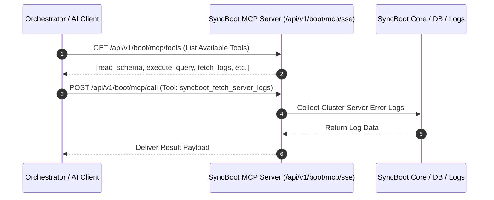

# AgentScope Java & Model Context Protocol (MCP) Integration

SyncBoot embeds the enterprise-standard AI framework **AgentScope Java (`io.agentscope:agentscope-harness`)** and **Model Context Protocol (MCP)** interfaces to support A2A integration with external orchestrators and agents.

---

## MCP Integration Architecture

SyncBoot exposes Tools and Resources over HTTP Server-Sent Events (SSE).



---

## Built-in MCP Tool Specifications

| Tool Name | Description | Parameters | Return Format |
| :--- | :--- | :--- | :--- |
| `syncboot_read_schema` | Retrieves table structure and column metadata for a specific domain | `tableName` (String) | JSON with column names, data types, nullability, and comments |
| `syncboot_execute_query` | Executes domain CRUD queries within authorized boundaries | `sql` (String), `params` (Map) | List of result records (up to 100 rows) |
| `syncboot_fetch_server_logs` | Collects recent error logs across distributed servers | `lines` (Int), `level` (ERROR) | Stack trace text |
| `syncboot_get_table_list` | Lists all managed business domain tables | `tenantId` (String) | Array of physical table names and descriptions |

---

## Java Backend MCP Tool Declaration Example (AgentScope Java)

```java
package com.empasy.sync.boot.mcp;

import io.agentscope.core.tool.Tool;
import io.agentscope.core.tool.ToolParam;
import lombok.RequiredArgsConstructor;
import org.springframework.stereotype.Component;

@Component
@RequiredArgsConstructor
public class SyncBootMcpTools {

    private final SchemaService schemaService;
    private final LogInspectorService logInspectorService;

    @Tool(description = "Retrieves the DDL and column specifications for a specified domain table.")
    public TableMetaDTO readSchema(
            @ToolParam(description = "Physical table name to inspect (e.g., tb_order)") String tableName) {
        return schemaService.getTableMetadata(tableName);
    }

    @Tool(description = "Collects recent server error logs for diagnostic analysis.")
    public String fetchServerLogs(
            @ToolParam(description = "Number of log lines to retrieve (default: 100)") int lines) {
        return logInspectorService.getRecentErrorLogs(lines);
    }
}
```
