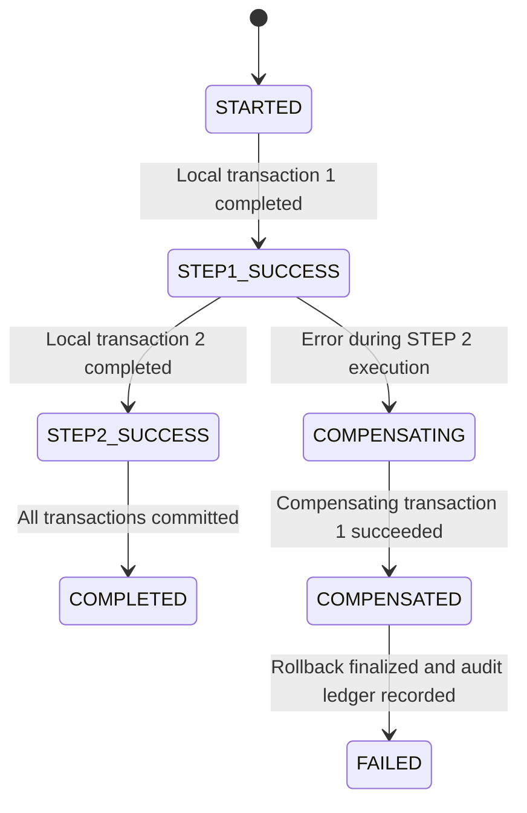

# SyncBoot Saga Distributed Transaction Implementation

## 1. Challenges of MSA Distributed Transactions

In a microservice architecture (MSA), each service owns an independent database, so traditional single-DB 2PC (Two-Phase Commit) distributed locks severely degrade system availability.  
SyncBoot adopts the **Saga pattern (Orchestrated Saga)** as its standard, executing local transactions sequentially via asynchronous messages or REST events and autonomously executing predefined **compensating transactions** in reverse order upon intermediate failure.

---

## 2. Distributed Transaction State Machine



---

## 3. Implementing the Compensating Transaction Execution Interface

Every distributed action must inherit the `SagaStep` interface and implement forward execution (`execute`) and reverse rollback (`compensate`) 1:1:

```java
package com.empasy.sync.boot.saga;

public interface SagaStep<T, R> {
    String getStepName();
    R execute(T context);
    void compensate(T context);
}
```

### 3.1 Order-Inventory Integration Saga Step Example

```java
package com.empasy.sync.boot.saga.steps;

import com.empasy.sync.boot.saga.SagaStep;
import lombok.*;
import lombok.extern.slf4j.Slf4j;
import org.springframework.stereotype.Component;

@Slf4j
@Component
public class InventoryDeductionStep implements SagaStep<OrderContext, Boolean> {

    @Override
    public String getStepName() {
        return "INVENTORY_DEDUCTION";
    }

    @Override
    public Boolean execute(OrderContext context) {
        log.info("[Saga:Tx] Deducting stock for item: {}, qty: {}", context.getProductId(), context.getQuantity());
        // Execute actual inventory deduction business logic
        return true;
    }

    @Override
    public void compensate(OrderContext context) {
        log.warn("[Saga:Compensate] Rolling back inventory for item: {}, restoring qty: {}", 
                context.getProductId(), context.getQuantity());
        // Execute compensating query to restore inventory on payment failure, etc.
    }
}
```
