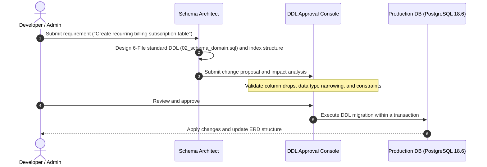

# Intelligent Schema Studio & 6-File DB Standard

SyncBoot enforces the enterprise **6-File DB script standard (`db/00_extensions.sql ~ 05_sample_dev.sql`)** and a **pre-approval (HITL) system** to ensure consistency and stability in database schema design.

---

## 6-File DB Script Standard Structure (6-File DB SSOT Standard)

Database scripts across all service modules, including SyncBoot, do not maintain backward-compatibility patch folders and are managed exclusively as **6-stage standard source files (6-File SSOT)** under each subproject root directory `<SubProject>/db/`.

```
db/
├── 00_extensions.sql     # 0. PostgreSQL 18.6 required extension declarations (vector, uuid-ossp, pg_trgm, etc.)
├── 01_schema_system.sql  # 1. Platform common system table DDL (sys_user, sys_role, sys_permission, etc.)
├── 02_schema_domain.sql  # 2. Domain-specific business table DDL, indexes, and constraints
├── 03_seed_system.sql    # 3. System essential seed data (initial super admin, default roles, common dictionary codes)
├── 04_seed_domain.sql    # 4. Domain operational menus (sys_permission), role permission mappings, and master data
└── 05_sample_dev.sql     # 5. [DEV/TEST ONLY] Sample data exclusively for development and demonstration
```

| File Name | Contents | Owner & Principles |
| :--- | :--- | :--- |
| **`00_extensions.sql`** | PostgreSQL 18.6 extensions such as `vector`, `uuid-ossp`, and `pg_trgm` | Platform infrastructure standard |
| **`01_schema_system.sql`** | System base table DDL including `sys_user`, `sys_role`, `sys_permission`, and `sys_tenant` | Platform common standard |
| **`02_schema_domain.sql`** | Business domain table DDL and indexes | Proposed by **Schema Architect**, approved by developer |
| **`03_seed_system.sql`** | Super admin account, default roles, and system code seed data | Deduplicated pure `INSERT INTO` enforced |
| **`04_seed_domain.sql`** | Domain dynamic routing menus (`sys_permission`) and permission mappings (`sys_role_permission`) | DB Single Source of Truth |
| **`05_sample_dev.sql`** | Baseline sample data for development and QA test environments | Excluded from automatic production execution |

---

## DDL Pre-Approval Workflow (Human-in-the-Loop)

To minimize errors during production database schema changes, changes go through a step-by-step review and approval workflow.



### Impact Analysis and Change Detection
- Proactively classifies and sends alerts for queries that may affect existing data, such as `DROP TABLE`, `DROP COLUMN`, and column length reductions.
- Also generates rollback scripts in case changes need to be reverted.

---

## DDL Definition Example

```sql
-- ===================================================
-- db/02_schema_domain.sql (Domain-specific table definition example)
-- ===================================================

CREATE TABLE tb_subscription (
    id BIGSERIAL PRIMARY KEY,
    tenant_id VARCHAR(64) NOT NULL DEFAULT 'default',
    user_id BIGINT NOT NULL,
    plan_code VARCHAR(32) NOT NULL,
    status VARCHAR(20) NOT NULL DEFAULT 'ACTIVE',
    started_at TIMESTAMPTZ NOT NULL,
    next_billing_at TIMESTAMPTZ NULL,
    created_by VARCHAR(64) NOT NULL,
    created_at TIMESTAMPTZ NOT NULL DEFAULT CURRENT_TIMESTAMP,
    updated_at TIMESTAMPTZ NOT NULL DEFAULT CURRENT_TIMESTAMP
);

CREATE INDEX idx_sub_tenant_user ON tb_subscription (tenant_id, user_id);
CREATE INDEX idx_sub_billing ON tb_subscription (status, next_billing_at);
```
