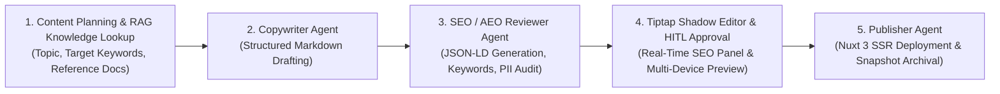

# SyncCMS AI Content Lifecycle & Authoring Studio

Beyond a static web document repository, `SyncCMS` provides a **3-stage multi-agent swarm (`CmsSwarmWorkflowService`)** and an **enterprise authoring studio** that autonomously generate, review, and publish marketing articles, technical release notes, and multilingual landing pages based on your internal knowledge base (`sync-module-rag`) and business events.

---

## 1. Copywriter-SEO-Publisher 3-Stage Agent Swarm & 4-Stage Lifecycle

The `SyncCMS` content production pipeline seamlessly combines three specialized agents built on **`AgentScope Java` (`io.agentscope:agentscope-harness:2.0.2`)** (`Copywriter Agent` -> `SEO/AEO Reviewer Agent` -> `Publisher Agent`) with a human editor's **HITL (Human-in-the-Loop) approval gate**.



### 1.1 Agent Roles & Output Specifications

| Swarm Stage | Assigned Agent (`CmsSwarmWorkflowService`) | Primary Input Data | Auto-Generated Outputs & Validation Criteria |
| :---: | :--- | :--- | :--- |
| **Stage 1** | **`Copywriter Agent`**<br>(Draft Authoring Agent) | Topic prompt, target audience, `PostgreSQL 18.6 pgvector` reference knowledge chunks | • Markdown draft structured as `H1` -> Summary (TL;DR) -> `H2/H3` body -> FAQ<br>• Front-loaded paragraphs and structured tables optimized for generative AI (GEO) citation |
| **Stage 2** | **`SEO & Safety Reviewer Agent`**<br>(Quality & Security Review Agent) | Stage 1 draft, target search keywords, forbidden terms & PII rules | • Automatic synthesis of HTML Head metadata (`title`, `description`, `og:*`, `canonical`)<br>• Generation of `Schema.org` (`Article`, `FAQPage`, `Product`) JSON-LD scripts<br>• Static audit for Personally Identifiable Information (PII) and unverified figures (triggers rewrite if score is below 85) |
| **Stage 3** | **`HITL Editor & Approval`**<br>(Editorial Review & Approval Gate) | Draft + metadata + AEO/GEO audit report | • Inline revisions in Tiptap editor and multi-viewport verification (Desktop/Tablet/Mobile)<br>• Final publishing approval after reviewing before/after snapshot diffs |
| **Stage 4** | **`Publisher Agent`**<br>(Deployment & Cache Sync Agent) | Approved content entity (`cms_article`) | • Immediate cache invalidation for Nuxt 3 SSR frontend (`cms.empasy.io`) and Live SDK<br>• Permanent archival of previous-version rollback snapshots (`cms_content_snapshot`) |

---

## 2. Enterprise Authoring Tools & Real-Time Diagnostic Components

### 2.1 Tiptap Shadow Editor (`TiptapShadowEditor.vue`)
- **Multi-Device Viewport Preview**: Immediately simulate responsive rendering for Desktop (`1440px`), Tablet (`768px`), and Mobile (`375px`) prior to deployment using the top toolbar toggle.
- **Bidirectional Markdown & Rich Block Sync**: Losslessly converts slash-command (`/`) blocks—such as callouts, code blocks, comparison tables, and Lottie animation blocks—to and from standard Markdown source.

### 2.2 Real-Time Inline SEO / AEO / GEO Analysis Panel (`SeoAnalysisPanel.vue`)
Continuously parses the active draft in the right-hand editor panel to quantitatively score Search Engine Optimization (SEO) and AI Answer Engine Optimization (AEO/GEO) out of 100 points.

| Diagnostic Category | Detailed Evaluation Criteria | Recommended Pass Threshold |
| :--- | :--- | :--- |
| **HTML Head Meta Governance** | Meta title length, meta description length, Canonical URL, OG image | Title `30–60 chars`, Description `70–155 chars`, 100% required OG tags present |
| **Semantic Document Hierarchy (SEO)** | Presence of a single `H1`, `H2` -> `H3` sequential integrity, average words per paragraph | `0` hierarchy inversions, `0` missing image `alt` attributes |
| **AI Answer Citation Optimization (AEO/GEO)** | Top executive summary block, structured comparison tables (`<table>`), Q&A section, JSON-LD | 100% validation pass for `Article` or `FAQPage` JSON-LD schema |
| **Compliance & Security** | Exposure of PII (phone numbers, emails, bank accounts) and dead links in body content | `0` unauthorized PII exposures, `0` broken internal/external links |

### 2.3 Interactive Component Library
- **`CommentSection.vue`**: Supports reader comment and reply threads, spam filtering, and moderator review (`[Pending Review]` -> Approved) status transitions.
- **`CommandPaletteModal.vue`**: Command palette triggered via `Ctrl + K` (or `Cmd + K`) to search and jump directly to any article, media asset, or metadata policy.

---

## 3. Swarm Workflow Execution REST API & JSON-LD Output Example

### 3.1 AI Content Swarm Generation Request (`POST /api/v1/cms/swarm/generate`)

```json
{
  "topic": "The Importance of Lexical Token Fingerprinting and Runtime Virtual Patching in Enterprise API Security",
  "categoryCode": "TECH_WHITEPAPER",
  "targetKeywords": ["API Security", "Virtual Patching", "Shadow API", "SyncAPIM"],
  "targetLocale": "en-US",
  "includeFaqSchema": true,
  "autoPublish": false
}
```

### 3.2 Swarm Execution Result & Auto-Generated JSON-LD Response Example

```json
{
  "code": 200,
  "success": true,
  "result": {
    "articleId": "art-20261118-305",
    "workflowStatus": "PENDING_HITL_APPROVAL",
    "aeoGeoAuditScore": 94,
    "headMeta": {
      "title": "Enterprise API Security: Lexical Token Fingerprinting & Real-Time Virtual Patching Guide | SyncCMS",
      "description": "An architectural guide to API security covering unregistered shadow API detection, SqlXssLexicalTokenizer parsing, and zero-downtime virtual patching.",
      "canonicalUrl": "https://cms.empasy.io/insights/enterprise-api-security-virtual-patching"
    },
    "generatedJsonLd": {
      "@context": "https://schema.org",
      "@type": "TechArticle",
      "headline": "Enterprise API Security: Lexical Token Fingerprinting & Real-Time Virtual Patching Guide",
      "author": {
        "@type": "Organization",
        "name": "Empasy Enterprise Security Team"
      },
      "datePublished": "2026-11-18"
    }
  }
}
```
