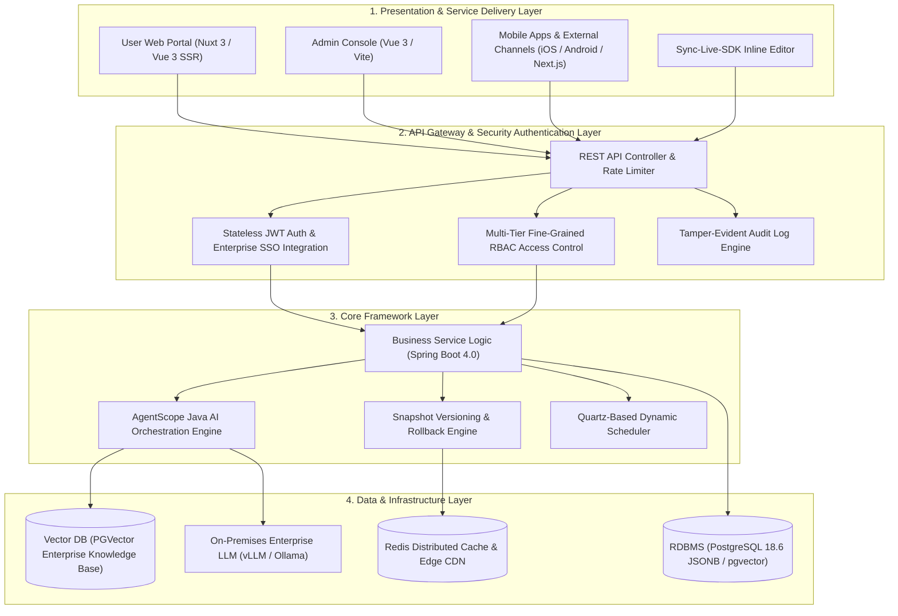
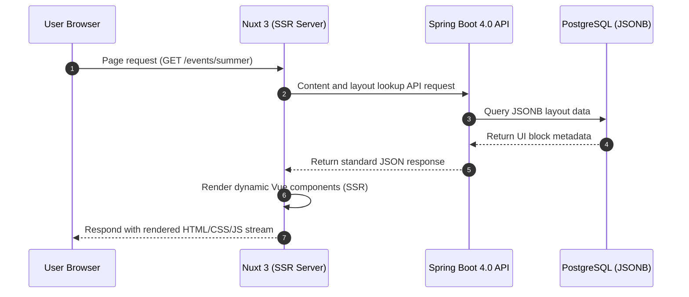

# SyncCMS System Architecture

SyncCMS is designed on a **4-layer Clean Architecture** to guarantee high-throughput traffic handling and enterprise-grade scalability.

---

## 4-Layer Architecture Diagram

---

## Detailed Layer Specifications

### 1. Presentation & Service Delivery Layer
- **User Web Portal (Nuxt 3)**: Uses Server-Side Rendering (SSR) to pre-render component trees received from backend APIs on the server, achieving fast initial load times and strong Search Engine Optimization (SEO).
- **Admin Console (Vue 3 / Vite)**: Built on TypeScript and Ant Design to provide menu management, a UI block layout builder, and a Quartz scheduler monitoring console.
- **Sync-Live-SDK**: A lightweight frontend SDK that enables selecting and editing content directly on the live production screen.

### 2. API Gateway & Security Authentication Layer
- **Stateless JWT Authentication**: Supports high-speed processing in distributed server environments without session synchronization overhead.
- **Multi-Tier RBAC (Role-Based Access Control)**: Enforces granular menu and API endpoint permissions by role, including system administrators, site operators, content authors, and approvers.
- **Audit Logging**: Records every lifecycle event—content creation, modification, approval, deployment, and rollback—alongside user ID, IP address, and change diffs.

### 3. Core Framework Layer
- **Spring Boot 4.0 & Java 25**: Built on the enterprise standard Java framework to support reliable transaction management and modular extensibility.
- **AgentScope Java AI Engine (`io.agentscope:agentscope-harness`)**: Executes on-premises LLM integration, autonomous `ReActAgent` tool invocation, and RAG (Retrieval-Augmented Generation) knowledge base queries in a single Java pipeline.
- **Snapshot Rollback Engine**: Persists versioned snapshots of content state at deployment time to enable instant rollback during incidents.
- **Quartz Scheduler**: Controls scheduled batch jobs and timed content publishing in real time.

### 4. Data & Infrastructure Layer
- **PostgreSQL JSONB Storage**: Stores unstructured UI block data and dynamic form fields in `JSONB` format, guaranteeing high-speed queries via GIN indexes.
- **Redis Distributed Cache**: Caches frequently requested headless content to distribute backend database load and minimize response latency.
- **On-Premises Enterprise AI Infrastructure**: Runs open-weight models via vLLM or Ollama inside air-gapped or private networks.

---

## Dynamic Page Rendering Pipeline

SyncCMS screen layouts are dynamically constructed and rendered from database JSON structures rather than rigid static template files.

