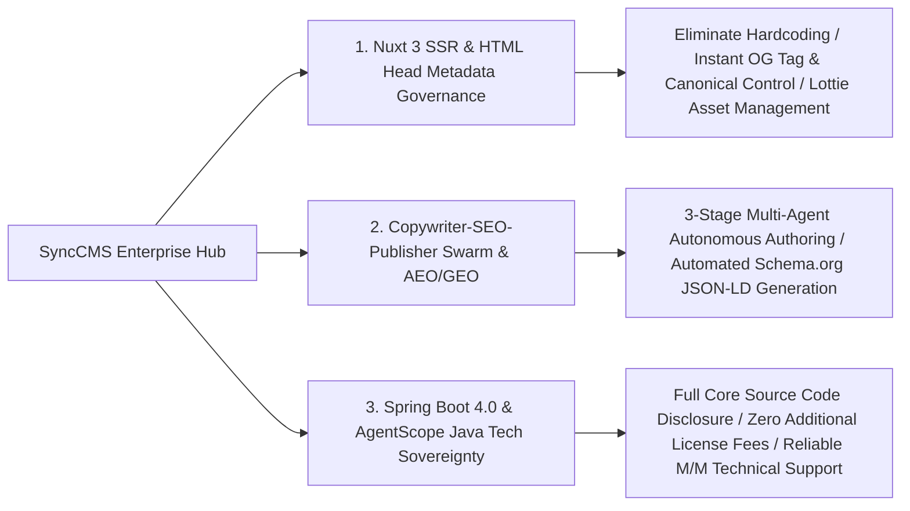
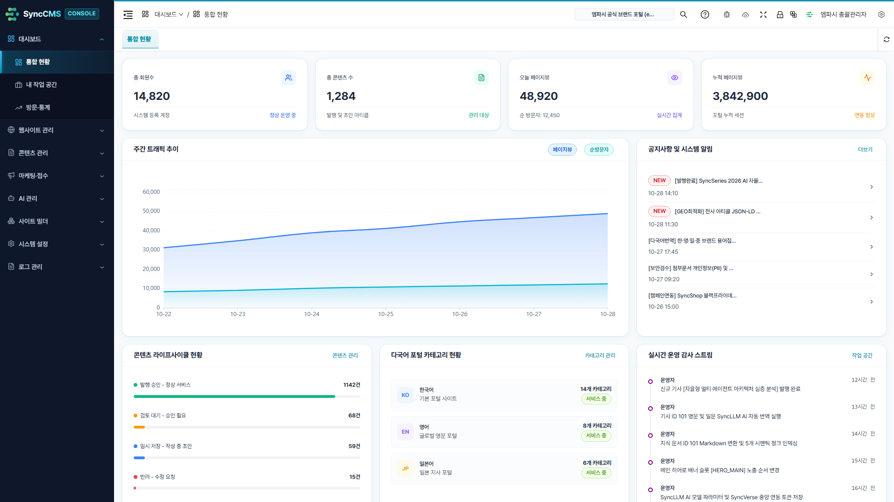
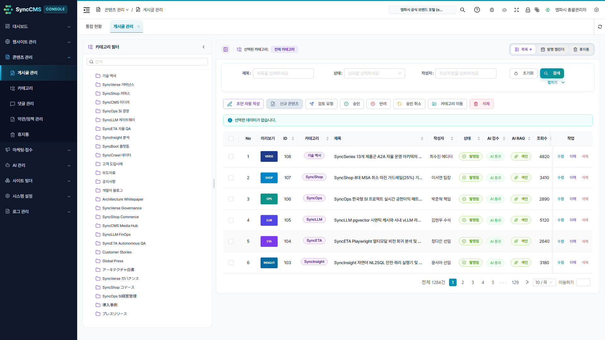
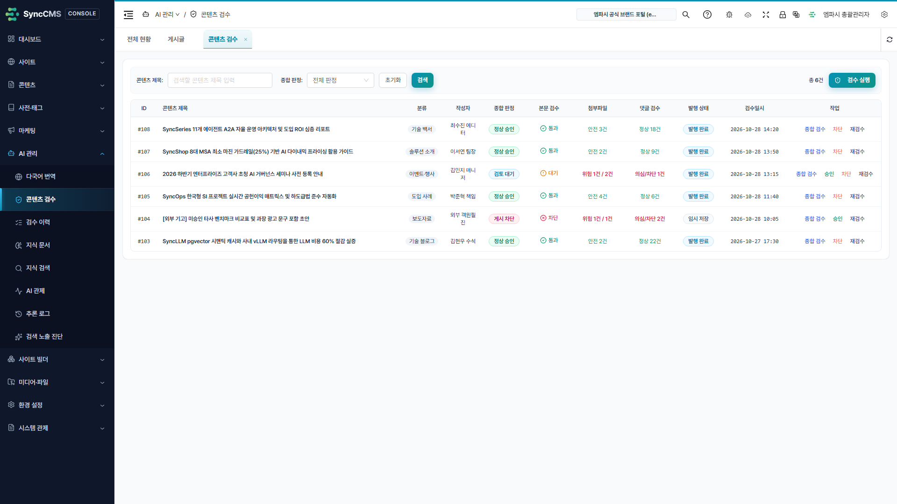
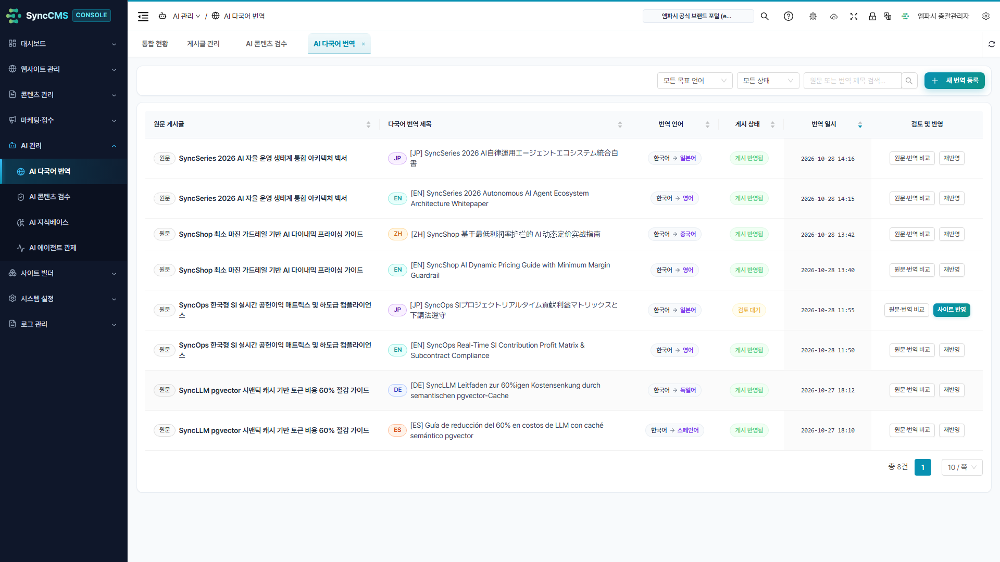

# SyncCMS: Enterprise AI Hybrid Headless CMS

> **Guide for Non-Developers & Adoption Evaluators**: For an accessible product overview, visit the [SyncCMS Product Homepage (empasy.io)](https://empasy.io/en/solutions/sync-cms.html){target="_blank" rel="noopener"}. For a zero-install interactive UI walkthrough, visit the [Integrated Demo Portal](https://demo.empasy.io/en/products/sync-cms/#demo){target="_blank" rel="noopener"}. Product brochures and proposal PDFs are available in the [Proposals Library](/en/proposals/).

**SyncCMS** (`https://empasy.io/en/solutions/sync-cms.html`) is an **enterprise hybrid headless CMS that delivers high-speed Nuxt 3 SSR rendering, a Copywriter-SEO-Publisher multi-agent swarm (`CmsSwarmWorkflowService`), centralized dynamic management of HTML Head metadata, and next-generation AI search (AEO/GEO) optimization** across all digital touchpoints such as customer-facing web portals and mobile apps.

Overcoming the closed nature and data-leakage risks of proprietary SaaS platforms as well as the aging architectures of legacy CMS products, SyncCMS **fully discloses its Java Spring Boot 4.0 and AgentScope Java (`io.agentscope:agentscope-harness`) standard framework source code, enabling the entire built system to be internalized as the client organization's independent digital software asset**.

---

## Three Core Differentiating Values of SyncCMS

### 1. Nuxt 3 SSR & Dynamic HTML Head Metadata Governance
- **Complete Elimination of Hardcoding**: Without developer deployments, marketers can configure per-page Title, Description, OpenGraph (OG) tags, and Canonical URLs directly in the back office and synchronize them in real time with the Nuxt 3 SSR web server (`cms.empasy.io`).
- **Multi-Channel Social Metadata Preview**: Simulates share thumbnails and copy in real time for KakaoTalk, Facebook, and X (Twitter).
- **Lottie & Multi-Format Media Streaming**: Reliably serves Lottie animation JSON, WebP, and multimedia assets via REST APIs (`/api/v1/cms/...`).

### 2. Copywriter-SEO-Publisher Multi-Agent Swarm & AEO·GEO·SEO Optimization
- **3-Stage Agent Swarm (`CmsSwarmWorkflowService`)**: A collaborative swarm of Copywriter (drafting) -> SEO/Reviewer (keyword, readability, and meta-tag review) -> Publisher (publishing and cache invalidation) autonomously produces high-quality content.
- **Automated Schema.org JSON-LD Generation**: The CMS automatically renders structured data scripts into the page header so search engines (SEO) and AI answer engines (AEO) can immediately parse them.
- **Generative AI (GEO) Citation Standard**: Provides a Title–Summary–H1~H3 Hierarchy–Clear Source/Author/Verification Date structure to maximize citations in AI answers such as ChatGPT and Perplexity.

### 3. Java Spring Boot 4.0 Framework & Zero License Fees
- **Full Disclosure of Java Standard Framework**: Transparently provides business Controller source code and the entire PostgreSQL 18.6 DDL, guaranteeing unrestricted extensibility for internal development teams.
- **Zero Additional Solution License Fees**: The solution is included in the SI build cost, with no extra charges as traffic or user volume grows.
- **Reliable Specialized Technical Support (M/M)**: Provides structured maintenance partnerships that continuously adapt to AI model updates and search algorithm changes.

---

## Live Screens & Core Workflows

### 1. Hybrid Headless CMS Content Publishing & Traffic Control Dashboard
Monitors Nuxt 3 SSR web server integration status, article publishing trends, AI agent authoring queues, and search quality metrics in real time.

### 2. Multilingual Category Filtering · Automated AI Drafting · Stage-Based Approval Ledger
Centrally manages automated AI drafting, stage-based approval statuses, and RAG knowledge base indexing ledgers within a multi-site, multilingual category tree.

### 3. Pre-Publication AI Safety & Compliance Screening for Body, Attachments, and Comments
Automatically inspects and approves or blocks pre- and post-publication content body text, attachments, comment risk levels, and compliance violations such as Fair Labeling and Advertising Act issues or competitor comparison tables.

### 4. Brand-Glossary-Driven Multilingual AI Translation & Side-by-Side Comparison
Performs multilingual translation across English, Japanese, Chinese, German, Spanish, and more based on a brand proper-noun glossary, allowing side-by-side comparison, review, and immediate publication.

---

## Official Technical Documentation Index

1. [System Architecture (Architecture)](/en/synccms/architecture) : 4-layer Clean Architecture and Spring Boot 4.0 / Nuxt 3 / AgentScope Java tech stack
2. [Sync-Live-SDK Integration Guide (Live SDK)](/en/synccms/live-sdk-guide) : One-line frontend script embedding (`cms.empasy.io`) and inline editing
3. [On-Premise Closed-Network AI & PII Security (AI & Security)](/en/synccms/onpremise-ai-security) : On-premise LLM integration and personal data protection
4. [Legacy System Integration & Rollback Governance (Governance)](/en/synccms/integration-governance) : E-approval / ERP integration and snapshot rollback
5. [Headless REST API Reference (API Reference)](/en/synccms/api-reference) : `/api/v1/cms/...` REST API specifications and JSON schemas
6. [Enterprise FAQ & Technical Whitepaper (FAQ)](/en/synccms/enterprise-faq) : Frequently asked questions and 1:1 architecture assessment requests
