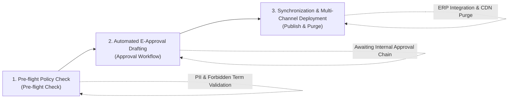

# Legacy System Integration & Snapshot Rollback Governance

SyncCMS integrates securely with corporate groupware e-approval systems, ERP, and SSO, and guarantees operational stability during critical incidents through a **snapshot-based 3-stage zero-downtime rollback**.

---

## 3-Stage Deployment Approval Pipeline



1. **Pre-flight Policy Check**
   - Automatically checks for PII exposure, potential Fair Labeling and Advertising Act violations, and broken links upon content deployment requests.
2. **Automated E-Approval Drafting (Approval Workflow)**
   - Automatically generates approval forms and change diffs conforming to internal groupware API specifications and routes them through the compliance officer and department head approval chain.
3. **Synchronization & Multi-Channel Deployment (Publish & Purge)**
   - Once the approval webhook is received, commits the target RDBMS transaction, synchronizes with the ERP promotion master, and refreshes the distributed cache and edge CDN.

---

## Snapshot-Based 3-Stage Zero-Downtime Rollback

In the event of erroneous content publication or a system failure, restores the previous healthy version snapshot with zero downtime in a single click.

```
[Stage 1: RDBMS Snapshot Restoration]
 └── Restores data records to the state of the specified snapshot_id within a DB transaction

[Stage 2: Redis Distributed Cache Refresh]
 └── Invalidates local/distributed cache keys across all connected API servers and loads new data

[Stage 3: Multi-Channel Edge CDN Purge]
 └── Invokes edge cache invalidation APIs in batch across Cloudflare / CloudFront / Akamai
```

---

## Audit Log Database Schema

Permanently retains all change histories to comply with Electronic Financial Transaction Supervision Regulations and internal audit requirements.

```sql
CREATE TABLE sys_cms_audit_log (
    audit_id        BIGSERIAL PRIMARY KEY,
    site_key        VARCHAR(50) NOT NULL,
    content_id      VARCHAR(100) NOT NULL,
    action_type     VARCHAR(30) NOT NULL,    -- CREATE, UPDATE, APPROVE, PUBLISH, ROLLBACK
    actor_id        VARCHAR(50) NOT NULL,    -- User account ID
    actor_ip        VARCHAR(45) NOT NULL,    -- Client IP address
    previous_state  JSONB,                   -- Pre-change snapshot (JSONB)
    current_state   JSONB,                   -- Post-change snapshot (JSONB)
    diff_summary    TEXT,                    -- Change summary
    approval_doc_no VARCHAR(100),            -- Corporate e-approval document number
    created_at      TIMESTAMP WITH TIME ZONE DEFAULT CURRENT_TIMESTAMP NOT NULL
);

-- Indexes for high-speed lookup
CREATE INDEX idx_cms_audit_content ON sys_cms_audit_log(site_key, content_id);
CREATE INDEX idx_cms_audit_created ON sys_cms_audit_log(created_at DESC);
```
