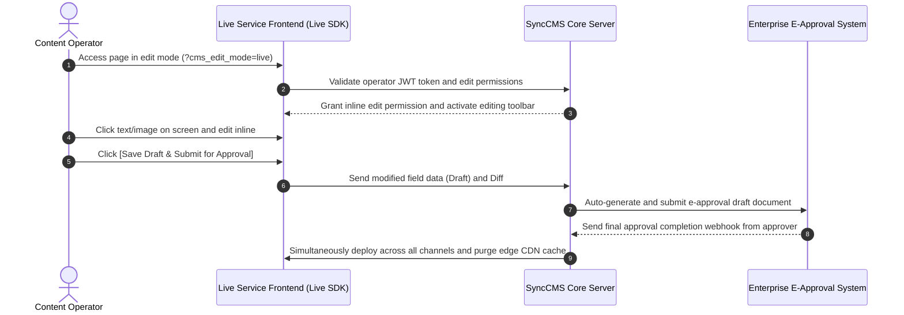

# Sync-Live-SDK Integration Guide

**Sync-Live-SDK** is a lightweight frontend SDK that enables operators and marketers to **select and inline-edit text and images directly on live web/mobile service screens** without switching to a separate back-office administration console.

Edited content is not exposed immediately to the live production environment; it goes through the corporate e-approval workflow before zero-downtime deployment.

---

## Execution Flow & Sequence



---

## 1. Vanilla HTML Environment Integration

Add the SDK script at the bottom of the `<body>` tag in your HTML file and define identification attributes on target DOM elements.

```html
<!DOCTYPE html>
<html lang="en">
<head>
    <meta charset="UTF-8">
    <title>Promotion Page</title>
</head>
<body>
    <!-- Target content block for editing -->
    <div id="hero-section" data-sync-content-id="PROMO_2026_FALL">
        <h1 data-sync-field="headline">2026 H2 New Member Benefits</h1>
        <p data-sync-field="description">Sign up now and discover welcome coupon packs and point rewards.</p>
    </div>

    <!-- Sync-Live-SDK script embedding -->
    <script src="https://empasy.io/en/solutions/sync-cms.htmlsdk/sync-live-sdk.js"
            data-sync-cms-endpoint="https://empasy.io/en/solutions/sync-cms.htmlapi/v1/cms"
            data-sync-site-key="SITE_PORTAL_KO"
            async></script>
</body>
</html>
```

### Required Data Attributes
- `data-sync-content-id`: Unique identifier of the content group.
- `data-sync-field`: Specific field name within the content group (e.g., headline, description, bannerUrl).

---

## 2. React / Next.js Integration

In React environments, you can bind content to component state via the `@empasy/sync-live-react` package or a custom hook.

```tsx
import React from 'react';
import { useSyncContent } from '@empasy/sync-live-react';

interface PromoContent {
  headline: string;
  description: string;
  ctaText: string;
}

export default function HeroBanner() {
  const { content, isEditMode } = useSyncContent<PromoContent>({
    contentId: 'PROMO_2026_FALL',
    defaultData: {
      headline: '2026 H2 New Member Benefits',
      description: 'Sign up now and discover welcome coupon packs and point rewards.',
      ctaText: 'Claim Benefits'
    }
  });

  return (
    <section className={`hero-container ${isEditMode ? 'sync-live-active' : ''}`}>
      <h1 data-sync-field="headline">{content.headline}</h1>
      <p data-sync-field="description">{content.description}</p>
      <button data-sync-field="ctaText">{content.ctaText}</button>
    </section>
  );
}
```

---

## 3. Vue 3 / Nuxt 3 Integration

In Vue 3 environments, register the plugin and integrate with templates using the `v-sync-editable` directive.

```vue
<template>
  <div class="banner-wrapper" :class="{ 'edit-mode': isEditMode }">
    <h2 v-sync-editable="{ contentId: 'BANNER_MAIN', field: 'title' }">
      {{ bannerData.title }}
    </h2>
    <p v-sync-editable="{ contentId: 'BANNER_MAIN', field: 'summary' }">
      {{ bannerData.summary }}
    </p>
  </div>
</template>

<script setup lang="ts">
import { ref } from 'vue';
import { useSyncLive } from '@empasy/sync-live-vue';

const { isEditMode } = useSyncLive();

const bannerData = ref({
  title: 'Data-Driven Unified Operations Solution',
  summary: 'Control enterprise infrastructure and content from a single platform.'
});
</script>
```

---

## 4. Safe Deployment & Permission Governance

1. **Token-Based Access Control**: Edit mode is activated only when a valid administrator session or a signed JWT token is passed as a parameter (`?cms_token=...`).
2. **Draft Isolation**: Data undergoing inline editing is stored in a temporary draft table and does not affect live production API query responses.
3. **Zero-Downtime Post-Approval Rollout**: Once the approver completes sign-off, the backend commits the PostgreSQL transaction while simultaneously triggering Redis cache updates and CDN purge webhooks.
