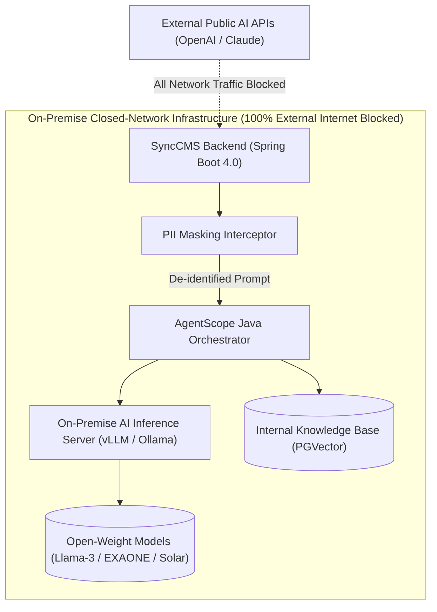

# On-Premise Closed-Network AI & PII Security Compliance

SyncCMS provides dedicated closed-network AI pipelines and real-time security filters to satisfy **network separation security regulations and personal data protection laws** for financial institutions, public agencies, and large enterprises.

---

## Closed-Network AI Architecture



---

## 1. On-Premise AI Configuration with AgentScope Java (`io.agentscope:agentscope-harness`)

Configure the vLLM or Ollama endpoint running on your internal GPU server as a standard AgentScope `ChatModel` bean in the Spring Boot backend.

### `application.yml` Configuration Example
```yaml
agentscope:
  open-ai:
    chat-model:
      base-url: http://internal-vllm-cluster.local:8000/v1
      api-key: ${INTERNAL_LLM_API_KEY:internal-key}
      model-name: meta-llama/Llama-3-70b-Instruct
      temperature: 0.2
      timeout: PT60S
```

### Java Configuration Example
```java
package com.empasy.sync.cms.config;

import io.agentscope.core.model.ChatModel;
import io.agentscope.core.model.OpenAIChatModel;
import org.springframework.beans.factory.annotation.Value;
import org.springframework.context.annotation.Bean;
import org.springframework.context.annotation.Configuration;

@Configuration
public class AiModelConfiguration {

    @Value("${agentscope.open-ai.chat-model.base-url}")
    private String baseUrl;

    @Value("${agentscope.open-ai.chat-model.model-name}")
    private String modelName;

    @Value("${agentscope.open-ai.chat-model.api-key}")
    private String apiKey;

    @Bean
    public ChatModel onPremiseChatModel() {
        return OpenAIChatModel.builder()
                .baseUrl(baseUrl)
                .apiKey(apiKey)
                .modelName(modelName)
                .build();
    }
}
```

---

## 2. Real-Time PII De-Identification Interceptor

Automatically detects and masks sensitive personally identifiable information (PII) before invoking the AI authoring assistant or persisting content.

```java
package com.empasy.synccms.security;

import java.util.regex.Pattern;

public class PiiMaskingInterceptor {

    // Resident Registration Number pattern (900101-1234567 -> 900101-1******)
    private static final Pattern RRN_PATTERN = 
        Pattern.compile("\\b(\\d{6})-[1-4]\\d{6}\\b");

    // Credit card number pattern (1234-5678-9012-3456 -> 1234-****-****-3456)
    private static final Pattern CARD_PATTERN = 
        Pattern.compile("\\b(\\d{4})-\\d{4}-\\d{4}-(\\d{4})\\b");

    // Mobile phone number pattern (010-1234-5678 -> 010-****-5678)
    private static final Pattern PHONE_PATTERN = 
        Pattern.compile("\\b(01[016789])-\\d{3,4}-(\\d{4})\\b");

    public static String maskSensitiveData(String input) {
        if (input == null || input.isBlank()) {
            return input;
        }

        String masked = RRN_PATTERN.matcher(input).replaceAll("$1-*******");
        masked = CARD_PATTERN.matcher(masked).replaceAll("$1-****-****-$2");
        masked = PHONE_PATTERN.matcher(masked).replaceAll("$1-****-$2");

        return masked;
    }
}
```

---

## 3. Fair Labeling and Advertising Act & Corporate Glossary Validation

- **Legal Risk Term Detection**: Generates verification flags whenever terms requiring substantiation—such as `first`, `best`, `reliably supported`, `unconditional`, or `100% free`—are entered.
- **Enterprise Standard Glossary Injection**: Automatically injects official brand names, spacing rules, and forbidden-term rulesets into the AI System Prompt to maintain a consistent tone and manner.

---

## 4. Compliance Checklist

| Inspection Item | Standard & Legal Basis | SyncCMS Mitigation |
| :--- | :--- | :--- |
| **Network Separation Security** | FSS Regulation on Supervision of Electronic Financial Transactions, Art. 15 | Runs vLLM/Ollama models inside internal infrastructure isolated from external internet access |
| **Personal Data Protection** | Personal Information Protection Act, Art. 29 (Duty of Safeguards) | Real-time de-identification via PII interceptor and masking upon log storage |
| **Change History Retention** | FSS Regulation on Supervision of Electronic Financial Transactions, Art. 20 (Record Retention) | Permanently stores all content registration, approval, and deployment histories in immutable tables |
