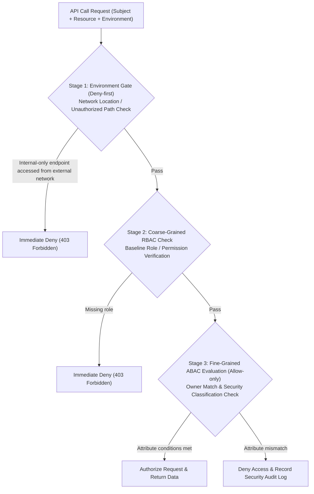

# Attribute-Based Access Control (ABAC) & Crawled Data Security Architecture

## 1. Background and Limitations of RBAC

Traditional Role-Based Access Control (RBAC) determines access to API endpoints based on user roles (such as `ROLE_USER` or `ROLE_ADMIN`). However, in environments where collected datasets and multiple agents collaborate, RBAC exhibits clear limitations for composite authorization checks:

1. **Lack of Tenant and Department Data Isolation**: Even when two users share the same collector role, fine-grained Data Ownership controls are required so that a user in Division B cannot access competitor analysis data collected by Division A.
2. **Inter-Agent Communication Trust Model**: Internal backend worker-to-worker communication (Pod-to-Pod) must validate explicit tokens and attributes rather than implicitly bypassing standard user session checks.
3. **Dynamic Blocking by Network Environment**: Even with a valid administrator account, certain management tool invocations originating from external public networks outside the corporate internal network (VNet) must be blocked.

To address these requirements, `SyncCrawl` adopts an **Attribute-Based Access Control (ABAC)** architecture that evaluates a combination of multi-dimensional Subject, Resource, and Environment attributes.

---

## 2. ABAC Attribute Inventory

Authorization evaluation combines three standardized categories of attributes.

### 1) Subject Attributes
- `userId / username`: Unique identifier of the requester
- `tenantId / orgId`: Multi-tenant and organizational unit identifier
- `roles / permissions`: Set of permissions granted under the existing RBAC model
- `agentToken`: Signed authentication token for internal system agent communication (`Signed Header`)

### 2) Resource Attributes
- `resourceId / ownerId`: Unique key of the collected dataset and owner identifier
- `resourceType`: Target object type being accessed (e.g., `CrawledDataset`, `Scenario`, `Credential`)
- `sensitivityClassification`: Data security classification level (`PUBLIC`, `INTERNAL`, `RESTRICTED`)

### 3) Environment Attributes
- `networkLocation`: Whether the request originates from internal VPC/AKS cluster traffic or a public internet gateway
- `endpointType`: Intended scope of the invoked URI (`INTERNAL_SYSTEM_API` vs `EXTERNAL_CLIENT_API`)

---

## 3. Three-Stage Policy Evaluation Precedence

Authorization checks are evaluated sequentially inside a unified `AuthorizationContext` according to a strictly predefined precedence order:

1. **Stage 1: Environment Gate (Deny-first)**:
   - Immediately blocks any external access detected through public ingress to internal agent-only endpoints (e.g., `/api/internal/worker/*`).
2. **Stage 2: Coarse-Grained RBAC Check**:
   - Verifies that the requesting subject holds the baseline domain permission (e.g., `@PreAuthorize("hasPermission('crawling:read')")`).
3. **Stage 3: Fine-Grained ABAC & Data Ownership Check (Allow-only)**:
   - Verifies that the requester's `tenantId` matches the resource's tenant affiliation.
   - When the resource's security classification is `RESTRICTED`, it cross-checks the subject's clearance level and resource ownership (`ownerId`); if any single condition fails, access is denied.

---

## 4. Internal Agent Token Authentication & Audit Trail

- **Signed Header Verification**:
  - When distributed worker agents (`smart-crawling-agent`) transmit collected data to the central server, they attach an `X-Sync-Agent-Token` header signed with a timestamp and secret key.
- **Replay Attack Prevention**:
  - Signed tokens are strictly limited to a 60-second validity window, and any attempt to reuse the same signed token is immediately blocked within the server's in-memory replay window.
- **Security Audit Reporting Integration**:
  - Every authorization evaluation result—both successes and failures—is recorded in a WORM audit log along with the source IP of unauthorized access attempts and the subject identifier for security compliance evidence.
