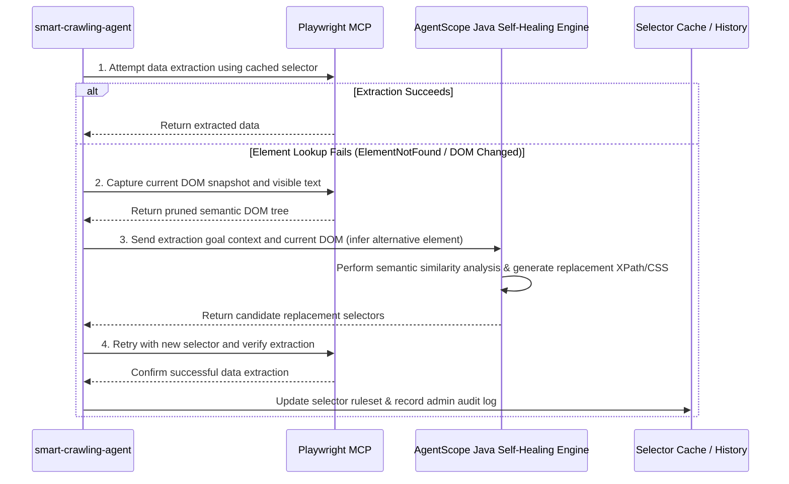

# Adaptive Crawling & AI Self-Healing Engine

A significant share of maintenance issues in web crawling operations stems from **UI redesigns and HTML/CSS structural changes on target websites**. SyncCrawl handles structural changes seamlessly through **Playwright MCP** and its **Self-Healing selector recovery algorithm**.

---

## Traditional Crawlers vs. SyncCrawl Adaptive Engine

| Comparison Area | Traditional Crawlers (Scrapy, Puppeteer, etc.) | SyncCrawl Adaptive Crawling Engine |
| :--- | :--- | :--- |
| **Selector Strategy** | Relies on rigid CSS/XPath selectors | **Semantic analysis and multi-weight heuristics** |
| **Response to UI Changes** | Pipeline breaks and requires manual fixes | **Discovers alternative elements and autonomously reconstructs selectors** |
| **Dynamic SPA Support** | Fixed sleep timers prone to race-condition failures | **DOM Mutation and Network Idle-based synchronization** |
| **Complex Interactions** | Requires hand-coding individual click/input scripts | **Action sequence generation via natural-language scenario builder** |

---

## Self-Healing Selector Recovery Process

When target element extraction fails, SyncCrawl executes the following automated recovery workflow:



---

## Self-Healing Technical Details

### 1. Semantic DOM Pruning
Strips non-essential `<script>`, `<style>`, `<svg>`, and similar tags from the full browser HTML, constructing a lightweight DOM tree focused on visible text nodes, input forms, tables, and semantic tags (`article`, `section`, `nav`, etc.).

### 2. Multi-Weight Heuristics
Evaluates candidate replacement elements by combining the following signals:
- **Text Label Similarity**: Semantic match against adjacent labels around the element (e.g., "Published Date", "Author", "Price").
- **Relative DOM Hierarchy**: Structural similarity to the parent/child node patterns observed during previous successful extractions.
- **Accessibility Tree Metadata**: Semantic verification using `aria-label`, `role`, and `name` attributes.

### 3. Success-History Ruleset Updates
Once extraction is verified using the replacement selector, the updated selector version for that site is persisted in the database so subsequent runs extract data directly without incurring additional inference overhead.

---

## Dynamic Interactions & Complex Scenarios

Beyond passive page reading, SyncCrawl supports a wide range of interactive browser actions:

```typescript
// SyncCrawl Scenario Agent interaction example (Playwright MCP bridge)
await scenarioRunner.execute([
  { action: 'NAVIGATE', url: 'https://partner.portal.com/login' },
  { action: 'FILL_CREDENTIALS', userField: '#loginId', passField: '#passwd' },
  { action: 'WAIT_FOR_NAVIGATION', waitUntil: 'networkidle' },
  { action: 'HANDLE_MODAL', selector: '.popup-close-btn', optional: true },
  { action: 'INFINITE_SCROLL', maxRounds: 5, scrollDelayMs: 800 },
  { action: 'EXTRACT_LIST', targetSelector: '.data-row', schema: ContentSchema }
]);
```

- **Popups & Cookie Banners**: Detects overlay modals or cookie consent banners, clicks the close/accept control, and resumes execution.
- **Virtual Scrolling & Pagination**: Detects asynchronously loaded elements triggered by scrolling and accumulates results across pages.
