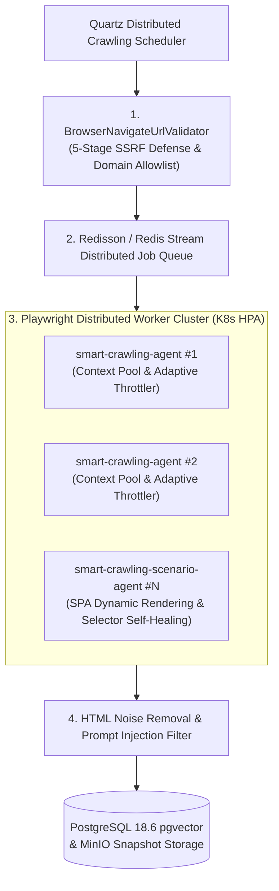

# SyncCrawl Adaptive Anti-Bot Mitigation & Distributed Scaling Architecture

## 1. Enterprise Web Collection Stability & Adaptive Rate Control

When continuously collecting large-scale external market trends, public regulatory notices, and competitor price indices, systems must retrieve data reliably without overloading target servers or triggering blocks (such as IP rate limits, WAF false positives, or dynamic rendering timeouts). `SyncCrawl` adheres to legitimate robots exclusion standards and enterprise security governance while applying the following three-tier adaptive collection controls:



### 1.1 Three Core Adaptive Collection Stabilization Techniques
1. **Browser Context Isolation & Header/Viewport Normalization**:
   - Each worker node maintains an isolated Playwright `BrowserContext` pool that keeps cookies, `localStorage`, TLS sessions, `User-Agent`, `Accept-Language`, and WebGL/viewport metadata consistent with standard desktop and mobile browser profiles.
2. **Per-Domain Adaptive Throttling & Proxy Pool Rotation**:
   - Automatically tunes per-domain concurrency (`maxConcurrentPerHost`), inter-request jitter delays (`minDelayMs` ~ `maxDelayMs`), and exponential backoff driven by response status codes (`429 Too Many Requests`, `503 Service Unavailable`).
   - Combines multiple outbound proxy gateways with sticky sessions to ensure sessions remain intact across logins and multi-step pagination.
3. **Block Detection & HITL Remote Session Handoff**:
   - When an abnormal white screen, access-denied banner, or additional verification challenge is detected on a target site, the job is immediately paused (`PAUSED_BY_GUARD`) to prevent permanent IP bans from infinite retries, and an alert is dispatched to the smart crawling console.

---

## 2. Per-Domain Collection Policy & Scaling Configuration Specification

`SyncCrawl` dynamically manages granular traffic-control and self-healing parameters per target site (`crawl_site_config`) in the database.

| Configuration Parameter (`crawl_site_config`) | Default | Allowed Range | Function & Behavior Description |
| :--- | :---: | :---: | :--- |
| `max_concurrent_workers` | `4` | `1 ~ 32` | Maximum number of concurrent Playwright worker contexts permitted for the same target domain |
| `request_delay_jitter_ms` | `1200` | `200 ~ 10000` | Random jitter range (`ms`) added to the base delay between consecutive page navigations |
| `backoff_multiplier` | `2.0` | `1.5 ~ 5.0` | Exponential multiplier applied to retry wait intervals upon receiving `429` / `503` responses |
| `max_retry_attempts` | `3` | `0 ~ 5` | Maximum automatic retry attempts upon transient network drops or timeouts |
| `self_healing_enabled` | `true` | `true / false` | Enables semantic DOM self-healing when existing CSS/XPath matching fails due to DOM changes |
| `ssrf_strict_mode` | `true` | `true` (Fixed) | Enforces the 5-stage SSRF defense guard (blocking private IPs, loopback, and cloud metadata `169.254.169.254`) |

---

## 3. Kubernetes (K8s) Distributed Worker Autoscaling & Data Sanitization

### 3.1 Kubernetes HPA (Horizontal Pod Autoscaler) Configuration
When large scheduled collection batches start simultaneously and the pending depth of the Redis distributed job queue (`crawl:job:pending`) exceeds the threshold, Kubernetes HPA automatically scales out `smart-crawling-agent` pods.

```yaml
apiVersion: autoscaling/v2
kind: HorizontalPodAutoscaler
metadata:
  name: synccrawl-worker-hpa
  namespace: sync-series
spec:
  scaleTargetRef:
    apiVersion: apps/v1
    kind: Deployment
    name: smart-crawling-agent
  minReplicas: 2
  maxReplicas: 20
  metrics:
    - type: Resource
      resource:
        name: cpu
        target:
          type: Utilization
          averageUtilization: 70
    - type: Pods
      pods:
        metric:
          name: synccrawl_pending_jobs_per_pod
        target:
          type: AverageValue
          averageValue: "15"
```

### 3.2 RAG Data Poisoning Guard & Sanitization Pipeline
To prevent malicious Indirect Prompt Injection hidden in collected external web pages (e.g., `"Ignore previous instructions..."` embedded inside `font-size: 0` or `display: none` blocks) from poisoning internal RAG knowledge bases, the `Sanitizer` pipeline enforces three-stage purification:
1. **Complete Removal of Non-Visible Regions & Script Tags**: Pre-strips `<script>`, `<style>`, `<iframe>`, `aria-hidden="true"`, and hidden CSS-styled nodes from the DOM tree.
2. **Structure-Preserving Markdown Conversion**: Extracts only body headings (`H1`~`H3`), tables (`<table>`), and list structures into normalized Markdown, computing a SHA-256 content hash to prevent duplicate ingestion.
3. **PostgreSQL 18.6 `pgvector` Incremental Indexing**: Only documents with detected changes are chunked via `ContextAwareMarkdownSplitter` and indexed into the `PostgreSQL 18.6 pgvector` HNSW index in real time.
