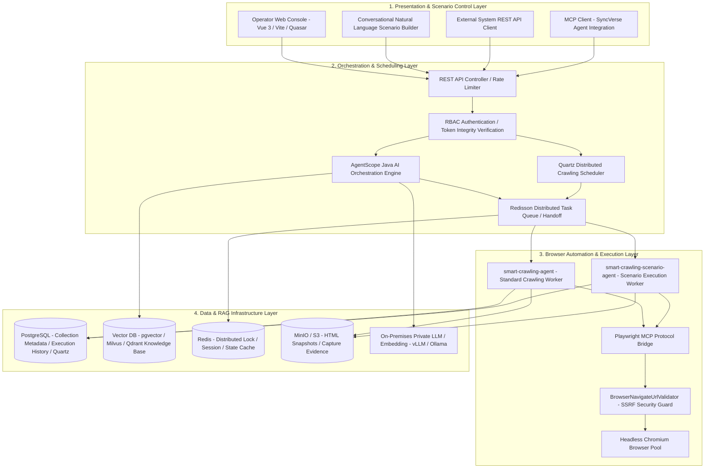

# SyncCrawl System Architecture

SyncCrawl is designed on a **4-layer distributed agent Clean Architecture** to handle large-scale crawling workloads, ensure reliable operations, and integrate seamlessly with AI knowledge pipelines.

---

## 4-Layer Architecture Diagram

---

## Four Core Distributed Container Images

SyncCrawl consists of four distributed container images to enable zero-downtime deployment and independent scale-out.

| Container Image | Technology Stack | Core Roles and Capabilities |
| :--- | :--- | :--- |
| **`smart-crawling-server`** | Java 25, Spring Boot 4.0, AgentScope Java (`io.agentscope:agentscope-harness`), 6-File DB SSOT Standard (`db/00_extensions.sql` ~ `05_sample_dev.sql`) | Provides API endpoints, schedules collection jobs (Quartz), plans AI tasks, and orchestrates RAG vector indexing |
| **`smart-crawling-agent`** | Java 25, Playwright Java, MCP SDK | Executes standard web collection jobs, parses DOM, extracts data, and stores HTML snapshots |
| **`smart-crawling-scenario-agent`** | Java 25, Node.js/Playwright MCP, Chromium | Executes complex scenarios including login, multi-step form input, infinite scrolling, and SPA interactions |
| **`smart-crawling-console`** | Vue 3, TypeScript, Vite, Quasar | Monitors collection jobs, provides natural language scenario builder UI, validates collected data, and hosts the RAG Q&A test console |

---

## Detailed Layer Design

### 1. Presentation & Scenario Control Layer
- **Natural Language Scenario Builder**: When a user enters a collection goal in natural language, the builder interacts conversationally with the backend AgentScope Java agent to automatically generate scenario steps.
- **Real-Time Execution Monitoring**: Streams browser execution screenshots and step-by-step logs in real time over WebSocket and SSE (Server-Sent Events).

### 2. Orchestration & Scheduling Layer
- **AgentScope Java AI Engine (`io.agentscope:agentscope-harness`)**: Analyzes user queries and target page structures, and dynamically binds the appropriate crawling tools (Playwright Tool).
- **Quartz Distributed Scheduler**: Executes multiple periodic crawling batches in a distributed manner based on database clustering.
- **Redisson Distributed Queue & Lock**: Handles task distribution (Handoff) and concurrency control across multiple worker nodes.

### 3. Browser Automation & Execution Layer
- **Playwright MCP Integration**: Controls browsers in compliance with the Model Context Protocol standard specification.
- **SSRF Security Guard (`BrowserNavigateUrlValidator`)**: Pre-validates and blocks local loopback (`127.0.0.1`, `localhost`) access and internal corporate network intrusion attempts.
- **Self-Healing Selector Engine**: When the DOM tree changes, cross-references page text context and semantic tags to discover alternative selectors.

### 4. Data & RAG Infrastructure Layer
- **PostgreSQL 18.6 & 6-File DB SSOT Standard (`db/00_extensions.sql` ~ `05_sample_dev.sql`)**: Centrally manages collection metadata, dynamic menus and permissions (`sys_permission`), and execution history under a unified 6-stage standard SQL structure.
- **Vector DB & Embeddings**: Chunks collected unstructured text, stores it in PostgreSQL 18.6 `pgvector`, Milvus, or Qdrant, and provides semantic search for enterprise RAG Q&A.
- **MinIO / S3 Object Storage**: Retains original HTML at collection time and capture evidence images in object storage.
