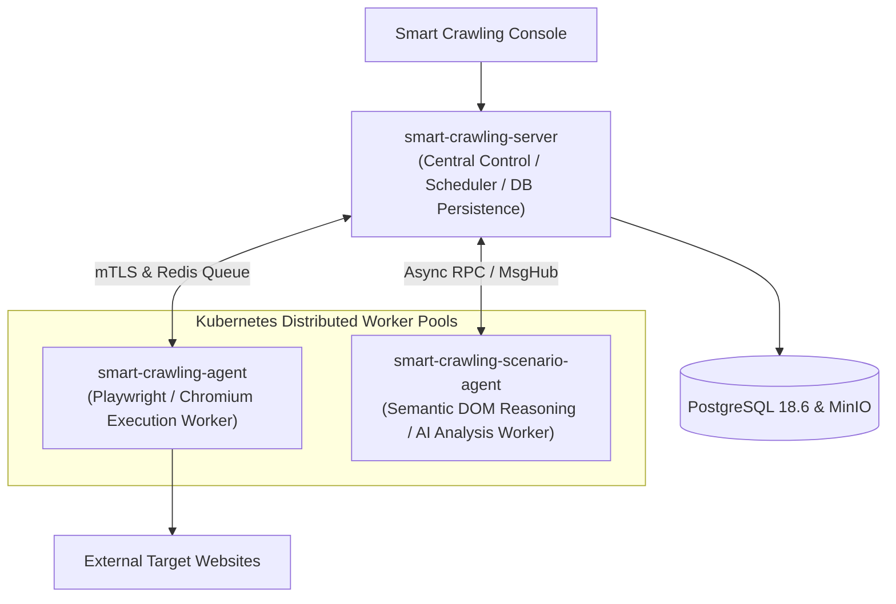

# 3-Tier Distributed Agent Topology & Deployment Infrastructure

## 1. Overview and Purpose of Layer Separation

If browser automation and large-scale LLM inference are executed simultaneously on a single monolithic server, Chromium browser processes can consume large amounts of memory, creating a risk of central API server crashes or response latency.

To achieve workload isolation and zero-downtime scaling, `SyncCrawl` physically separates the system into three tiers: a **Central Orchestration Server**, **Browser Execution Worker Agents**, and **AI Scenario Reasoning Worker Agents**.



---

## 2. 3-Tier Service Roles and Responsibilities (R&R)

### 1) smart-crawling-server (Central Orchestration Server)
- **Responsibilities**:
  - Defines collection jobs and manages Cron scheduling.
  - Distributes tasks to worker agents via Redis message queues and controls concurrency.
  - Persists collected raw data in the RDB, performs indexing, and exposes RESTful APIs.
- **Resource Profile**: A stable, long-running service with predictable CPU and memory utilization.

### 2) smart-crawling-agent (Browser Collection Worker)
- **Responsibilities**:
  - Launches Playwright-based Chromium browser instances to access web pages, maintain sessions, and extract data.
  - Applies browser fingerprint normalization to prevent bot-detection regressions.
- **Resource Profile**: Experiences transient high CPU and memory bursts, so it autoscales dynamically from 2 to 20 instances using KEDA based on queue backlog depth.

### 3) smart-crawling-scenario-agent (AI Scenario Reasoning Worker)
- **Responsibilities**:
  - Analyzes target web pages' semantic DOM trees, performs multimodal reasoning combining vision screenshots, and synthesizes new self-healing selectors.
  - Communicates with the LLM gateway (`SyncLLM`) to generate extraction rules for unstructured data.
- **Resource Profile**: Deployed as an independent Pod optimized for network I/O and large-scale JSON parsing.

---

## 3. Kubernetes (AKS) Deployment and Secure Secret Injection

To ensure worker agents never hold target website authentication credentials (ID/Password) or database connection strings in plaintext environment variables, **Azure KeyVault CSI Driver** and **Kubernetes Secrets** are integrated.

```yaml
apiVersion: apps/v1
kind: Deployment
metadata:
  name: smart-crawling-agent
  namespace: sync-crawl
spec:
  replicas: 3
  template:
    spec:
      containers:
      - name: crawling-worker
        image: harbor.empasy.internal/syncseries/smart-crawling-agent:2026.10
        resources:
          limits:
            cpu: "4"
            memory: 8Gi
          requests:
            cpu: "1"
            memory: 2Gi
        volumeMounts:
        - name: secrets-store-inline
          mountPath: "/mnt/secrets-store"
          readOnly: true
      volumes:
      - name: secrets-store-inline
        csi:
          driver: secrets-store.csi.k8s.io
          readOnly: true
          volumeAttributes:
            secretProviderClass: "sync-crawl-keyvault"
```

---

## 4. Fault Isolation and Secure Communication Standards

- **Pod-to-Pod mTLS Communication**:
  - All crawling control packets transmitted between the server and workers inside the cluster are encrypted via Istio service mesh mutual TLS (mTLS).
- **Worker Crash Isolation (Process Sandboxing)**:
  - Even if malicious webpage scripts cause a browser process to crash due to a memory leak, only that single process inside the worker Pod terminates, with zero impact on the central server or other workers' jobs.
  - Failed tasks are detected in the backend queue and safely reassigned to another healthy worker.
