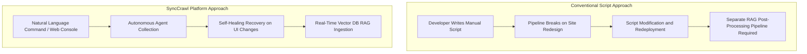

# Enterprise FAQ & Adoption Guide

Frequently asked questions and answers for IT decision-makers and engineers evaluating SyncCrawl.

---

## Q1. How does SyncCrawl differ from open-source crawlers (Scrapy, Selenium, Puppeteer)?

Conventional open-source tools are libraries for writing scripts. In a production environment, organizations must build distributed scheduling, database pipelines, monitoring UIs, RAG vectorization, and **script maintenance when target sites are redesigned** on their own.

SyncCrawl delivers a **Self-Healing Selector Recovery Engine**, a **RAG Knowledge Pipeline**, and a **Distributed Architecture** as an integrated platform, significantly reducing the engineering effort required to maintain crawling systems.

---

## Q2. How does SyncCrawl handle bot detection and access restrictions on target sites?

SyncCrawl supports the following control capabilities for reliable data collection:

1. **Browser Environment Emulation**: Powered by Playwright, it configures real browser canvas fingerprints, WebGL rendering, User-Agent, and screen resolution.
2. **Dynamic Request Interval Control**: Simulates randomized delay intervals (Jittering) and mouse movements rather than fixed-interval polling.
3. **Enterprise Proxy Integration**: Integrates with corporate gateways or commercial proxy pools to support IP rotation.

---

## Q3. How does the system support scalability for large-scale data collection?

SyncCrawl supports **elastic scaling (HPA) in Kubernetes environments**.

- **Microservice Separation**: Because `smart-crawling-server` (management) and `smart-crawling-agent` (collection workers) are decoupled, worker node Pods can be scaled out flexibly during large batch jobs.
- **Redisson Distributed Queue Load Balancing**: Distributed locks and queues distribute large-scale jobs across multiple workers and support task handoff if a worker fails.

---

## Q4. Does SyncCrawl provide legal compliance and personal data protection features for collected data?

SyncCrawl provides built-in capabilities for enterprise compliance management.

- **Robots.txt Compliance Policy**: Provides an option to parse target domain `robots.txt` rules and enforce compliance by default.
- **Personally Identifiable Information (PII) Masking Filter**: Detects personal data patterns such as national ID numbers, email addresses, and phone numbers in collected text for de-identification.
- **Collection Purpose Audit Trail**: Stores the job registration reason, owner, and approval history for every crawling request.

---

## Q5. Does SyncCrawl support deployment in internal air-gapped (on-premises) networks?

SyncCrawl supports **Air-Gapped on-premises environments**.

- **Air-Gapped Installation Support**: Can be deployed as container images in internal Kubernetes or Linux VM environments with no external internet connectivity.
- **Internal LLM Integration**: Connects directly to internal vLLM, Ollama, and on-premises Vector DBs without external cloud communication, preventing external data leakage.
- **Technical Support**: Provides technical guides for enterprise Single Sign-On (SSO) integration and custom collection scenario configuration.
