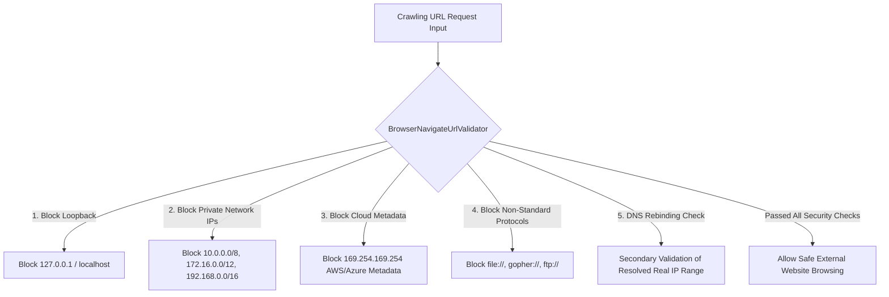
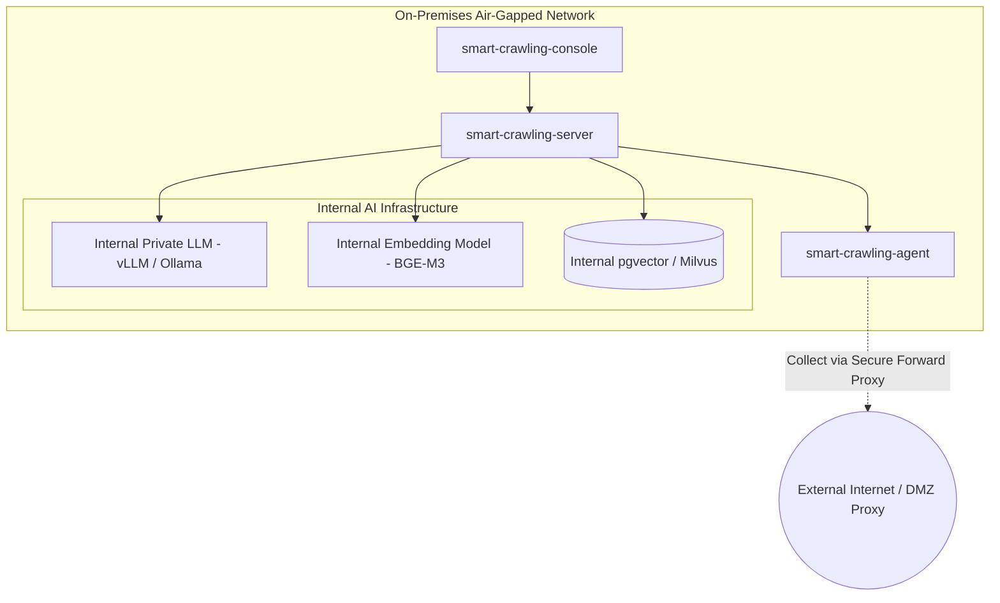

# Enterprise Security & Air-Gapped Governance

This guide introduces SyncCrawl's security architecture designed to meet the security and regulatory compliance requirements of operating web crawlers in enterprise infrastructure environments.

---

## SSRF (Server-Side Request Forgery) Defense Architecture

Because web crawlers visit external URLs to collect data, the system must be protected against unauthorized requests and malicious attempts to access internal IP addresses.

SyncCrawl enforces multi-layered blocking policies through its custom-built URL validation module, **`BrowserNavigateUrlValidator`**.

### Core SSRF Defense Policies
- **Loopback and Private Network Blocking**: Proactively blocks access to `localhost`, `127.0.0.1`, and RFC 1918 private IP ranges.
- **Cloud Instance Metadata Protection**: Restricts access to cloud metadata endpoints (`169.254.169.254`) on AWS, Azure, and GCP.
- **DNS Rebinding Defense**: Performs a secondary check immediately before connection to verify whether the resolved destination IP belongs to a private network range.
- **Protocol Restriction**: Excludes non-standard schemes (`file://`, `jar://`, `dict://`) other than `http://` and `https://`.

---

## Air-Gapped On-Premises Infrastructure Support

SyncCrawl can operate independently in on-premises air-gapped environments isolated from the public internet.

- **Internal Private LLM Integration**: Integrates with on-premises `vLLM`, `Ollama`, or `LocalAI` instances without calling external SaaS APIs, eliminating external data leakage risks.
- **Secure Proxy Integration**: When external site collection is required, outbound traffic is routed exclusively through an authorized DMZ forward proxy.
- **Air-Gapped Build Support**: Configured to pull container images and packages from internal air-gapped registries (Harbor, Nexus).

---

## Multi-Layer RBAC and Execution Audit Trail

All crawling tasks and collected data views are governed by role-based access control and audit logging.

### 1. Role-Based Access Control (RBAC)
- **Crawling Engineer (Admin)**: Authors scenarios, registers schedules, and manages selector rulesets
- **Business Analyst (Analyst)**: Queries data, runs RAG search tests, and downloads result reports
- **Security Administrator (Auditor)**: Reviews crawling access history, IP access logs, and monitors security policies

### 2. Execution Audit Log Records
When a collection job runs, the following information is persisted in the database:
- Execution job ID and requester account/IP
- Target URL and final destination URL (redirect tracking)
- Collection timestamp, elapsed duration, and HTTP response code
- SHA-256 hash and storage path of collected files and HTML
- Whether selector recovery (Self-Healing) occurred and the selector diff before and after modification
