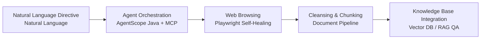
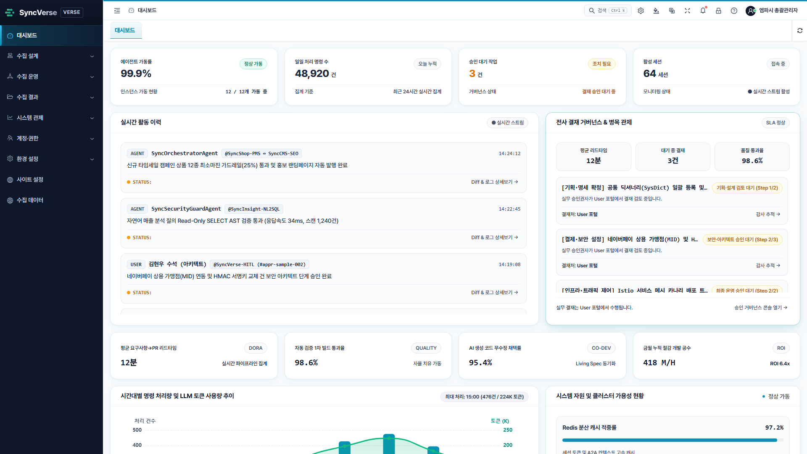
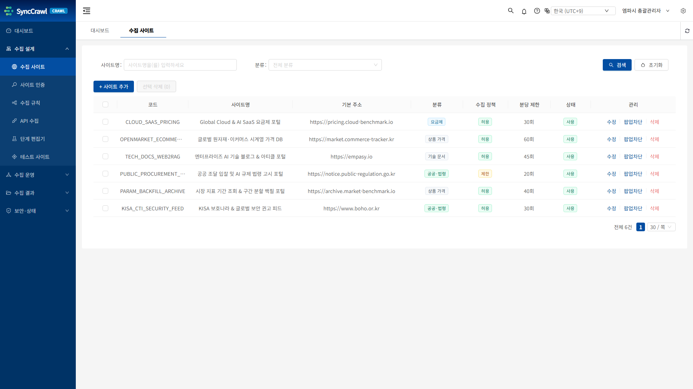
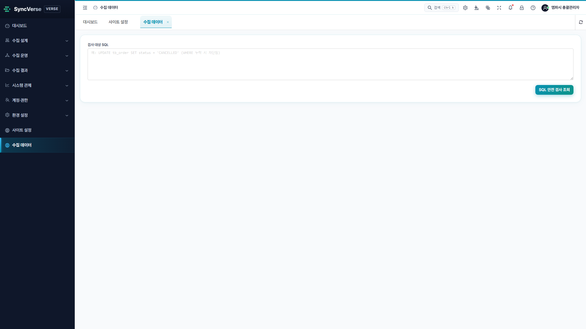
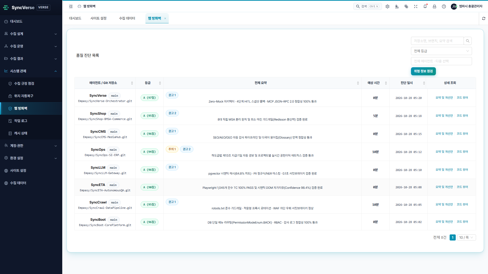

# SyncCrawl™: Web Crawling & RAG Knowledge Platform

> **For Non-Developers & Evaluators**: For a high-level product overview, visit the [SyncCrawl Product Homepage (empasy.io)](https://empasy.io/en/solutions/sync-crawl.html){target="_blank" rel="noopener"}. To explore the UI without installation, try the [Unified Demo Portal](https://demo.empasy.io/en/products/sync-crawl#demo){target="_blank" rel="noopener"}, or download product brochures and proposal PDFs from the [Proposals Repository](/en/proposals/).

SyncCrawl™ is an enterprise web harvesting platform that integrates data collection, natural language processing (NLP), **Playwright MCP-based browser automation**, and a **RAG (Retrieval-Augmented Generation) knowledge pipeline**.

When the UI or DOM structure of a target website changes, SyncCrawl analyzes the surrounding context to reconstruct selectors (Self-Healing), and cleanses and embeds collected unstructured web data into your enterprise vector knowledge store.

---

## Key Features & Architecture

Reduces pipeline outages caused by website redesigns and unifies the vector indexing workflow for harvested data.

### 1. Adaptive Crawling (Self-Healing Crawling)
- **Natural Language Command Interpretation**: Register crawling jobs using business-level queries such as "Collect the latest 10 major agency announcements and their body content."
- **Adaptive Selector Recovery**: Even when CSS/XPath selectors break due to site redesigns, the engine analyzes the DOM structure and text context to re-locate target data.

### 2. RAG Knowledge Pipeline (Knowledge Base)
- **Context-Preserving Chunking**: Parses HTML tag structures to split content into semantic chunks while preserving context.
- **Multilingual & Korean Embeddings**: Supports embedding models tailored for Korean and enterprise domain terminology.
- **Vector Database Integration**: Integrates with major vector databases—including PGVector, Milvus, Qdrant, and Weaviate—for real-time indexing.

### 3. Distributed Runtime & Security Architecture (Production Architecture)
- **Distributed Microservices**: Composed of four independent containers (`Server`, `Agent`, `Scenario-Agent`, and `Console`) to scale large-volume harvesting workloads.
- **SSRF Defense Mechanism**: Includes a built-in URL validator (`BrowserNavigateUrlValidator`) that blocks internal network access and unauthorized redirects.
- **Air-Gapped Environment Support**: Operates in on-premises environments with restricted external internet access by integrating with internal private LLMs (vLLM, Ollama).

---

## Technical Specifications Summary

| Category | Supported Technologies & Specifications |
| :--- | :--- |
| **Core Backend** | Java 25, Spring Boot 4.0, AgentScope Java (`io.agentscope:agentscope-harness:2.0.2`), 6-File DB SSOT Standard (`db/00_extensions.sql` ~ `05_sample_dev.sql`) |
| **Browser Automation** | Playwright MCP, Headless Chromium, Distributed Workers |
| **Storage & Cache** | PostgreSQL 18.6, Redis, MinIO / S3 Object Storage |
| **Vector Databases** | PostgreSQL 18.6 `pgvector`, Milvus, Qdrant, Weaviate |
| **Operations Console** | Vue 3, Vite, TypeScript, Quasar Design System |
| **Deployment Infrastructure** | Docker Multi-Arch (amd64/arm64), Kubernetes (AKS), Air-Gapped Runner |

---

## Live Screens & Core Workflows

### 1. Adaptive Web Harvesting Pipeline & Worker Cluster Operations Dashboard
Monitors real-time throughput of distributed browser workers, DOM selector self-healing success rates, and RAG vector indexing progress in a unified dashboard.

### 2. Natural Language Target Site Registration & Selector Self-Healing Configuration
Defines natural language collection goals and extraction schemas without complex CSS/XPath authoring, and configures automatic recovery policies based on semantic DOM reasoning when target websites change.

### 3. Cleansed Markdown Extraction Preview & RAG Vector Indexing
Validates structured Markdown documents—stripped of ads and navigation noise—and real-time ingestion of semantic chunk embeddings into PostgreSQL 18.6 `pgvector`.

### 4. Crawl Policy Inspection, Copyright Risk & PII De-Identification Audit
Comprehensively audits `robots.txt` allowance policies, crawl delays, copyright risk levels, and PII de-identification completion (such as email addresses and phone numbers) for every job.

---

- [System Architecture & Clean Architecture](./architecture.md): 4-layer distributed architecture and component interactions
- [Adaptive Crawling & AI Self-Healing Engine](./adaptive-crawling-engine.md): Playwright MCP integration and selector recovery mechanics
- [Smart Crawling Console Guide](./smart-crawling-console.md): Vue 3 + Vite operations console architecture and real-time session monitoring
- [3-Tier Distributed Agent Topology](./distributed-agent-topology.md): Server, browser worker, and AI inference worker topology and Kubernetes deployment
- [Concurrent Session Arbitration & Stability Guide](./session-arbitration.md): Multi-login session conflict prevention and white-screen false positive elimination
- [Attribute-Based Access Control (ABAC) & Data Security](./abac-data-security.md): Subject/resource/environment 3-stage policy evaluation and token auditing
- [RAG Knowledge Construction & Vector Store Integration](./rag-knowledge-pipeline.md): Data cleansing, chunking, embedding, and Vector DB pipelines
- [Enterprise Security & Air-Gapped Governance](./enterprise-security-governance.md): SSRF blocking, air-gapped deployment, and RBAC audit trails
- [REST API & MCP Tool Reference](./api-reference.md): API specifications for job control, querying, and result retrieval
- [Enterprise FAQ & Adoption Guide](./enterprise-faq.md): Anti-blocking strategies, scaling, and frequently asked questions

### Core Foundational Patents
- [Patent Pending No. 04](../patents/04-semantic-dom-self-healing.md): Whitepaper on Semantic DOM Reasoning and Vision-Based Web Crawling Selector Self-Healing
