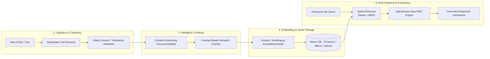

# RAG Knowledge Pipeline & Vector Store Integration

SyncCrawl cleanses harvested web data and transforms it into a **RAG (Retrieval-Augmented Generation) knowledge base** ready for generative AI applications.

---

## Knowledge Pipeline Architecture



---

## Core RAG Processing Stages

### 1. Noise Removal & Structuring (Boilerplate Stripping)
Web pages often contain elements unnecessary for Q&A, such as navigation bars, footers, ad banners, and copyright notices.
- **Main Content Extraction Algorithm**: Analyzes text density and tag patterns to isolate the primary content body.
- **Metadata Preservation**: Indexes source page URLs, crawl timestamps, document titles, and category tags as chunk metadata to provide verifiable citations during retrieval.

### 2. Context-Preserving Semantic Chunking
- **Structure-Aware Splitting**: Respects HTML structural boundaries including headings (`<h1>`–`<h6>`), paragraphs (`<p>`), lists (`<ul>`, `<ol>`), and tables (`<table>`).
- **Configurable Overlap**: Maintains an appropriate overlap between consecutive chunks (e.g., 100–200 tokens) to prevent context loss across boundaries.

### 3. Embedding Model Support
Through a standard interface integrated with the AgentScope Java (`io.agentscope:agentscope-harness`) framework, embedding models can be swapped seamlessly based on your deployment requirements.

| Model Category | Supported Embedding Models | Key Features & Ideal Environments |
| :--- | :--- | :--- |
| **On-Premise (Air-Gapped)** | `BGE-M3`, `KoSimCSE`, `Snowflake-Arctic` | Isolated on-premises environments without external internet access; optimized for Korean search |
| **Commercial Cloud (API)** | `OpenAI text-embedding-3-large`, `Cohere v3` | Global multilingual RAG environments |
| **Lightweight CPU Runtime** | `all-MiniLM-L6-v2`, `ONNX Runtime` | Cost-sensitive infrastructure and edge server environments |

---

## Supported Vector Databases (Vector DB)

SyncCrawl provides drivers for multiple Vector DB engines to match your enterprise infrastructure.

```java
// Example: Vector DB integration with AgentScope Java + PostgreSQL 18.6 pgvector
@Bean
public PgVectorKnowledgeStore knowledgeStore(JdbcTemplate jdbcTemplate, EmbeddingClient embeddingClient) {
    return PgVectorKnowledgeStore.builder()
            .jdbcTemplate(jdbcTemplate)
            .embeddingClient(embeddingClient)
            .tableName("synccrawl_knowledge_vectors")
            .dimension(1024) // Based on BGE-M3
            .build();
}
```

- **PostgreSQL (pgvector)**: Manage relational data and vectors together within existing RDBMS infrastructure without provisioning a separate database.
- **Milvus / Qdrant**: Distributed processing and high-speed search for large-scale vector datasets.
- **Elasticsearch / OpenSearch**: Hybrid search combining keyword BM25 retrieval with dense vector retrieval.

---

## Knowledge Synchronization & Lifecycle Management

- **Incremental Sync**: Re-chunks content and recomputes vectors only when the underlying web page has actually changed.
- **TTL-Based Auto-Expiration**: Automatically purges expired notices or ephemeral data according to configured Time-To-Live (TTL) policies.
- **Domain Trust Weighting**: Configures source weights between official portals and general websites to control ranking priority during retrieval.
