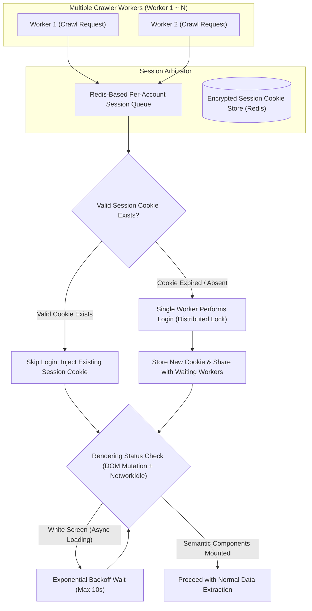

# Concurrent Session Arbitration & White-Screen False Positive Prevention Guide

## 1. Overview & Runtime Failure Modes

Two of the most common failure modes encountered by web automation crawlers in production enterprise environments stem from **concurrent multi-login blocking policies** on target sites and **asynchronous rendering delays in SPAs (Single Page Applications)**:

1. **Concurrent Login Session Kick**:
   - When multiple crawler workers attempt to log in simultaneously using the same service account, existing sessions are forcibly terminated or the account is temporarily locked out due to anomalous access detection.
2. **White-Screen False Positives**:
   - On React or Vue-based SPA sites, JavaScript chunk downloads or API latency can leave the viewport temporarily blank. Crawlers may misinterpret this transient state as a page load failure and trigger unnecessary retries.

`SyncCrawl` stabilizes these runtime exceptions using a **centralized session arbitration queue** and a **DOM mutation-based rendering verification engine**.

---

## 2. Concurrent Multi-Login Session Arbitration

When multiple crawler workers execute jobs against the same target site simultaneously, a centralized arbitration mechanism prevents redundant login attempts.

### 1) Session Cookie Store & Reuse
- Before initiating a login sequence, each crawler worker checks the Redis session store to see if a valid session (Cookies & LocalStorage) already exists for that account.
- If a valid session is found, the worker injects the cookies directly into the browser context and navigates straight to the target page without hitting the login screen.

### 2) Atomic Single-Flight Login
- When a session expires and re-authentication is required, only the single worker that acquires the distributed lock `account:lock:{siteId}:{username}` submits the login form and authenticates.
- All other workers wait in the session queue. Once the lead worker completes authentication and updates the store with fresh cookies, the waiting workers receive those cookies and resume simultaneously.
- This prevents concurrent duplicate logins on the target site and avoids triggering account protection lockouts.

---

## 3. White-Screen False Positive Prevention Algorithm

Relying solely on `networkidle` or `DOMContentLoaded` events can cause crawlers to capture a blank white screen when network requests have finished but client-side virtual DOM rendering is still in progress.

`SyncCrawl` evaluates page readiness by combining three composite signals:

1. **DOM Mutation Observer Integration**:
   - Verifies quiescence under `document.body`—confirming that no additional child node insertions or text mutations occur for 500ms.
2. **Text Density & Visible Node Evaluation**:
   - Checks that the total character count of user-visible text nodes and block elements (`
`, `
`, `<tr>`, etc.) within the rendered viewport meets a minimum threshold (e.g., at least 50 characters of text).
3. **Loading Spinner Disappearance Detection**:
   - Ensures common loading indicator classes and attributes (e.g., `.spinner`, `.loading`, `[role="progressbar"]`) have completely disappeared from the DOM before transitioning to data extraction.

---

## 4. Temporary File Download Isolation & Auto-Cleanup

- If a crawler terminates while downloading large attachments or PDF disclosure documents, incomplete downloads can cause disk exhaustion or corrupted artifacts.
- Each worker process isolates downloads in a UUID-scoped temporary directory (`/tmp/crawl_session_{uuid}`). Only files that pass SHA-256 hash verification upon completion are promoted to permanent object storage (MinIO), after which the temporary directory is immediately purged (`clean-up`).
