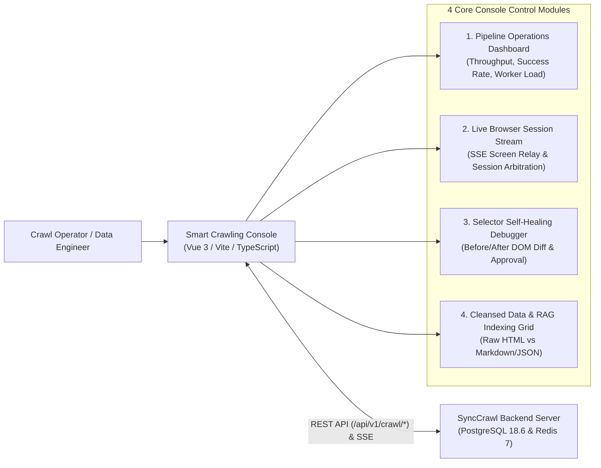

# Smart Crawling Console Architecture & Real-Time Operations Guide

## 1. Overview & Console Design Purpose

In large-scale enterprise web data harvesting environments, dozens to hundreds of crawling scenarios and distributed browser workers run asynchronously. Consequently, an integrated operations console is essential for monitoring pipeline throughput, detecting failure signals in real time, and controlling execution.

`SyncCrawl`'s **Smart Crawling Console** is an operator-facing web console built with Vue 3, Vite, and TypeScript. From a single unified interface, operators can design natural language harvesting scenarios, stream live Playwright browser sessions, approve semantic DOM selector self-healing suggestions, validate harvested data integrity, and track Tri-Hybrid RAG indexing status.



---

## 2. Detailed Breakdown of the 4 Core Console Modules

### 2.1 Unified Pipeline Operations Dashboard
- **Real-Time Worker Cluster Telemetry**: Visualizes active browser context counts, pages processed per second (Pages/sec), and average rendering latency across running `smart-crawling-agent` and `smart-crawling-scenario-agent` nodes.
- **Error Categorization & Aggregation**: Aggregates failures by category—network timeouts, DOM structure changes (Selector Drift), SSRF guard blocks, and schema validation errors—to pinpoint bottlenecks immediately.

### 2.2 Live Session Stream & Arbitration
- Streams browser navigation steps (URL navigation -> dynamic rendering wait -> element click -> text extraction) from active worker agents in real time via Server-Sent Events (SSE).
- When multiple scenarios share limited login accounts on the same target site, operators can inspect Redisson distributed session lock ownership and wait queues in real time and trigger forced lock release when necessary.

### 2.3 Semantic DOM Selector Debugger (Self-Healing Selector Studio)
- When existing CSS/XPath selectors break due to a target website redesign, the `SyncCrawl` self-healing engine analyzes DOM hierarchy, semantic attributes, and surrounding text anchors to propose candidate selectors.
- Operators can visually compare the **pre-change DOM snapshot against post-change matched extraction results** in the console's side-by-side Diff View and commit updates to the scenario template DB with a single click.

| Self-Healing Diagnostic Item | Console Display Information | Operator Action |
| :--- | :--- | :--- |
| **Previous Selector (`brokenSelector`)** | `div.board-list > ul > li:nth-child(1) > a.title` | Inspect match failure reason (`0 Elements Matched`) |
| **Proposed Healed Selector (`healedSelector`)** | `article[data-role='notice-item'] h3.post-heading > a` | Review extracted sample text and semantic similarity (`0.96`) |
| **Application Mode (`applyMode`)** | Auto-applied (`>= 0.95`) or awaiting admin approval (`0.80 ~ 0.94`) | Click **[Apply Permanently]** or **[Edit Selector Manually]** |

### 2.4 Harvested Data Integrity Validation & RAG Indexing Grid
- Displays raw HTML (archived in `MinIO / S3`), noise-stripped normalized Markdown, and JSON Schema extraction results side by side in a 3-pane split view.
- Automatically validates required fields (such as `title`, `published_at`, and `body_markdown`) against JSON Schema rules and triggers immediate indexing into the `PostgreSQL 18.6 pgvector` knowledge base for validated documents.

---

## 3. Console Standard REST API & SSE Event Specifications

The Smart Crawling Console communicates with the backend server over canonical `/api/v1/crawl/*` endpoints.

| Screen Module | HTTP Method & Canonical URL | Description |
| :--- | :--- | :--- |
| **Dashboard Metrics** | `GET /api/v1/crawl/dashboard/metrics` | Retrieves worker utilization, daily harvest counts, self-healing success rate, and queue depth |
| **Sites & Scenarios** | `GET /api/v1/crawl/sites/list`<br>`POST /api/v1/crawl/scenarios/execute` | Lists target domains and triggers immediate execution of natural language or scripted scenarios |
| **Live Session Stream** | `GET /api/v1/crawl/sessions/{jobId}/stream` | Subscribes to real-time SSE streams of browser execution step logs and captured frames |
| **Self-Healing Approval** | `POST /api/v1/crawl/healing/{healingId}/approve` | Commits an AI-repaired DOM selector to the production scenario template |
| **Harvested Data & RAG** | `GET /api/v1/crawl/documents/list`<br>`POST /api/v1/crawl/documents/{docId}/index-rag` | Retrieves cleansed Markdown results and triggers immediate `PostgreSQL 18.6 pgvector` embedding |

```json
{
  "jobId": "crawl-job-20261118-019",
  "siteCode": "KR_GOV_POLICY_PORTAL",
  "status": "HEALED_AND_COMPLETED",
  "extractedRecords": 25,
  "selfHealingEvent": {
    "field": "attachment_download_url",
    "previousSelector": "div.file-box > a.btn-down",
    "healedSelector": "section.attach-area a[href*='/download/']",
    "confidenceScore": 0.97,
    "autoApplied": true
  },
  "ragIndexing": {
    "vectorTable": "crawl_rag_chunk",
    "chunksCreated": 118,
    "embeddingModel": "text-embedding-3-large"
  }
}
```

---

## 4. Frontend Architecture & Build Optimization

- **DB Single-Source Dynamic Routing**: Dynamically fetches menu trees and button permissions from the `sys_permission` table (`/api/v1/crawl/sys/permission/getUserPermissionByToken`) to enforce role-based access control.
- **Reactive State Sync & Lazy Loading**: Combines Pinia stores with an SSE event bus to update harvest progress in real time without full-page reloads, and minimizes initial load times via Vite code-splitting.
