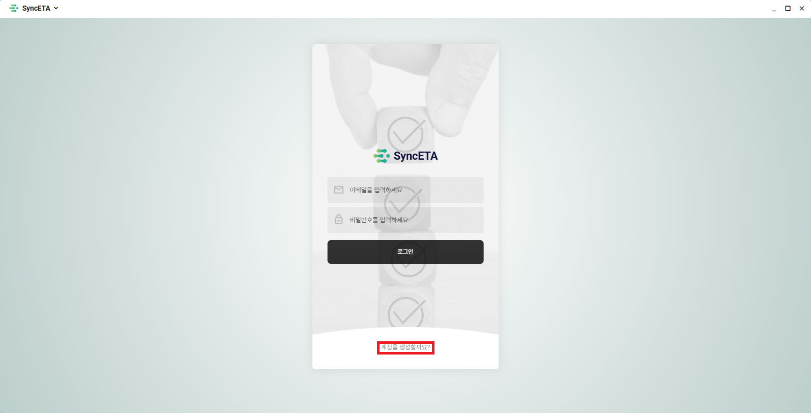
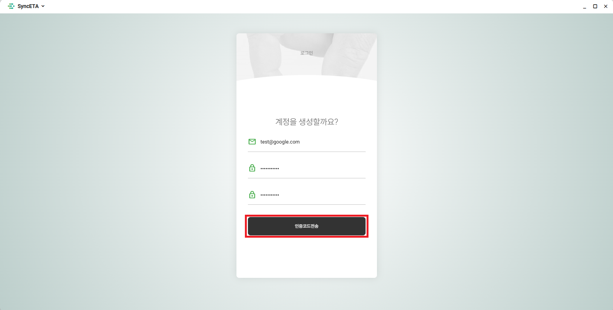
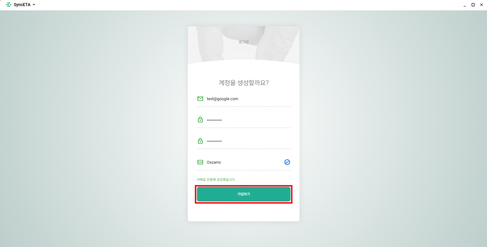
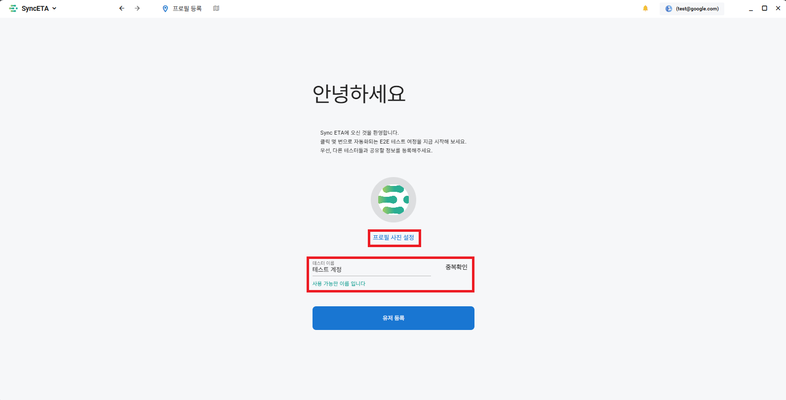
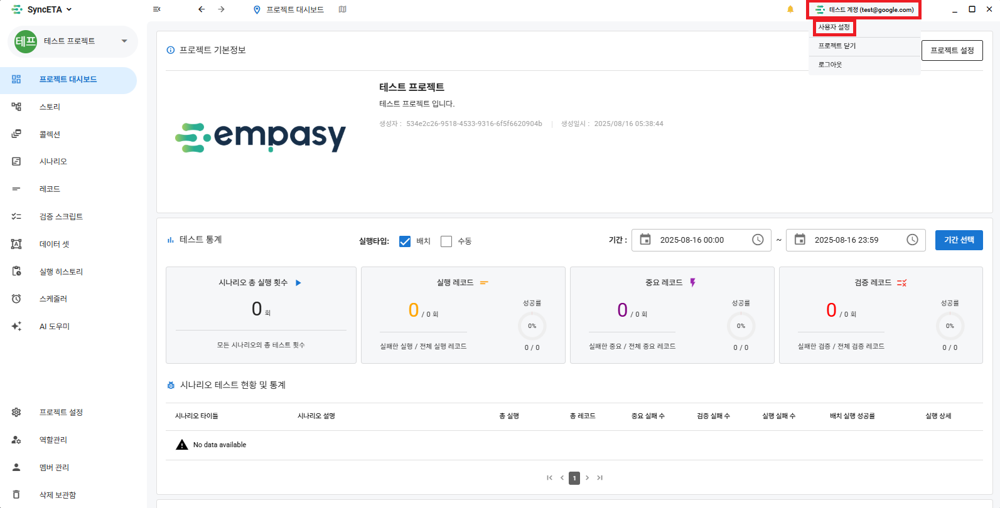
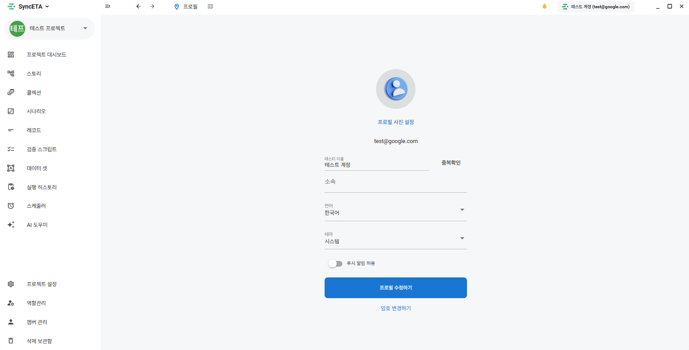

# Account and Workspace Management

This guide explains how to manage your user account and personal preferences to access the SyncETA platform, create test projects, and collaborate with your team.

---

## 1. Sign Up and Email Verification

### Step 1: Open the Account Creation Screen
Click the **'Create an account?'** link at the bottom of the SyncETA login screen.

### Step 2: Send Verification Code
Enter your email address and desired password, then click the **'Send Verification Code'** button. The system sends a 6-digit one-time verification code to the email address you entered.

### Step 3: Verify Code and Complete Registration
Enter the verification code from your email into the input field and click **'Sign Up'**. Once verification succeeds, you are automatically redirected to the login screen.

### Step 4: Configure Your Initial Profile
On your first login, a setup screen appears where you can register your display name and profile image.

---

## 2. User Profile and Preferences

Click the **'My Profile'** icon in the upper-right corner of the dashboard to customize your personal settings.

### Available Preference Settings
- **Profile Information**: Update your display name and avatar image
- **Language Settings**: Switch the interface between Korean, English, and Japanese
- **Theme Mode**: Toggle between Light Mode and Dark Mode
- **Security Settings**: Change your password
- **Notification Settings**: Enable or disable email and webhook notifications for test failures and scheduled execution results

