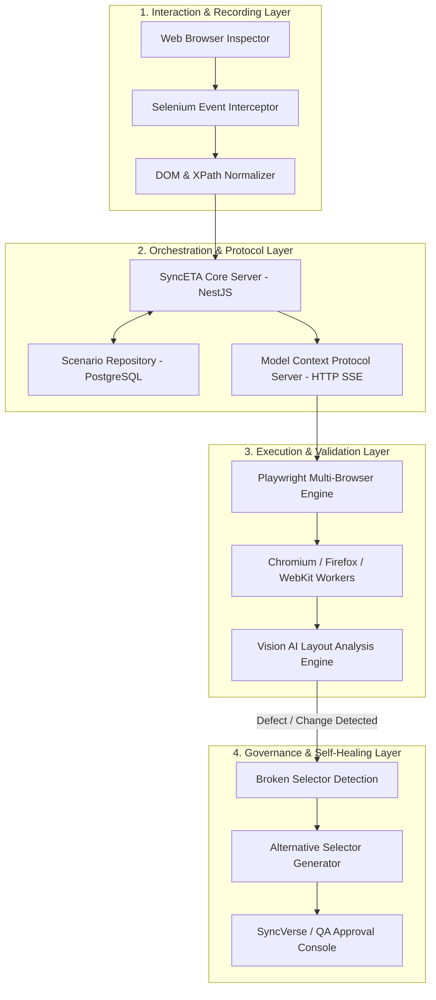

# System Architecture and Pipeline

SyncETA handles the entire lifecycle—from browser event capture to distributed execution, visual validation, and self-healing—through a modular 4-tier architecture.

---

## 4-Tier Architecture Diagram

---

## Detailed Capabilities and Tech Stack by Layer

### 1. Interaction & Recording Layer
- **Selenium Event Interceptor**: Captures user interactions on web pages in real time, including clicks (`click`), text inputs (`input/change`), scrolling (`scroll`), and tab switches (`tab switch`).
- **DOM Normalizer**: Collects absolute/relative XPath expressions, unique CSS IDs, class combinations, and hierarchical paths for each target node to build a resilient array of selectors.
- **Standard Format Serialization**: Serializes captured interaction data into a platform-independent JSON/YAML scenario format.

### 2. Orchestration & Protocol Layer
- **NestJS Core Server**: Manages scenario versioning, per-project isolation, dataset mapping, and execution schedules.
- **MCP (Model Context Protocol) Server**: Communicates statelessly with external AI orchestrators (SyncVerse) and CI/CD pipelines over HTTP Server-Sent Events (SSE).
- **JWT-Based Authorization (AuthZ)**: Validates tenant and role claims during inter-system communication to block unauthorized test execution requests.

### 3. Execution & Validation Layer
- **Playwright MCP Engine**: Launches Chromium, Firefox, and WebKit browser containers from collected scenarios to run tests in parallel.
- **Video & Snapshot Capture**: Captures DOM trees and screenshots before and after each test step, and archives a 5-second MP4 screen recording around any failure point.
- **Vision AI Layout Engine**: Analyzes rendered screenshots to detect overlapping components, text clipping, and broken responsive viewport layouts.

### 4. Governance & Self-Healing Layer
- **Broken Selector Detection**: When a web application deployment invalidates an existing DOM selector, instead of failing immediately, the engine uses a vision model to locate the target element visually.
- **Alternative Selector Generation**: Extracts the updated DOM path of the located UI element to generate candidate replacement selectors.
- **Human-in-the-Loop Governance**: Rather than letting AI overwrite test code autonomously, SyncETA sends change approval requests to the admin console and SyncVerse to ensure reliability.

---

## Data Flow Lifecycle

| Stage | Data Flow | Data Format | Description |
| :--- | :--- | :--- | :--- |
| **1. Capture** | Browser -> Recorder | `Raw Event Object` | Coordinates, timestamp, event type, and raw DOM snippet |
| **2. Store** | Recorder -> PostgreSQL | `Scenario JSON` | Normalized step list, variable binding keys, and wait/assertion conditions |
| **3. Dispatch** | CI/CD -> MCP Server | `MCP Tool Call (JSON)` | `scenario_id`, `browser_type`, `viewport`, and `dataset_id` |
| **4. Execute** | MCP Server -> Playwright | `Headless Context` | Script execution inside isolated browser instances |
| **5. Collect** | Playwright -> Storage | `Result Payload` | Pass/fail status, elapsed time, failed DOM, console logs, and MP4 video |
| **6. Analyze** | Storage -> Vision Engine | `Visual Diff Request` | Visual discrepancy analysis between baseline and current screenshots |
