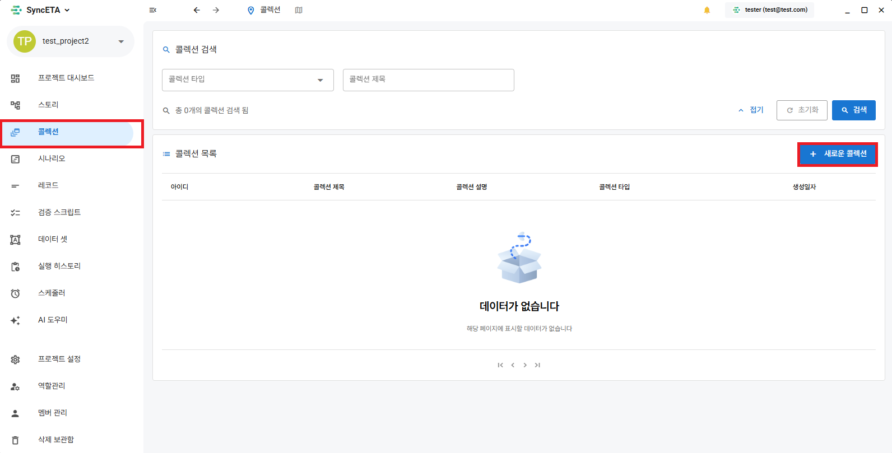
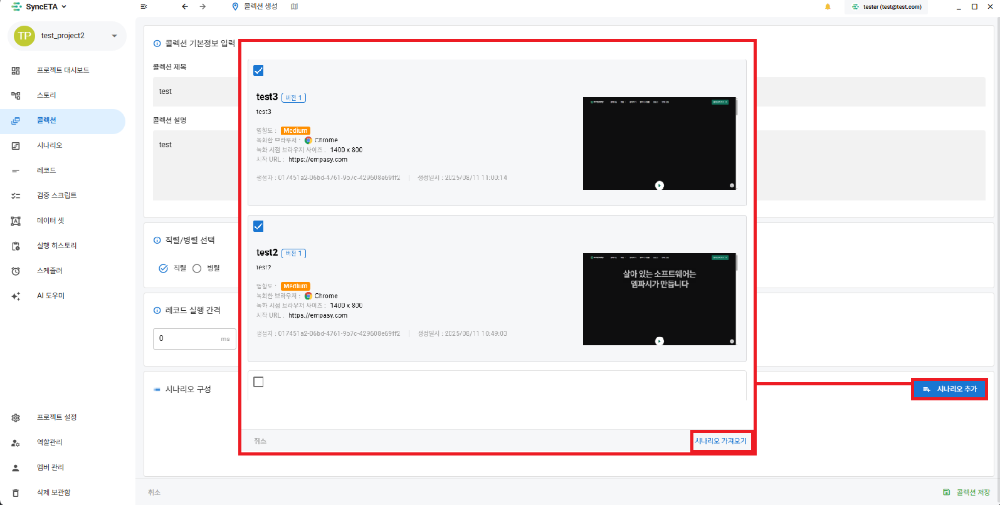

# Collection Management and Batch Execution

A **Collection** lets you group related test scenarios together to manage and run them in batches as a single Test Suite.

---

## 1. Key Use Cases for Collections

- **Sequential End-to-End Batch Verification**: Verify individual scenarios consecutively in order, such as Login -> Browse Products -> Checkout & Payment -> Order Cancellation.
- **Concurrent Multi-Browser Parallel Execution**: Run the same scenario set simultaneously across multiple browser environments—such as Chrome, Firefox, and Edge—to validate cross-browser compatibility.

---

## 2. How to Create a Collection

### Step 1: Navigate to Collections and Create a New One
Select **'Collections'** from the left navigation menu, then click the **'New Collection'** button in the upper-right corner.

### Step 2: Select Scenarios and Define Execution Order
Check the scenarios you want to include in the collection and drag and drop them to arrange their execution order.

---

## 3. Collection Execution Modes and Strategy Comparison

Depending on your testing goals and CI/CD pipeline stage, you can run a collection in either of two execution modes.

| Execution Mode | Behavior | Session & Cookie Sharing | Primary Use Cases |
| :--- | :--- | :---: | :--- |
| **Sequential Mode** | Executes scenarios one by one in the specified order (`1 -> 2 -> 3`) | Isolated or selectively preserved | Smoke tests and business flows with sequential data dependencies |
| **Parallel Mode** | Runs scenarios and multiple browsers (`Chromium`, `Firefox`, `WebKit`) concurrently across Playwright workers | Fully isolated per scenario | Large-scale nightly regression tests and cross-browser compatibility checks |

---

## 4. Collection Execution and Result Aggregation

When a collection runs, pass/fail status for each scenario is aggregated in real time. Once the entire collection finishes, a comprehensive summary report is recorded on the dashboard.

<iframe width="100%" height="400" src="https://www.youtube.com/embed/dsb0XpGy7A0" frameborder="0" allowfullscreen allow="autoplay; encrypted-media"></iframe>
