# Dashboard and Result Analysis Guide

The SyncETA dashboard provides a centralized monitoring interface where you can review overall project test pass rates and pinpoint failure causes at a glance.

---

## 1. Execution Statistics and Trend Analysis

You can filter by execution period and test execution type (**`Batch`**, **`Manual`**) to inspect comprehensive quality metrics.

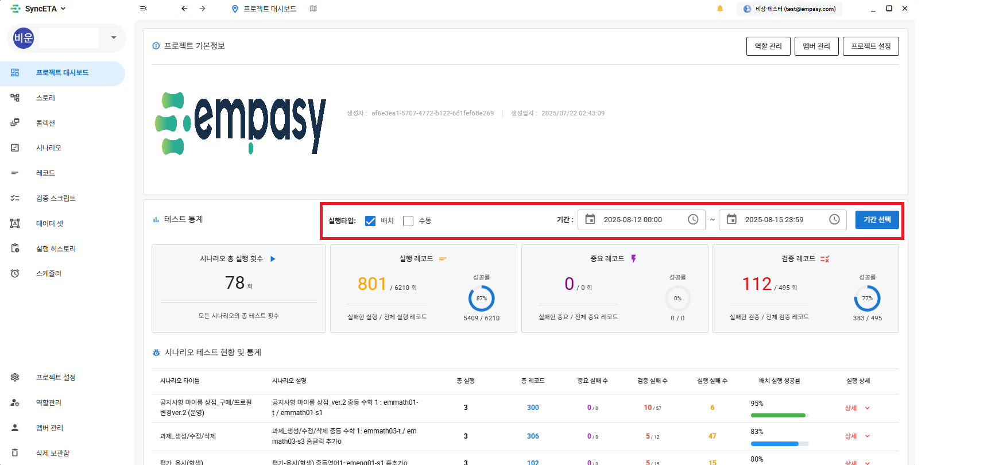

### Key Monitoring Metrics
- **Total Executions (`Total`)**: Cumulative pass and failure counts for scenarios and records filtered by the selected period and execution type (`Batch`/`Manual`)
- **Pass Rate by Priority (`Priority High`)**: Focused monitoring of execution pass/failure counts and pass rates for high-priority core business scenarios
- **Assertion Pass Rate**: Step-by-step verification match rate across assertions (DOM, value, and Vision)

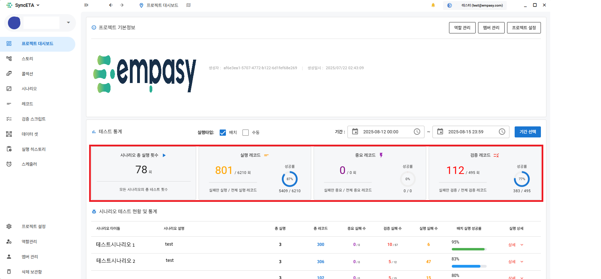

---

## 2. Failure-Point Diagnostics and Synchronized Video Playback

Click a failed test case to inspect the exact browser state at the moment the error occurred.

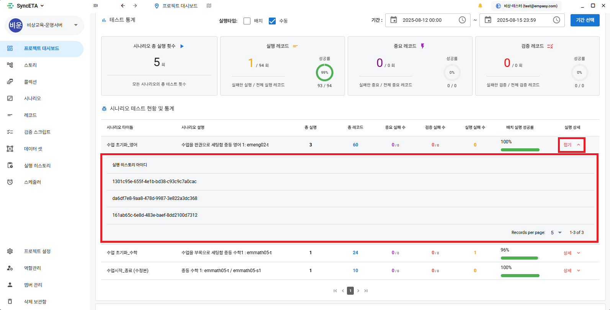

### Timeline-Synchronized Video Playback
The recorded execution video is synchronized with the step-by-step record timeline. Clicking any record immediately jumps the video to the exact moment that action was performed.

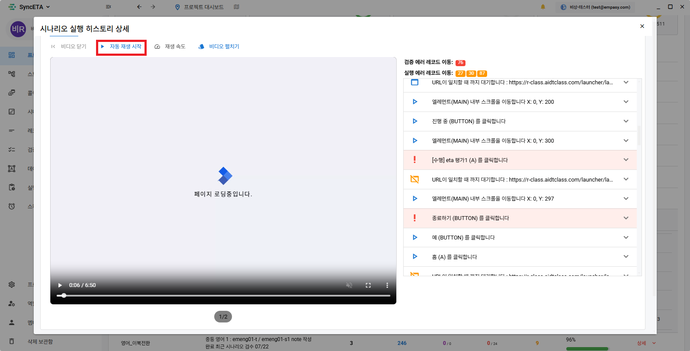
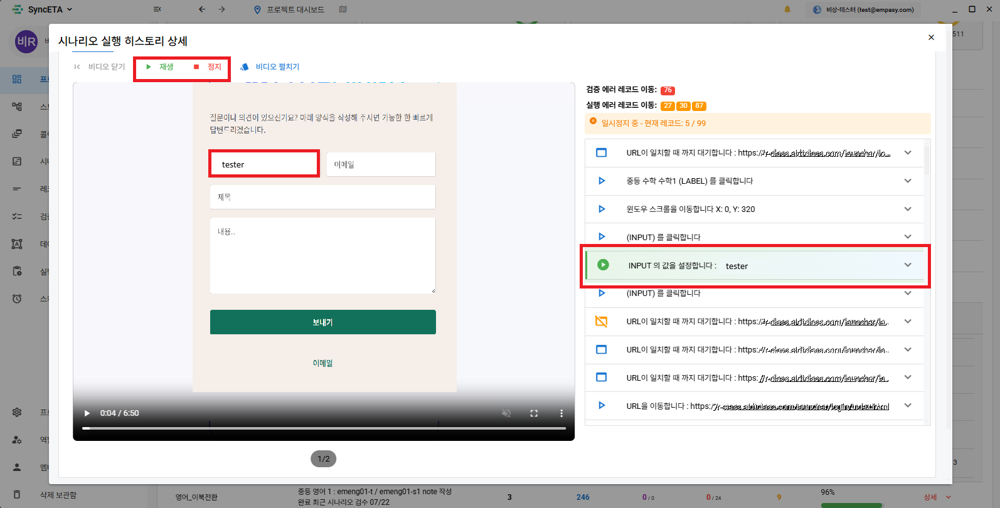
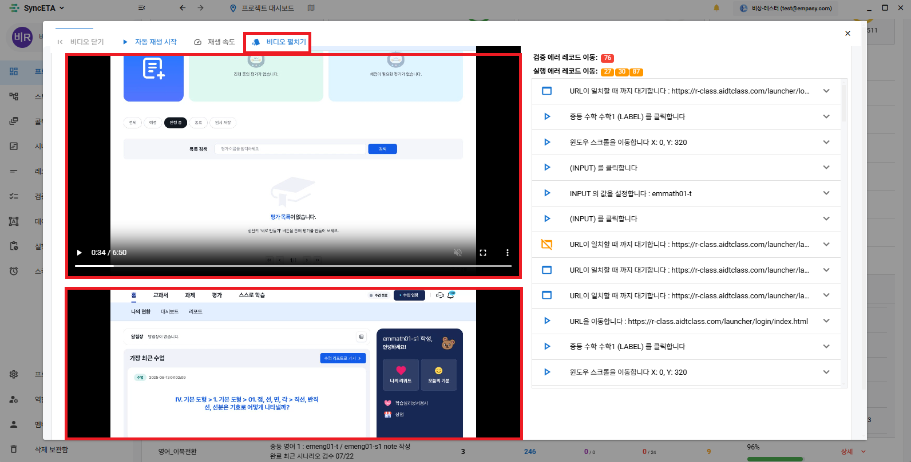

### Jump to Error Record Location
Clicking an error log automatically scrolls the view to the exact record in the list that triggered the error.

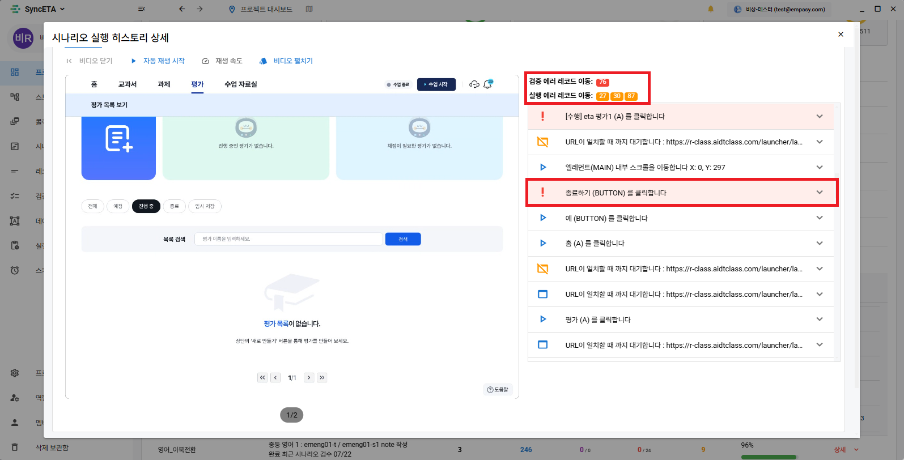
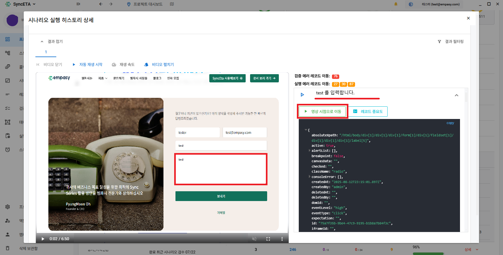

---

## 3. Team Collaboration and Comments

Add issue comments directly to specific steps in a test result and mention teammates (`@username`) to share defects and collaborate quickly.

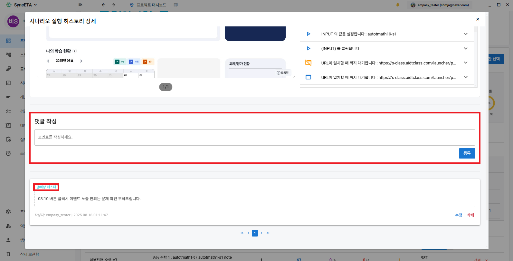
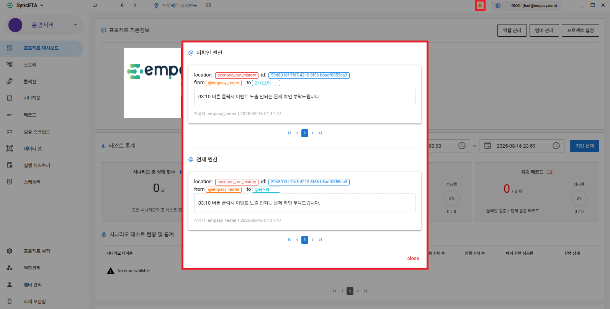

---

## 4. Automatically Collected Diagnostic Data

During test execution, SyncETA automatically captures supplementary diagnostic telemetry at both the browser and infrastructure levels.

| Collected Item | Description |
| :--- | :--- |
| **DOM Hierarchy Snapshot** | Preserves the full DOM tree and node attributes at the time each event occurred |
| **Browser Console Errors** | Automatically collects JavaScript runtime errors and warnings logged to the webpage console during execution |
| **SSL Certificate Expiration** | Checks the SSL/TLS certificate validity period for the target service domain and alerts on upcoming expirations |

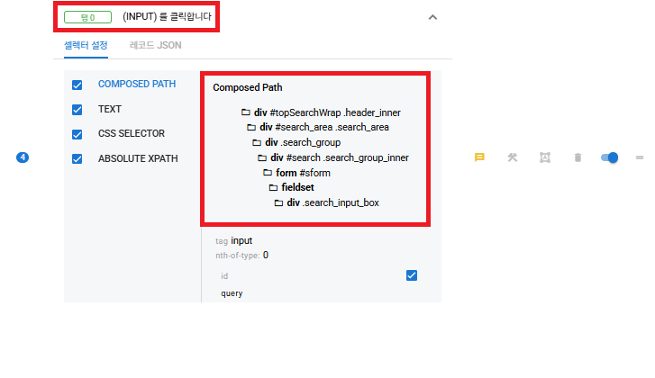
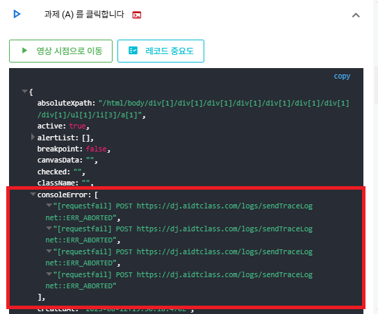
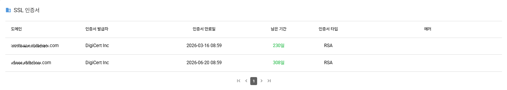
