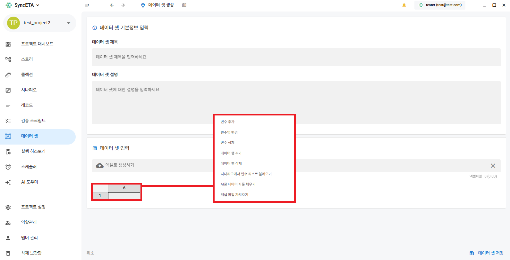
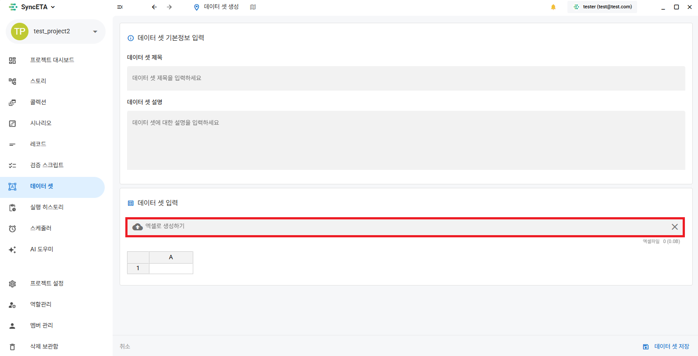
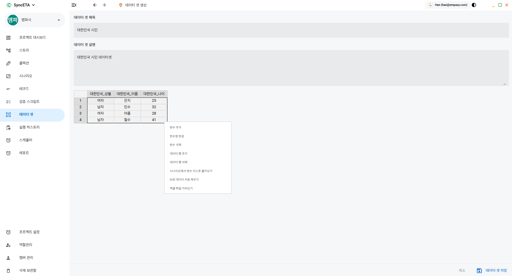
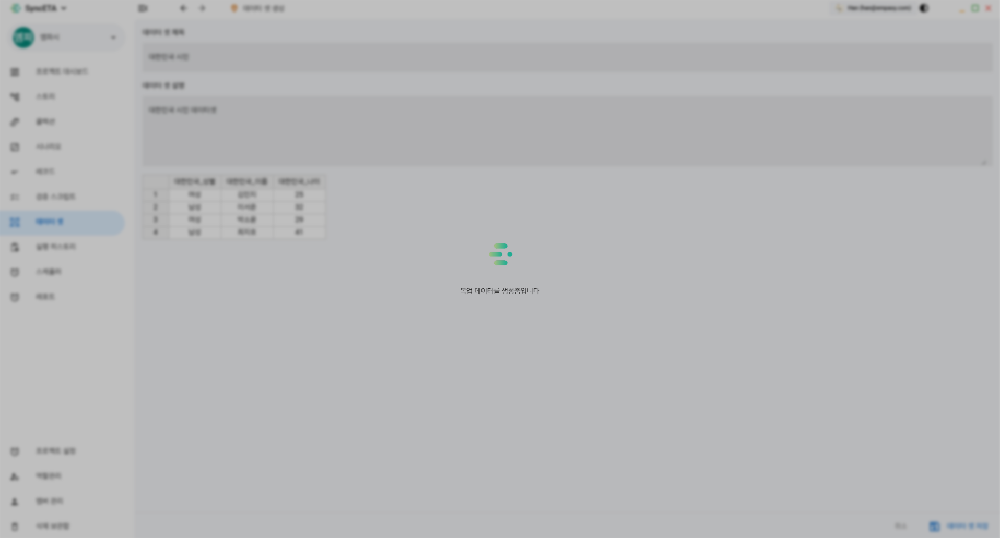

# Dataset Management and Parameterization (Data-Driven Testing)

A **Dataset** lets you dynamically map hardcoded input values in a test scenario to variables in an external data table, enabling a single scenario to be validated repeatedly against numerous input combinations—such as boundary values, exception cases, and multilingual text.

---

## 1. Dataset Structure and Capabilities

- **Spreadsheet-Style UI**: Manage test parameters in a familiar row-and-column table interface.
- **Excel File Import/Export**: Easily upload or download large volumes of existing test data in Excel spreadsheet format.
- **Dynamic Variable Binding**: Specify variables such as `{{username}}` or `{{search_keyword}}` in scenario records, and SyncETA sequentially injects the corresponding column values from the dataset at runtime.

---

## 2. Creating and Managing Datasets

### Direct Table Editing
Add, edit, or delete columns (variable names) and rows (test data sets) directly in the Dataset management screen.

### Bulk Upload via Excel File
Download the built-in template file, populate your test data, and upload it in bulk.

- **Download Template File**: [dataset_form.xlsx](../../ko/synceta/image/dataset/dataset_form.xlsx)

### AI-Assisted Data Generation
Right-click a column and select **'Auto-fill Data with AI'** from the context menu to automatically generate valid sample test data tailored to the variable type (such as names, email addresses, or phone numbers).

---

## 3. Applying Datasets to Scenarios and Running Tests

When you select a created dataset in the scenario execution options, an independent test case is executed sequentially or in parallel for each row in the dataset.

<iframe width="100%" height="400" src="https://www.youtube.com/embed/d2RU8aabXIQ" frameborder="0" allowfullscreen allow="autoplay; encrypted-media"></iframe>
