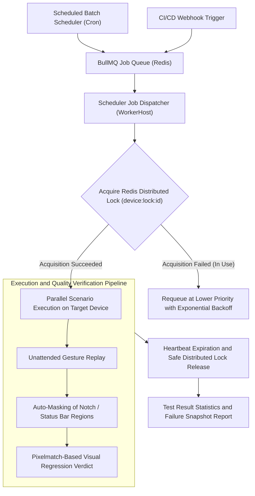

# Server Unattended Batch Scheduler and Distributed Lock-Based Device Farm Operations

## 1. Overview and Large-Scale Testing Challenges

Moving beyond 1:1 testing on a developer's local PC, running **overnight unattended regression tests** against dozens of physical mobile devices deployed in-house (Android racks, Mac mini-based iOS racks, and Docker redroid virtual device pools) introduces the following concurrency challenges:

1. **Device Contention**: Different projects or build pipelines simultaneously accessing the same physical device, causing tests to interfere with one another or terminate abnormally.
2. **Device Deadlock on Abnormal Termination**: If a runner process is forcefully terminated during test execution, the device session remains locked, leaving subsequent tests waiting indefinitely.
3. **Visual False Positives from Notches and Status Bars**: Battery level indicators, clock minute/second changes, and front camera notch areas causing pixel comparisons to falsely report failures even when no actual app defect exists.

`SyncETA` achieves unattended automation for large-scale device farms through a **NestJS Scheduler & BullMQ Queue**, **Redis Distributed Locks**, and an **Intelligent Region Masking Engine**.

---

## 2. Redis Distributed Lock-Based Device Contention Control

To prevent duplicate control of the same device, SyncETA applies a Redis-based distributed locking mechanism.

- **Lock Acquisition Specification**:
  - Key format: `device:lock:{platform}:{deviceId}` (e.g., `device:lock:android:emulator-5554`)
  - Atomic operation: Redis `SET key value NX PX 120000` (default timeout: 120 seconds)
- **Heartbeat Renewal and Safe Release**:
  - The test runner process renews the lock's Time-To-Live (TTL) every 30 seconds.
  - Even if a network disconnection or abnormal process crash occurs, the Redis key automatically expires (Auto-Release) after 120 seconds, preventing the device from becoming permanently locked.

---

## 3. Notch and Status Bar Auto-Masking Visual Regression Verification

To eliminate unnecessary false positives during pixel-level visual regression testing of mobile screens, a 3-stage masking pipeline is executed.

1. **Top Status Bar Static Masking**:
   - Excludes the top bar height collected from each device's OS configuration (e.g., Android `24dp`, iOS Dynamic Island `54pt`) from comparison (Zero-Alpha processing).
2. **Bottom Gesture Navigation Bar (Home Bar) Masking**:
   - When not in full-screen mode, masks the bottom `16~20dp` system bar region.
3. **Pixelmatch-Based Effective Threshold Comparison**:
   - Runs the `pixelmatch` library against the main content region excluding the masked areas, and marks the test as passed if the pixel difference ratio falls within a predefined tolerance threshold (e.g., `0.1%` or less).

---

## 4. Overnight Batch Pipeline Operating Standards

- **Scheduling Cycle**: Executes full regression tests across all registered enterprise scenarios daily between `02:00` and `05:00`.
- **Failure Isolation and Preservation**:
  - Immediately upon detecting a test failure, captures the current screen and bundles the preceding 10 seconds of Logcat or system console logs for persistent storage in S3/MinIO.
  - Automatically attaches a Diff image overlaying the differences between the failed screen and the baseline screen to the report so the development team can immediately identify the root cause the following morning.
