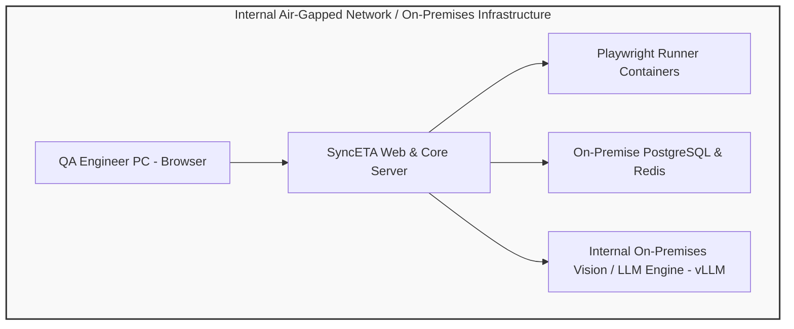

# Enterprise Security and On-Premises Deployment

To meet the stringent security requirements of financial institutions, public agencies, and large enterprises, SyncETA provides **complete on-premises air-gapped deployment** and **data governance capabilities**.

---

## 1. Air-Gapped Environment and On-Premises Architecture

Even in closed networks where external public cloud connectivity is prohibited, all SyncETA capabilities (recording, execution, and visual analysis) can be operated end-to-end.

### Internal Local Vision / LLM Engine Integration
- **Open-Source Vision Models**: Deploy models such as Llama-3.2-Vision or LLaVA on internal GPU infrastructure (vLLM, Ollama) to perform visual regression analysis without external API calls.
- **Standard OpenAI-Compatible Interface**: Easily switch to a local instance simply by configuring the endpoint URL (`http://local-vllm.internal:8000/v1`) and API key.

---

## 2. Sensitive Data Masking (PII Data Masking)

Multi-stage masking is applied to prevent leakage of personally identifiable information (national ID numbers, phone numbers, credit card numbers, passwords, etc.) exposed on screen during test execution.

- **DOM-Level Text Masking**: Password (`type="password"`) fields and text matching configured regular expression patterns are immediately masked as `********` during record collection.
- **Screenshot/Video Visual Blur**: Rendered regions matching configured masking selectors (CSS Selectors) are pixelated/blurred prior to capturing screenshots and saving video recordings.

---

## 3. Role-Based Access Control (RBAC) and Tenant Isolation

Enforces the Principle of Least Privilege at the project level to guarantee a secure collaborative environment.

| Default Role | Create/Edit Scenarios | Execute Tests | Edit Datasets | Issue CI/CD API Keys | Invite Users / Permissions |
| :--- | :---: | :---: | :---: | :---: | :---: |
| **System Admin** | O | O | O | O | O |
| **Project Lead** | O | O | O | O | O |
| **QA Engineer** | O | O | O | X | X |
| **Viewer / Tester** | X | O (View/Execute) | X | X | X |

---

## 4. Audit Logging and Traceability (Audit Trail)

- **Selector Self-Healing Approval Log**: Permanently retains a complete history of when, by whom, and for what reason a scenario selector change was approved.
- **Test Execution Record Retention**: Archives the executing user ID, execution timestamp, target URL, browser environment, pass/fail status, and error stack traces for 1 year.
