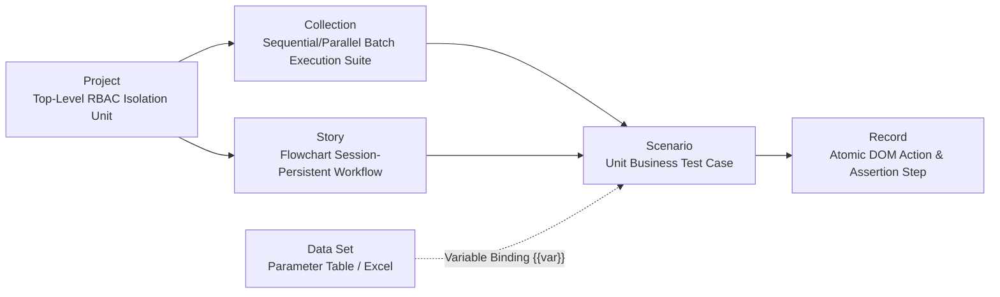

# Technical Glossary

Definitions of core concepts and technical terms used across the SyncETA platform.

---

### Record
The atomic execution unit that captures a user's browser events and DOM information. Records user interactions such as clicks, keyboard inputs, scrolls, and tab switches in real time along with URL, XPath, CSS Selector, and tag attribute metadata.

### Scenario
The fundamental test case unit composed by sequencing a series of Records to follow a specific business flow (e.g., login, product search, checkout). Can include wait conditions, assertion conditions, and failure recovery scripts.

### Collection
A batch execution unit that groups multiple independent Scenarios into a single test suite to run sequentially or in parallel.

### Story
A higher-level integrated workflow that conditionally connects multiple Scenarios on a flowchart canvas interface and runs them continuously while preserving session state (cookies, authentication) within a single browser session.

### Data Set
A capability for managing test data mapped to input variables defined in Scenarios in a spreadsheet (Key-Value) format. Supports Excel file Import/Export for Data-Driven Testing.

### Playwright MCP
A distributed test execution engine that remotely controls Playwright browser instances in compliance with the Model Context Protocol (MCP) standard. Supports multi-browser parallel execution across Chromium, Firefox, and WebKit.

### Visual Regression AI
A capability that overcomes the limitations of naive pixel-by-pixel comparison by leveraging Vision models to analyze element overlapping, text clipping, and layout breakage from a human perceptual perspective.

### Self-Healing
A capability that analyzes Vision models and the DOM tree when existing DOM identifiers (XPath/CSS Selectors) break due to web application deployments, computing candidate replacement selectors and routing them to an approval queue.

### Human-in-the-Loop Governance
A quality management principle requiring explicit review and approval by QA engineers and administrators before AI-generated test cases or self-healed selectors are automatically committed into the system.

### Air-Gapped / On-Premises Deployment
An enterprise deployment model capable of running independently by pairing with local open-source Vision/LLM engines (such as vLLM) inside closed internal networks where external internet communication is blocked.

---

## Test Asset Hierarchy Summary

