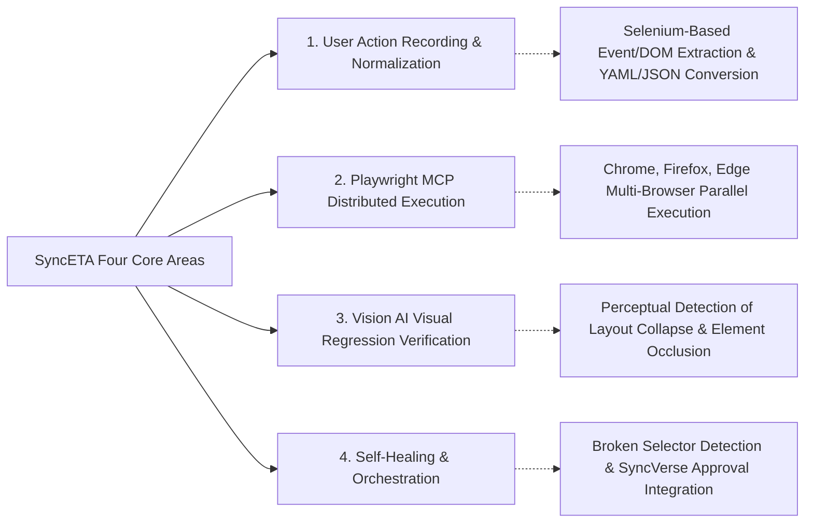
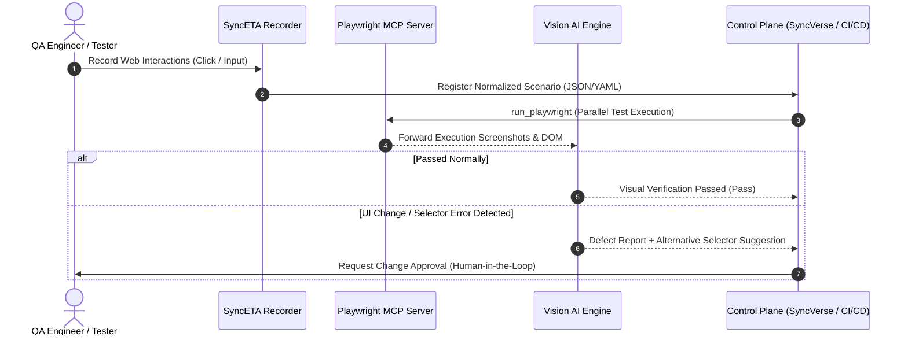

# SyncETA: AI Test Automation and Self-Healing Platform

> **Non-Developers & Adoption Evaluation Guide**: For an accessible product overview, visit the [SyncETA Product Homepage (eta.empasy.io)](https://eta.empasy.io/en/){target="_blank" rel="noopener"}. For desktop installation and live hands-on evaluation, visit the [Unified Demo Portal](https://sync.empasy.io/en/products/sync-eta#demo){target="_blank" rel="noopener"}. Brochures and proposal PDFs are available in the [Proposals Library](/en/proposals/).

**SyncETA** is an enterprise **AI test automation** platform that maximizes QA and development efficiency by automating the entire lifecycle without writing test code: **automatic scenario generation (no-code recording, natural language, and Excel), Playwright MCP parallel execution, failure root-cause analysis, visual regression detection, and selector Self-Healing**.

::: tip Instant Desktop Application Launch Guide
SyncETA provides a desktop application (v0.0.58) that lets you immediately test local and staging websites without setting up separate server infrastructure.  
Download the Windows (x64, arm64) and macOS (Apple Silicon, Intel) installers for free from the **[Empasy Official Download Page (empasy.io)](https://empasy.io/en/download_eta.html)** and run your first test in under a minute.
:::

---

## Comparison of AI Test Automation Approaches (Code Generation vs. Autonomous E2E Agent)

| Category | Legacy Script Automation (Selenium / Standalone Playwright) | Code-Generation Assistants (Claude Code / GitHub Copilot) | Autonomous E2E QA Agent (**Empasy SyncETA**) |
| :--- | :--- | :--- | :--- |
| **Scenario Authoring** | Developers manually write CSS/XPath selector code | Prompts generate draft unit/integration test code | **No-code browser action recording & automatic generation/direct execution from natural language or Excel** |
| **Self-Healing on UI Changes** | Not supported (tests fail immediately on class/DOM changes) | Requires manual re-prompting and developer code edits | **Real-time Self-Healing of broken selectors via Vision-LLM and DOM context reasoning (98.4%)** |
| **Visual Regression Verification** | Naive pixel comparison (false positives on minor banner/font shifts) | Code-level assertion focus (limited rendered layout verification) | **Vision AI automatically detects layout collapse and element occlusion before/after deployment** |
| **Target Users & Cost** | Requires dedicated automation engineers; high maintenance effort | Assists developers with unit/integration tests; per-call token billing | **Shared no-code E2E regression testing for PMs, QA, and developers; zero AI cost on repeated runs** |

---

## Four Core Functional Areas

1. **User Action Recording & Normalization**:
   - Captures real browser interactions (clicks, inputs, page navigations, tab switches) in real time.
   - Normalizes collected events into standard JSON/YAML formats along with XPath, CSS Selectors, and DOM hierarchy metadata.

2. **Playwright MCP-Based Distributed Test Execution**:
   - Executes tests in parallel across multi-browser environments (Chromium, Firefox, WebKit) via standard Model Context Protocol (MCP) tools.
   - When an error occurs during execution, captures the DOM snapshot, console logs, and video recording at the exact point of failure.

3. **Vision AI-Based Visual Regression Verification**:
   - Moves beyond naive pixel comparison by using Vision models to detect overlapping components, clipped text, and broken layouts.
   - Supports configuring Ignored Regions to mask dynamic rendering areas.

4. **Selector Self-Healing & Control Plane Integration (Self-Healing & Governance)**:
   - When an existing identifier breaks due to UI changes, analyzes the screen structure to compute the optimal replacement selector.
   - Rather than modifying code unilaterally, updates test assets only after Human-in-the-Loop approval from the SyncVerse control plane and QA engineers.

---

## 5-Stage End-to-End Test Pipeline

---

## Key Business Benefits

- **Reduced Test Script Maintenance**: Rapidly repairs broken scripts caused by UI updates through the Self-Healing pipeline.
- **Shorter Cross-Browser Verification Cycles**: Reduces total regression test duration via Playwright MCP-based parallel execution.
- **High-Precision Visual Integrity**: Blocks layout regressions prior to release with Vision AI verification immune to pixel noise.
- **Standard Protocol Interoperability**: Provides an HTTP SSE-based MCP interface for seamless integration with internal CI/CD systems (Jenkins, GitHub Actions) and AI orchestrators.

---

## Live UI Screens and Core Workflows

### 1. Autonomous QA Quality Assurance Unified Dashboard
Monitors overall project scenario pass rates, autonomous task counts, selector self-healing status, and token savings achieved through snapshot lightweighting in a unified control view.

### 2. Selector Self-Healing and Automated Locator Recovery
Reviews legacy selectors broken by UI redesigns alongside AI-inferred replacement selectors from visual and DOM context, confidence scores, and reasoning before approving updates.

### 3. Multi-Resolution Visual Regression Inspection and Layout Defect Analysis
Compares baseline screens before deployment against current screens across resolutions to automatically evaluate pixel error rates, layout collapse, and text clipping.

### 4. Domain-Specific E2E Scenario Execution History and Snapshot Evidence Ledger
Tracks domain-level E2E scenario pass rates, selector positional stability metrics, execution duration, and step-by-step DOM snapshot and network evidence.

---

## Documentation Index

### 1. Overview & System Architecture
- [System Architecture & Pipeline](./architecture) - 4-tier architecture and component communication structure
- [5-Minute Quickstart Guide](./quickstart) - Launching local containers and running your first test

### 2. Practitioner User Guide
- [Account & Workspace Management](./account) - Sign-up, profile configuration, and environment management
- [Project Management](./project) - Creating projects, roles/permissions (RBAC), and member invitations
- [Scenario Recording & Editor](./scenario-create) - Browser recording, wait conditions, assertions, and recovery scripts
- [Scenario Execution Options](./scenario-run) - Cross-browser, multi-resolution, background parallel execution, and scheduler
- [Collection Management](./collection) - Configuring sequential/parallel batch execution across multiple scenarios
- [Story Workflows](./story) - Flowchart-based conditional scenario branching and dynamic chaining
- [Dataset Management](./dataset) - Excel integration, input parameter substitution (Data-Driven Testing), and boundary value datasets
- [Dashboard & Result Analysis](./dashboard) - Execution statistics, console error collection, failure-point DOM snapshots, and video analysis

### 3. Mobile Test Engineering
- [Mobile E2E System Architecture](./mobile-testing-architecture) - Overall architecture for Android & iOS physical device capture and regression testing
- [Dual Automation Engine Specification](./mobile-dual-engine) - Playwright Android and Appium 3.7+ dual-engine architecture
- [Ultra-Low-Latency Mirroring & Capture](./mobile-live-mirroring) - Direct MJPEG 60 FPS screen streaming and asynchronous dual-track capture
- [Device Farm Scheduler](./device-farm-scheduler) - Redis distributed lock-based unattended overnight batch runs and visual regression verification

### 4. Advanced Integration & Enterprise
- [Visual Regression & Self-Healing](./self-healing-and-vision) - Vision AI layout verification and selector calibration workflow
- [MCP Protocol & CI/CD Integration](./mcp-and-cicd) - HTTP SSE standard Tool Schema and pipeline integration specification
- [Enterprise Security & On-Premises](./enterprise-security) - Local LLM integration, internal air-gapped network support, and data masking
- [Technical Glossary](./glossary) - Definitions of Record, Scenario, Collection, Story, MCP, and more

### 5. Core Foundational Patents
- [Korean Registered Patent No. 10-2025-0125736](../patents/registered-web-action-recording) - AI Natural Language Test Case Automation Based on Web Browser Action Recording
- [Pending Patent Application No. 21](../patents/21-mobile-gesture-nlp) - Mobile Gesture Analysis and Natural Language Test Automation System
