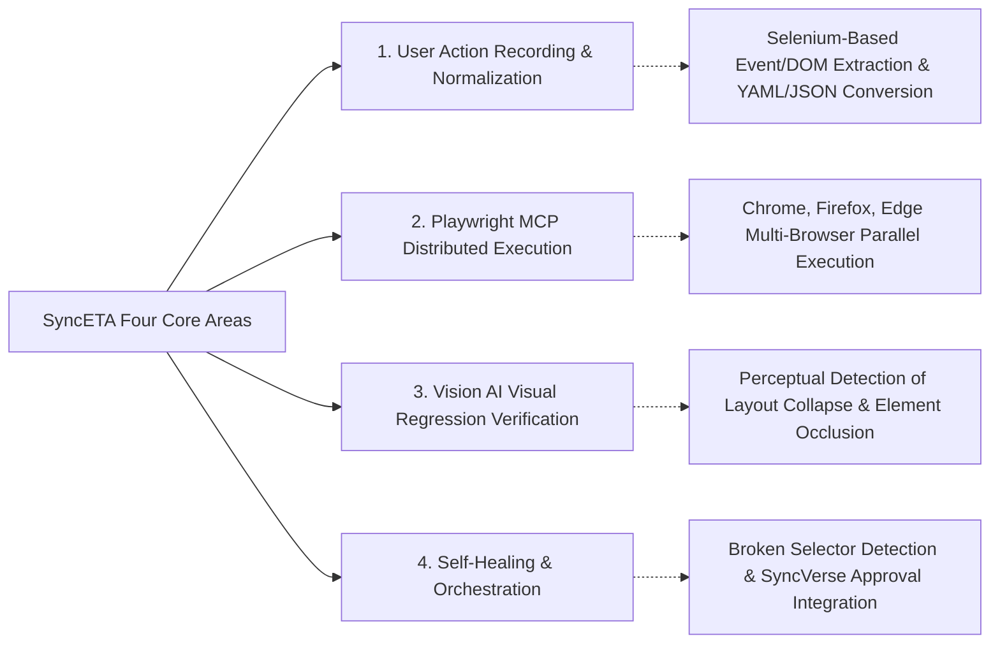
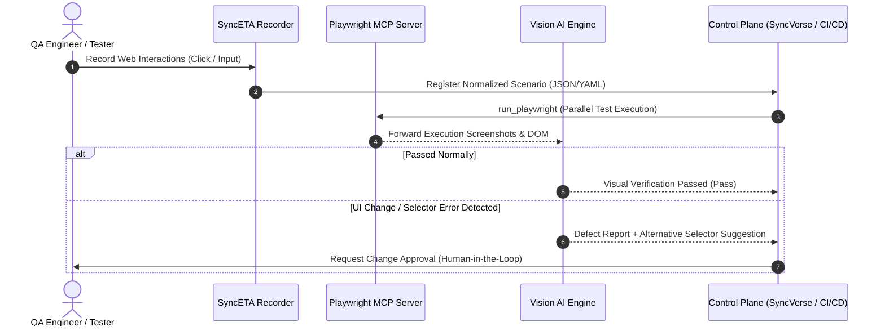
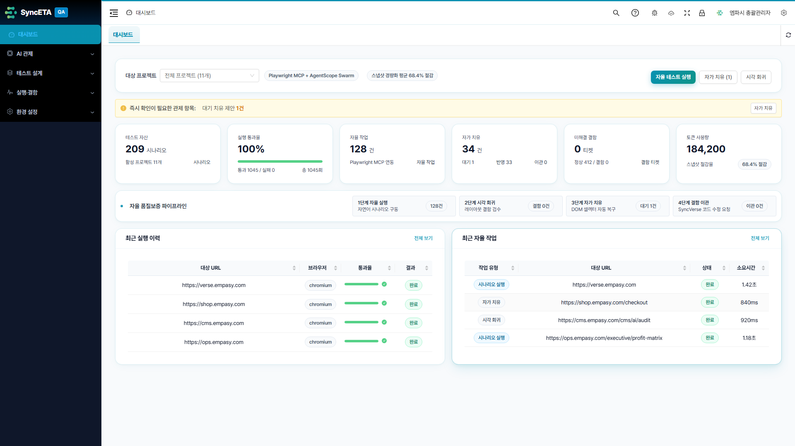
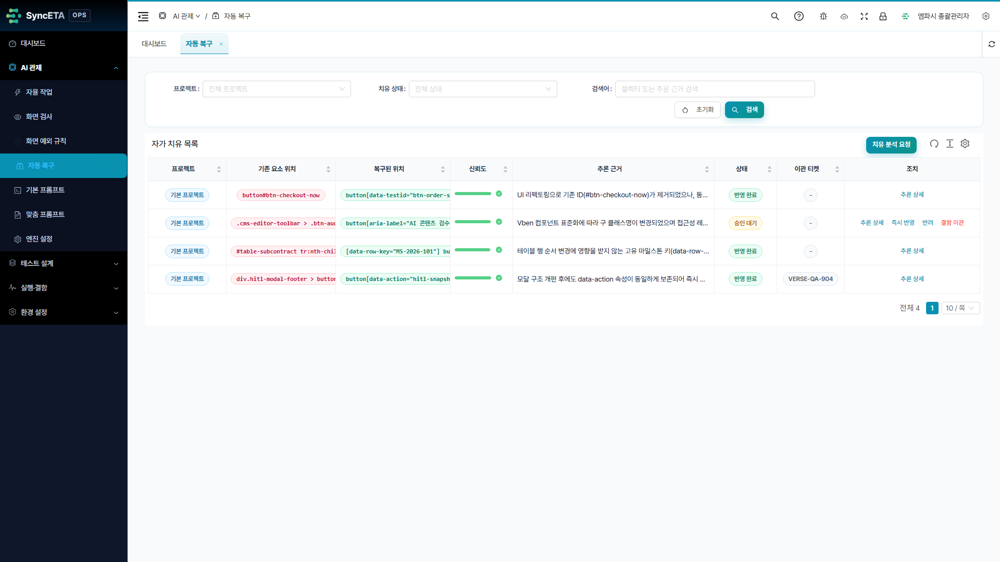
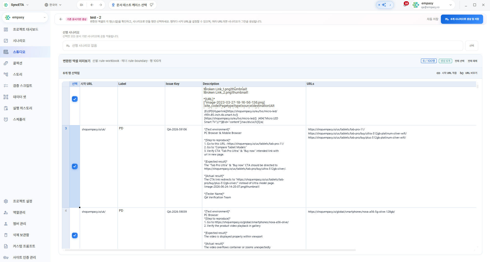
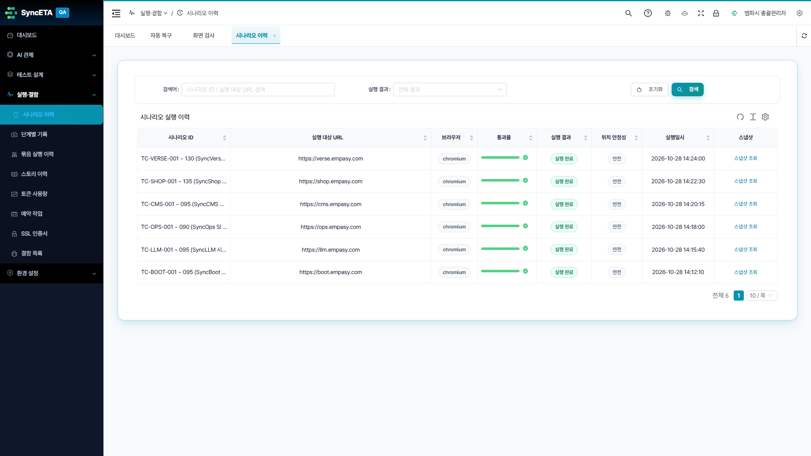
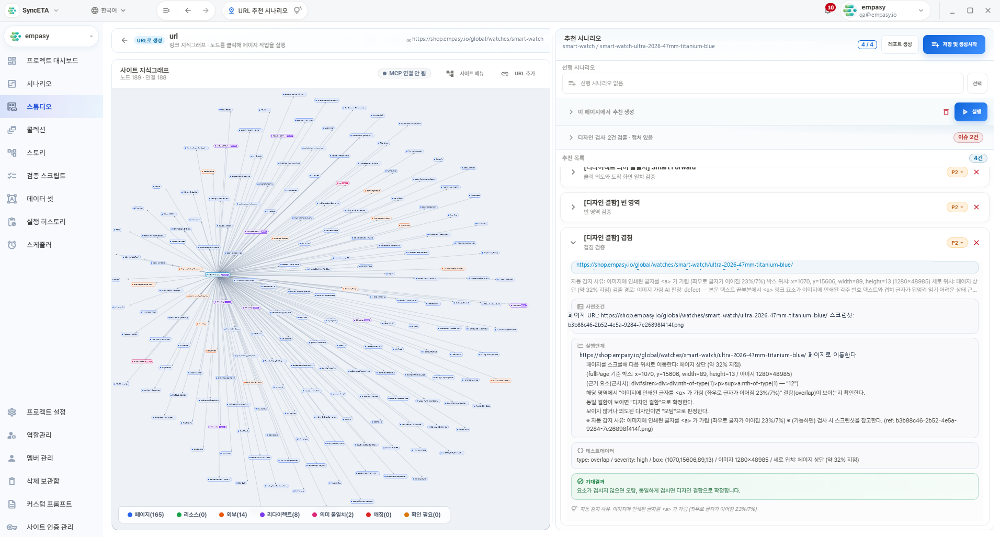
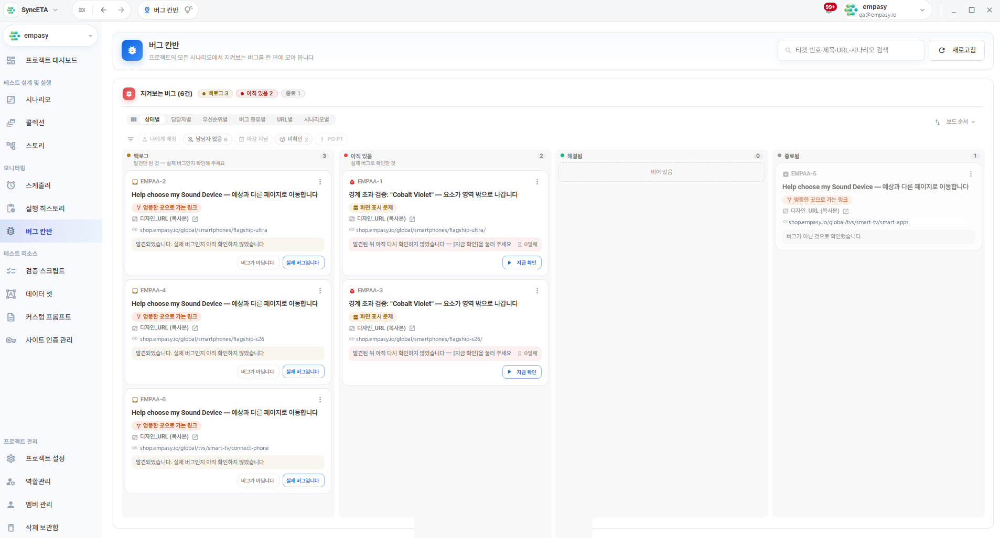

# SyncETA: AI Test Automation · Self-Healing Web QA Platform

> **Non-Developers & Adoption Evaluation Guide**: For an accessible product overview, visit the [SyncETA Official Product Page (empasy.io)](https://empasy.io/en/solutions/sync-eta.html){target="_blank" rel="noopener"} or [SyncETA Standalone Site (eta.empasy.io)](https://eta.empasy.io/en/){target="_blank" rel="noopener"}. For desktop installation and live hands-on evaluation, visit the [Unified Demo Portal](https://demo.empasy.io/en/products/sync-eta/#demo){target="_blank" rel="noopener"}. You can also read the [2026 AI Test Automation Tools Comparison Guide](https://empasy.io/en/blog/ai-test-automation-tools-comparison-2026.html){target="_blank" rel="noopener"} and download the 15-page brochure PDF in the [Proposals Library](/en/proposals/).

**SyncETA** automates the entire web quality verification lifecycle without writing brittle scripts: **browser action recording (with security keypad, cookie banner bypass, and PII masking), Excel and one-line prompt test conversion using representative/sample URLs, multi-account simultaneous testing, scenario-free link and layout-overlap audits with honest `[Needs Review]` triage, and Bug Kanban one-click `[Check Now]` re-verification**—powered by Playwright MCP parallel execution and adaptive element recovery.

::: tip Instant Desktop Application Launch Guide
SyncETA provides a desktop application (v0.0.66) that lets you immediately test local and staging websites without setting up separate server infrastructure.  
Download the Windows (x64, arm64) and macOS (Apple Silicon, Intel) installers for free from the **[Empasy Official Download Page (empasy.io)](https://empasy.io/en/download_eta.html)** and run your first test in under a minute.
:::

---

## Comparison of AI Test Automation Approaches (Code Generation vs. Autonomous E2E Agent)

| Category | Legacy Script Automation (Selenium / Standalone Playwright) | Code-Generation Assistants (Claude Code / GitHub Copilot) | Autonomous E2E QA Agent (**Empasy SyncETA**) |
| :--- | :--- | :--- | :--- |
| **Scenario Authoring** | Developers manually write CSS/XPath selector code | Prompts generate draft unit/integration test code | **No-code browser action recording & automatic generation/direct execution from natural language or Excel** |
| **Self-Healing on UI Changes** | Not supported (tests fail immediately on class/DOM changes) | Requires manual re-prompting and developer code edits | **Real-time Self-Healing of broken selectors via Vision-LLM and DOM context reasoning (93.0% across 1,200 internal runs)** |
| **Visual Regression Verification** | Naive pixel comparison (false positives on minor banner/font shifts) | Code-level assertion focus (limited rendered layout verification) | **Vision AI automatically detects layout collapse and element occlusion before/after deployment** |
| **Target Users & Cost** | Requires dedicated automation engineers; high maintenance effort | Assists developers with unit/integration tests; per-call token billing | **Shared no-code E2E regression testing for PMs, QA, and developers; zero AI cost on repeated runs** |

---

## Four Core Functional Areas

1. **User Action Recording & Normalization**:
   - Captures real browser interactions (clicks, inputs, page navigations, tab switches) in real time.
   - Normalizes collected events into standard JSON/YAML formats along with XPath, CSS Selectors, and DOM hierarchy metadata.

2. **Playwright MCP-Based Distributed Test Execution**:
   - Executes tests in parallel across multi-browser environments (Chromium, Firefox, WebKit) via standard Model Context Protocol (MCP) tools.
   - When an error occurs during execution, captures the DOM snapshot, console logs, and video recording at the exact point of failure.

3. **Vision AI-Based Visual Regression Verification**:
   - Moves beyond naive pixel comparison by using Vision models to detect overlapping components, clipped text, and broken layouts.
   - Supports configuring Ignored Regions to mask dynamic rendering areas.

4. **Selector Self-Healing & Control Plane Integration (Self-Healing & Governance)**:
   - When an existing identifier breaks due to UI changes, analyzes the screen structure to compute the optimal replacement selector.
   - Rather than modifying code unilaterally, updates test assets only after Human-in-the-Loop approval from the SyncVerse control plane and QA engineers.

---

## 5-Stage End-to-End Test Pipeline

---

## Key Business Benefits

- **Reduced Test Script Maintenance**: Rapidly repairs broken scripts caused by UI updates through the Self-Healing pipeline.
- **Shorter Cross-Browser Verification Cycles**: Reduces total regression test duration via Playwright MCP-based parallel execution.
- **High-Precision Visual Integrity**: Blocks layout regressions prior to release with Vision AI verification immune to pixel noise.
- **Standard Protocol Interoperability**: Provides an HTTP SSE-based MCP interface for seamless integration with internal CI/CD systems (Jenkins, GitHub Actions) and AI orchestrators.

---

## Live UI Screens and Core Workflows

### 1. Project Dashboard & Execution Analytics
Monitors overall test runs, pass-rate trends, failure cause ratios, active schedules, and live SSL certificate expiration status in one workspace with one-click reporting.

### 2. Browser Action Recorder & Real-Time DOM Verification
Captures clicks, inputs, and scrolls into reusable blocks while automatically handling financial virtual security keypads, global cookie consent banners, and personal data masking.

### 3. Excel Test Sheet & One-Line Prompt Conversion
Uploads existing Excel/CSV test specifications to batch-generate selected scenarios and applies them across multiple regional or product pages via representative and sample URLs.

### 4. Multi-Account Simultaneous Testing & Synchronized Video Replay
Runs two independent login sessions (such as customer Tab 0 and administrator Tab 1) side by side to validate cross-role workflows with separate per-tab logs and video replays.

### 5. Site Knowledge Graph Link Audit & Visual Defect Detection
Without pre-written scripts, audits all sub-links (404 errors and destination mismatches), text overlaps, empty regions, and media playback, flagging uncertain items as `[Needs Review]` with screenshots.

### 6. Bug Kanban Board & One-Click `[Check Now]` Re-Verification
Manages photo-attached defect tickets across Backlog, Open, Resolved, and Closed columns with duplicate blocking, persistent `[Not a Bug]` memory, and instant one-click re-checks.

---

## Documentation Index

### 1. Overview & System Architecture
- [System Architecture & Pipeline](./architecture) - 4-tier architecture and component communication structure
- [5-Minute Quickstart Guide](./quickstart) - Launching local containers and running your first test

### 2. Practitioner User Guide
- [Account & Workspace Management](./account) - Sign-up, profile configuration, and environment management
- [Project Management](./project) - Creating projects, roles/permissions (RBAC), and member invitations
- [Scenario Recording & Editor](./scenario-create) - Browser recording, wait conditions, assertions, and recovery scripts
- [Scenario Execution Options](./scenario-run) - Cross-browser, multi-resolution, background parallel execution, and scheduler
- [Collection Management](./collection) - Configuring sequential/parallel batch execution across multiple scenarios
- [Story Workflows](./story) - Flowchart-based conditional scenario branching and dynamic chaining
- [Dataset Management](./dataset) - Excel integration, input parameter substitution (Data-Driven Testing), and boundary value datasets
- [Dashboard & Result Analysis](./dashboard) - Execution statistics, console error collection, failure-point DOM snapshots, and video analysis

### 3. Mobile Test Engineering
- [Mobile E2E System Architecture](./mobile-testing-architecture) - Overall architecture for Android & iOS physical device capture and regression testing
- [Dual Automation Engine Specification](./mobile-dual-engine) - Playwright Android and Appium 3.7+ dual-engine architecture
- [Ultra-Low-Latency Mirroring & Capture](./mobile-live-mirroring) - Direct MJPEG 60 FPS screen streaming and asynchronous dual-track capture
- [Device Farm Scheduler](./device-farm-scheduler) - Redis distributed lock-based unattended overnight batch runs and visual regression verification

### 4. Advanced Integration & Enterprise
- [Visual Regression & Self-Healing](./self-healing-and-vision) - Vision AI layout verification and selector calibration workflow
- [MCP Protocol & CI/CD Integration](./mcp-and-cicd) - HTTP SSE standard Tool Schema and pipeline integration specification
- [Enterprise Security & On-Premises](./enterprise-security) - Local LLM integration, internal air-gapped network support, and data masking
- [Technical Glossary](./glossary) - Definitions of Record, Scenario, Collection, Story, MCP, and more

### 5. Core Foundational Patents
- [Korean Registered Patent No. 10-2025-0125736](../patents/registered-web-action-recording) - AI Natural Language Test Case Automation Based on Web Browser Action Recording
- [Pending Patent Application No. 21](../patents/21-mobile-gesture-nlp) - Mobile Gesture Analysis and Natural Language Test Automation System
