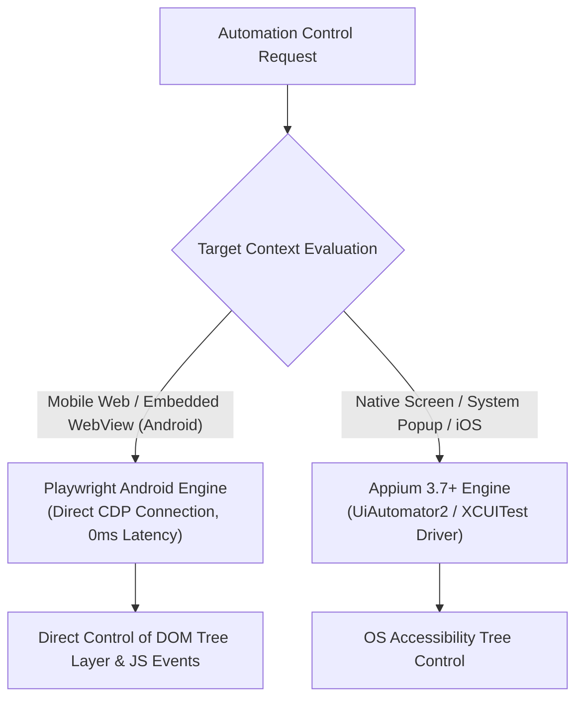

# Playwright Android and Appium 3.7+ Dual Automation Engine Specification

## 1. Background of Dual Engine Adoption

Mobile application environments are broadly divided into **pure native apps**, **mobile web**, and **hybrid apps (Flutter, React Native, WebView)** that combine web and native components.

Relying on a single automation framework introduces the following limitations:
- **Appium alone**: In mobile web or complex WebView environments, DOM event tracking and script execution suffer from high latency, degrading real-time recording interactions.
- **Playwright alone**: Cannot control elements outside the browser context, such as mobile system permission dialogs (camera/location allow popups), hardware back buttons, or push notification interactions.

To overcome these constraints, `SyncETA` adopts a **dual automation engine architecture** that combines **Playwright Android** and **Appium 3.7+ (UiAutomator2 / XCUITest)** within a single unified session.



---

## 2. Engine Roles and Routing Strategy

| Control Domain | Primary Engine | Communication Protocol | Primary Control Targets |
| :--- | :--- | :--- | :--- |
| **Mobile Web & WebView (Android)** | Playwright Android | Chrome DevTools Protocol (CDP) | DOM element manipulation, cookie/session control, network mocking |
| **Mobile Web (iOS Safari)** | Playwright WebKit / Appium | WebKit Remote Debug Protocol | Safari web page rendering verification |
| **Native Components** | Appium 3.7+ | W3C WebDriver Protocol | Native buttons, list views, navigation bars |
| **System Dialogs & Hardware** | Appium 3.7+ | ADB Shell / WDA Endpoint | Permission approval popups, volume/home/back keys, biometric authentication |

---

## 3. Cross-Platform Common Abstraction Layer (`IMobileAutomationService`)

The frontend recorder and backend batch runner issue commands through a unified common interface without needing to know the target platform (Android/iOS) or the internal implementation of the underlying sub-engine.

```typescript
export interface IMobileAutomationService {
  /** Initialize device session and launch target app */
  initSession(config: IMobileSessionConfig): Promise<void>;

  /** Perform single tap action at normalized coordinates */
  tapAtCoordinate(normalizedX: number, normalizedY: number): Promise<void>;

  /** Perform time-series swipe gesture */
  swipe(
    startX: number, startY: number,
    endX: number, endY: number,
    durationMs: number
  ): Promise<void>;

  /** Input virtual keyboard or hardware key */
  pressKey(keyCode: string): Promise<void>;

  /** Return device screen capture buffer */
  takeScreenshot(): Promise<Buffer>;

  /** Switch context between native and WebView */
  switchContext(contextId: 'NATIVE_APP' | string): Promise<void>;

  /** Extract UI tree hierarchy (XML/JSON) of current screen */
  getPageSource(): Promise<string>;

  /** Gracefully terminate session and release resources */
  close(): Promise<void>;
}
```

---

## 4. How Hybrid App Context Switching Works

When a user navigates into a WebView component while exploring a hybrid app, the engine automatically polls the list of available contexts:

1. **Context Detection**:
   - Invokes `driver.getContexts()` to receive the context list such as `['NATIVE_APP', 'WEBVIEW_com.example.app']`.
2. **Atomic Switching**:
   - When clicking an element inside a WebView, the context switches to `WEBVIEW_*` to activate CDP binding and perform high-speed DOM parsing.
3. **Returning to Native**:
   - As soon as a payment module or system camera popup appears, the context switches back to `NATIVE_APP` to click the native button.
- Because this entire sequence is automatically recorded with a `contextChange` flag inside the scenario record, contexts switch reliably without errors during replay.
