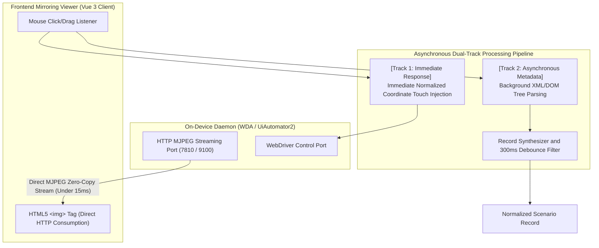

# Ultra-Low-Latency Live Screen Mirroring and Asynchronous Dual-Track Capture

## 1. Overview and Resolving Latency Bottlenecks

In a recording environment where a user views a mobile device connected via USB or remote network on a PC screen and operates it with a mouse, **screen transmission latency** and **touch responsiveness** are critical to the user experience.

Traditional naive frame-capture approaches (repeated ADB `screencap` calls and Electron IPC buffer copying) suffered from the following bottlenecks:
1. **High Screen Transmission Latency**: Delays of 100–200ms or more accumulated per frame, causing severe visual lag during fast scrolling or typing.
2. **UI Freezing from Synchronous XML Dumps**: Extracting the device's accessibility XML tree synchronously (`getPageSource`) on every screen touch caused input to freeze for hundreds of milliseconds.
3. **Duplicate Recording of Synthetic Events**: In mobile browser/WebView environments, a single tap generated `touchstart` and `touchend` events followed by a browser-synthesized `click` event, resulting in 2x or 3x duplicate event records.

`SyncETA` resolves these three bottlenecks through a **Direct MJPEG streaming pipeline** and an **asynchronous dual-track capture architecture**.

---

## 2. Direct MJPEG Ultra-Low-Latency Streaming Architecture

We completely replaced the legacy intermediate bridge approach that copied large image buffers from the Electron main process to the renderer process via IPC Transfer.

- **Direct Port-Forwarding Binding**:
  - For Android, UiAutomator2's built-in streaming port (default 7810) is forwarded to a local port.
  - For iOS, WebDriverAgent's MJPEG server port (default 9100) is forwarded to a local port.
- **Direct Client Consumption**:
  - The frontend viewer (`MobileLiveMirrorViewer.vue`) directly consumes the locally forwarded `http://127.0.0.1:7810` endpoint as the `src` of a standard `` tag.
  - Because no extra binary parsing or IPC memory copy overhead occurs, rendering performance is sustained at **60 frames per second (60 FPS) with measured latency under 15 milliseconds (ms)**.

---

## 3. Asynchronous Dual-Track Event Capture Mechanism

Touch input and heavy metadata extraction are separated into two independent asynchronous tracks to preserve input responsiveness.

### Track 1: High-Speed Injection Track (Fast Track)
- The moment the user clicks the mouse, relative coordinates against the screen viewport (0.0–1.0) are computed and transmitted to the device.
- Touch feedback appears on the device screen with zero perceptible delay, giving the user the same responsiveness as touching the physical device directly.

### Track 2: Asynchronous Metadata Extraction Track (Metadata Track)
- Immediately after the touch is injected, an asynchronous background worker collects the current screen's Accessibility Hierarchy and DOM node information.
- The collected attributes (`resourceId`, `className`, text value, visual anchor bounding box) are merged post-hoc with the coordinate data recorded on Track 1 and saved as a complete scenario card.

---

## 4. Synthetic Event Debounce and Deduplication Filter

In mobile WebView and browser environments, on a single tap action, the browser rendering engine dispatches `touchstart` and `touchend` events followed roughly 300ms later by an artificially synthesized `click` event for touch compatibility.

To prevent such duplicate recordings, `SyncETA` applies a **300ms sliding-window debounce filter**:
- Any subsequent click event occurring within 300ms and within the same coordinate radius (±5px) of the preceding touch event is automatically pruned from the recording list.
- This prevents the same button from being clicked twice in rapid succession during scenario replay, avoiding unintended duplicate payments or premature screen closures.
