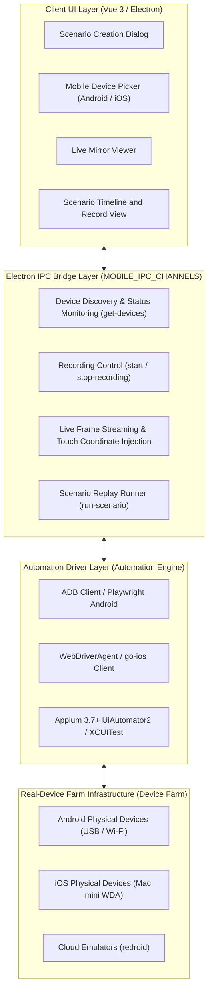

# Mobile (Android & iOS) Scenario E2E System Architecture

## 1. Overview and Background

Conventional web browser viewport resizing or simple User-Agent emulation falls short of thoroughly verifying touch gestures, mobile rendering engine behaviors, system permission dialogs (location, camera, notifications), and hardware key inputs on real mobile devices (Android and iOS).

`SyncETA`'s mobile testing architecture provides a pipeline built on physical mobile devices connected via USB or remote network (Wi-Fi ADB / WDA), enabling users to **record mobile user actions** through an interaction model unified with desktop scenario creation and **replay them unattended on real devices to execute regression tests**.



---

## 2. Three-Layer System Components

The overall mobile automation system operates across three role-separated layers:

### 1) Frontend UI Layer (Client Presentation)
- **Device Picker**: Automatically discovers mobile devices connected locally or over the network and lists model names, OS versions, resolutions (DPI), battery status, and real-time connection states.
- **Live Mirroring Studio**: Streams the device screen without delay and relays user mouse clicks and drags into real-time touch events on the mobile device.
- **Scenario Timeline**: Visualizes captured touch, swipe, and key input actions as step-by-step cards and provides an interface to add verification assertions.

### 2) Electron IPC Bridge Layer (System Bridge)
- Handles asynchronous communication between the renderer process and the main process, routing streaming binary data and device control signals across dedicated channels (`MOBILE_IPC_CHANNELS`):
  - `mobile:get-devices`: Refreshes the list of live connected devices
  - `mobile:inject-touch`: Immediately injects user click coordinates into the real device
  - `mobile:stream-frame`: Receives device screen buffer frames

### 3) Automation Engine Layer (Execution Engine)
- Exposes a common interface (`IMobileAutomationService`) that dynamically selects the optimal driver based on the target device OS and application type (WebView vs. native app).

---

## 3. Normalized Mobile Scenario Data Model

All user actions collected from mobile devices are stored with normalized attributes so they remain independent of device resolution:

```typescript
export interface IMobileRecord {
  /** Unique record identifier */
  id: string;
  /** Action type (TAP, SWIPE, LONG_PRESS, INPUT_TEXT, KEY_EVENT) */
  actionType: MobileActionType;
  /** Dimensionless normalized relative coordinates (0.0 ~ 1.0) */
  normalizedCoords: {
    x: number;
    y: number;
  };
  /** End coordinates for swipe actions (when applicable) */
  normalizedEndCoords?: {
    x: number;
    y: number;
  };
  /** Gesture duration (milliseconds) */
  durationMs: number;
  /** Text content entered (for text input actions) */
  inputValue?: string;
  /** Physical key code (BACK, HOME, VOLUME_UP, etc.) */
  keyCode?: string;
  /** Visual anchor and accessibility node metadata at event time */
  nodeMetadata?: {
    accessibilityId?: string;
    resourceId?: string;
    className?: string;
    bounds?: [number, number, number, number];
  };
}
```

---

## 4. Alignment with Foundational Patent Technology

This mobile scenario architecture extends the design philosophy of the foundational web recording patent officially registered with the Korean Intellectual Property Office (**Patent No. 10-2025-0125736**) into the mobile domain, and is implemented as the core hardware-integrated embodiment of **Patent No. 21 (Mobile Gesture Recording and AI Natural-Language Test Case Automation)**, currently in preparation for additional filing.
