# Project and Permission (RBAC) Management

In SyncETA, a **'Project'** is the top-level operational unit that independently isolates scenarios, datasets, execution histories, and dashboard reports. You can invite team members at the project level and assign granular permissions by role.

---

## 1. Creating a Project

A new project can be created through any of the following three paths.

### Path 1: Initial State with No Assigned Projects
Upon first login, click the **'New Project'** button in the center of the screen.

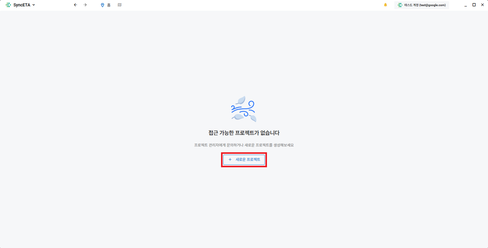

### Path 2: Creating from the Project List Screen
Click the **'New Project'** button at the top left of the project list.

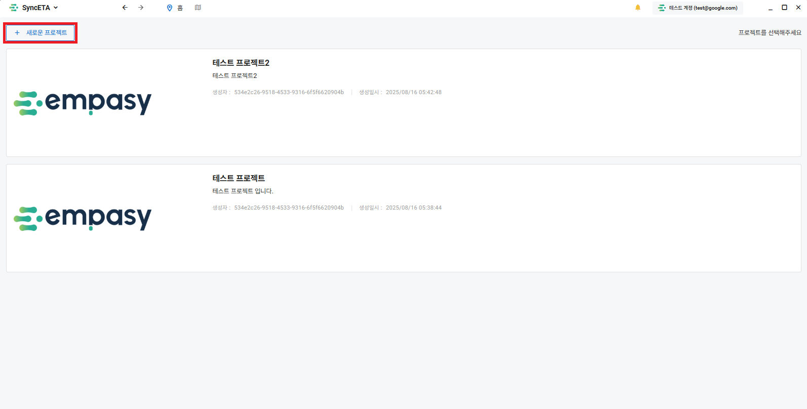

### Path 3: Creating from the Work Dashboard Toolbar
Click the **'New Project'** button in the project selection dropdown at the top of the left sidebar.

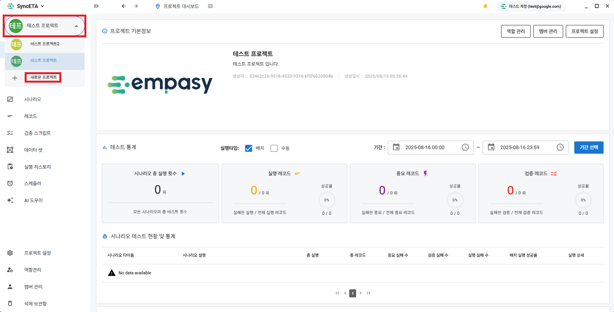

### Entering Project Details
Enter the project name, thumbnail image, project description, and target base URL, then complete creation.

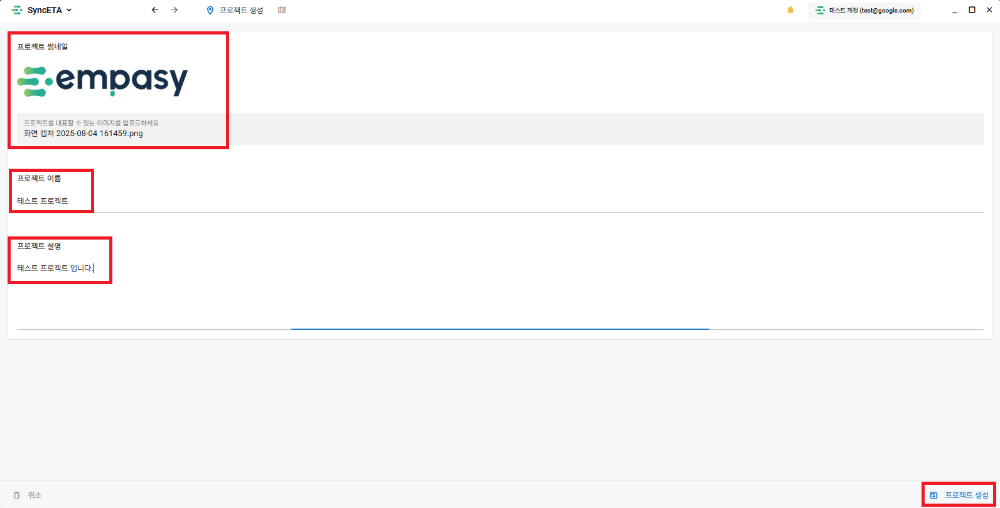

---

## 2. Project List and Switching

Click the **'Close Project'** or switch icon in the top right to view the list of projects you belong to and navigate to the desired project.

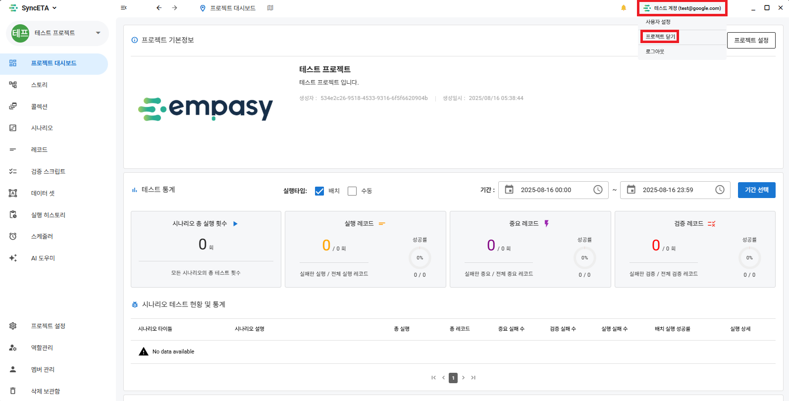
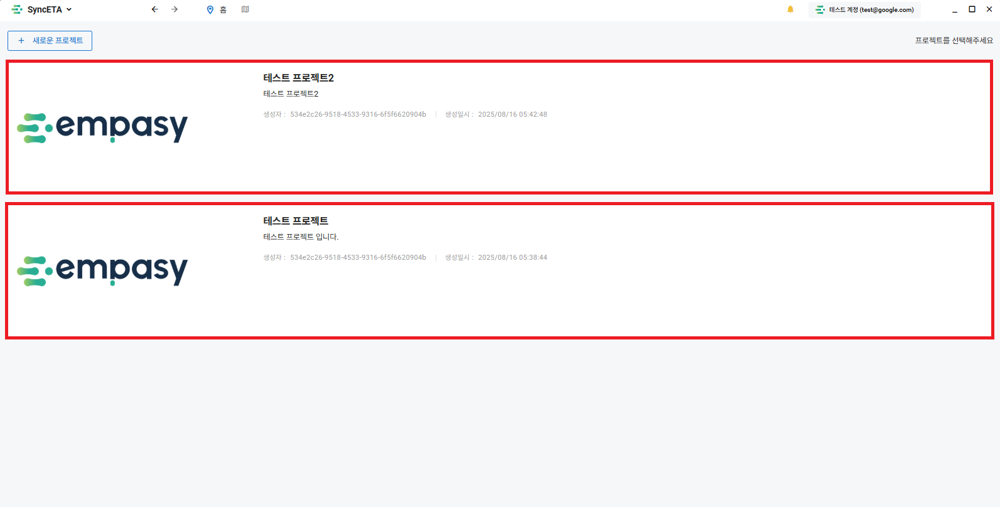

---

## 3. Role-Based Access Control (RBAC)

For project security and operational stability, you can control action permissions by role.

### Step 1: Creating a Role
Navigate to Project Settings -> **'Role Management'** and add a new role.

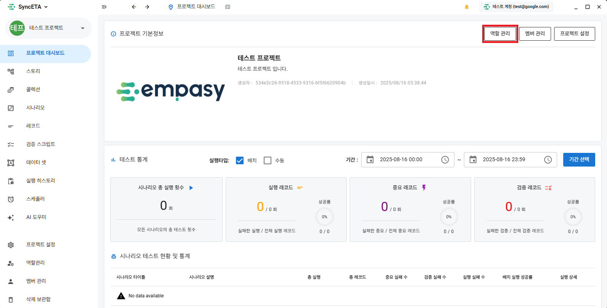

### Step 2: Mapping Permissions
Select and save the permissions that the role is allowed to perform (scenario creation/editing, execution permission, dataset editing, CI/CD API key issuance, etc.).

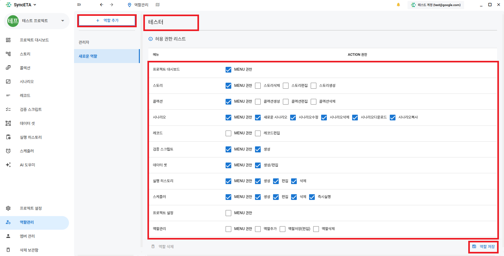

---

## 4. Inviting Members and Assigning Roles

1. **Open Member Invitation Screen**: Navigate to Project Settings -> **'Member Management'** and click the **'Invite Member'** button.
   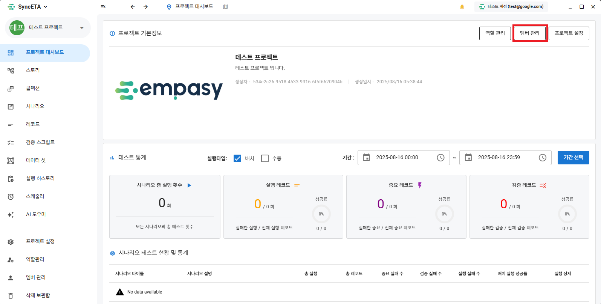
2. **Select Invitees**: Search for and select registered users by email address.
   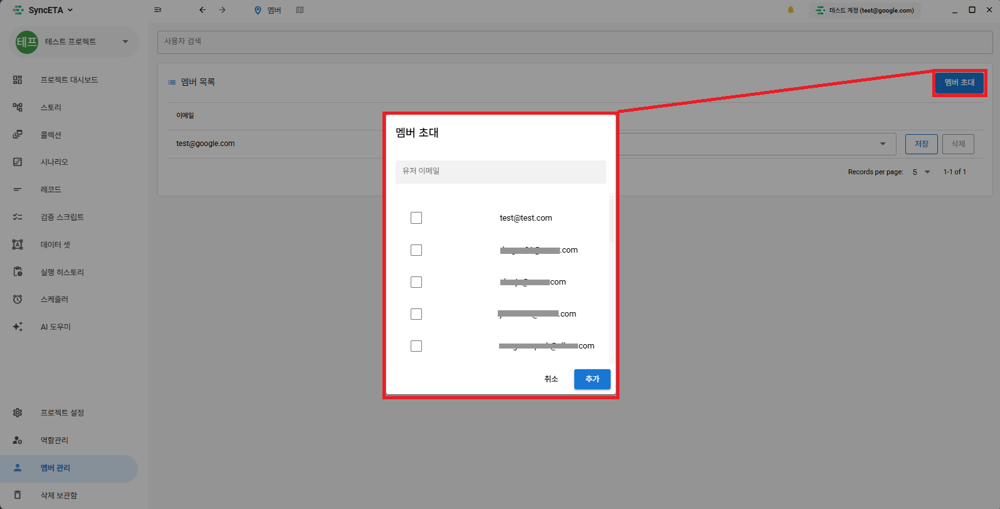
3. **Assign Role**: Assign a project-level role to the invited user. (The same user can be assigned different roles across different projects.)
   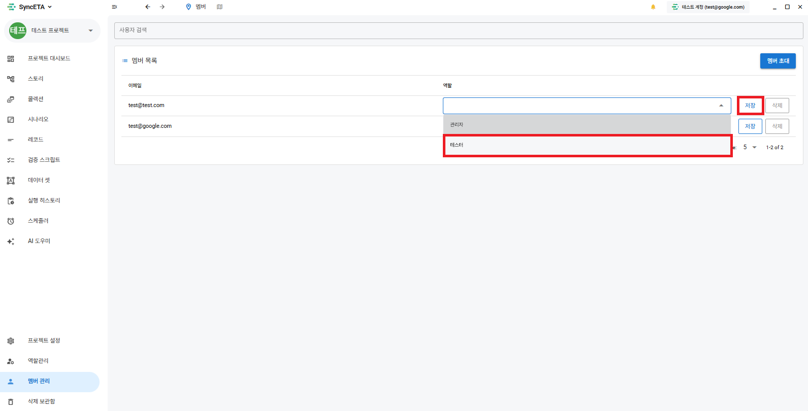
