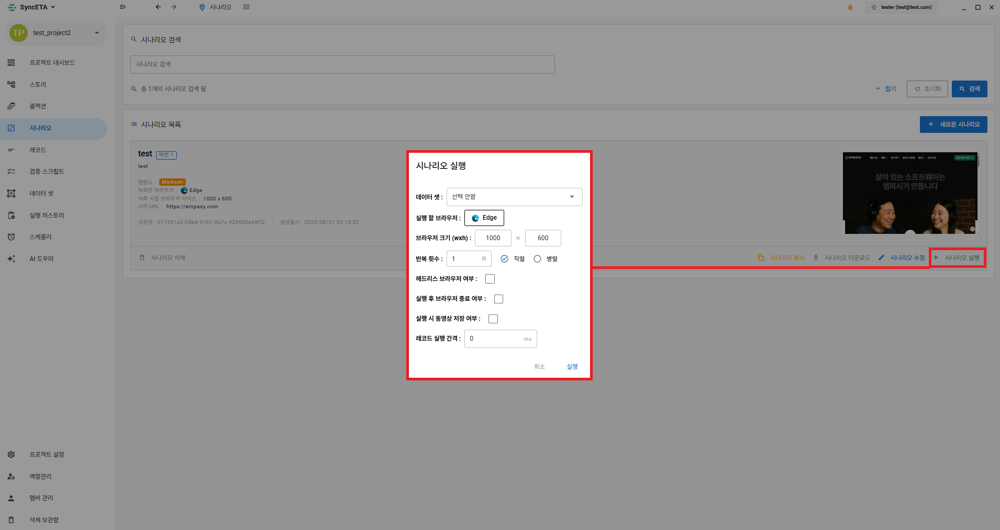
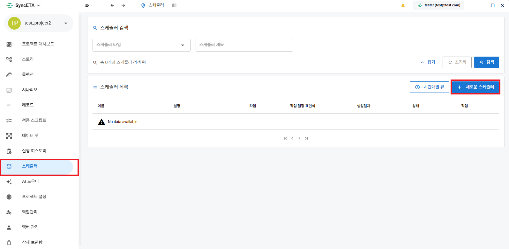
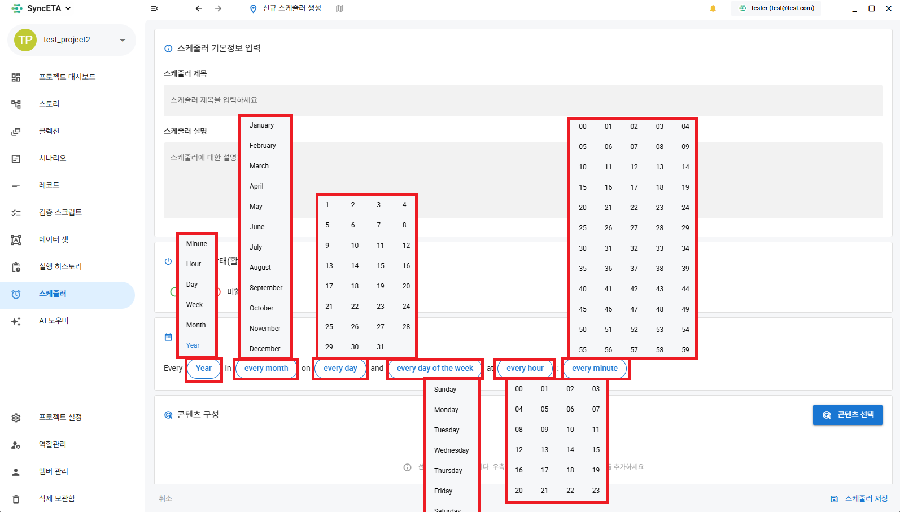
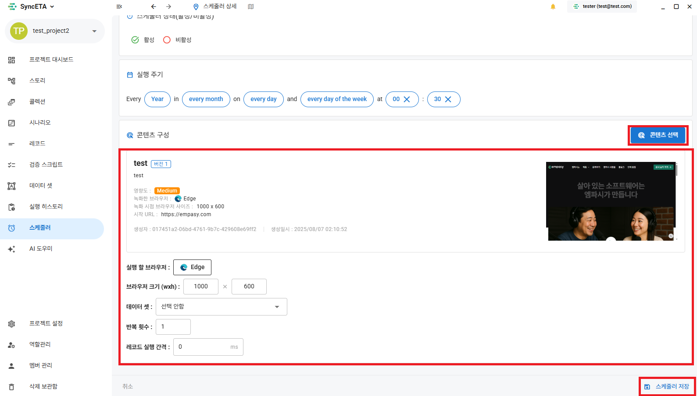
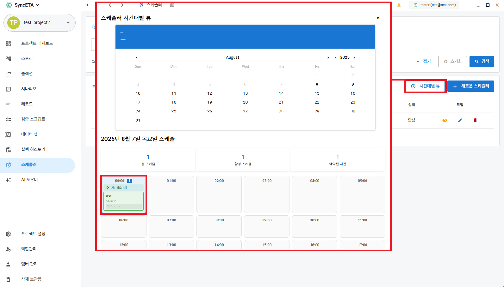

# Scenario Execution and Scheduler Configuration

SyncETA supports everything from immediate single-scenario execution to large-scale cross-browser verification and a scheduler for time-based automated regression testing.

---

## 1. Direct Execution

Click the **Run** button in the upper-right corner of the scenario detail screen to execute the test immediately.

### Key Execution Option Specifications

| Setting | Description | Default |
| :--- | :--- | :--- |
| **Data Set** | Select a dataset to apply during test execution (variable substitution) | None |
| **Target Browser** | Choose from Chromium, Chrome, Microsoft Edge, Firefox, or WebKit | Chrome |
| **Viewport Size** | Specify browser width and height resolution (for responsive testing) | 1920x1080 |
| **Execution Mode** | **Serial**: Run sequentially N times **Parallel**: Launch N browser instances simultaneously for parallel execution | Serial 1x |
| **Headless Mode** | Run at high speed as a background process without opening a browser GUI window | Disabled |
| **Close Browser After Run** | Whether to automatically clean up the browser context after the test finishes | Enabled |
| **Save Video** | Capture and save the entire test execution as an MP4 video file | Enabled |
| **Step Delay** | Default wait time (ms) inserted between each record execution | 0ms |

---

## 2. Periodic Automated Execution via Scheduler

You can configure a Cron-based scheduler for regular regression verification (such as nightly build tests or post-deployment smoke tests).

### Step 1: Navigate to the Scheduler Menu
Go to the **Scheduler** menu in the left sidebar.

### Step 2: Specify Execution Interval and Time Window
Configure the execution schedule to run at a specific time daily, on specific days of the week, or at a defined minute-based interval.

### Step 3: Map Target Scenarios and Execution Parameters
Specify the list of scenarios to execute under the schedule along with the browser type and viewport environment.

### Step 4: Review Registered Schedules and Execution History
Monitor the next scheduled run time and recent pass/fail status in the registered scheduler list.

