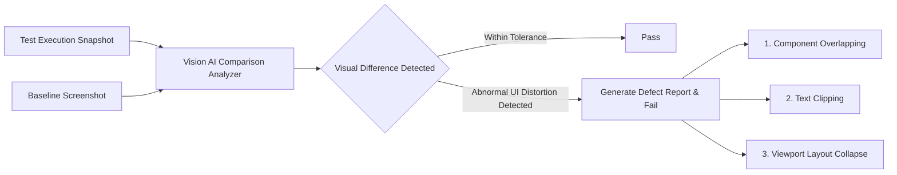
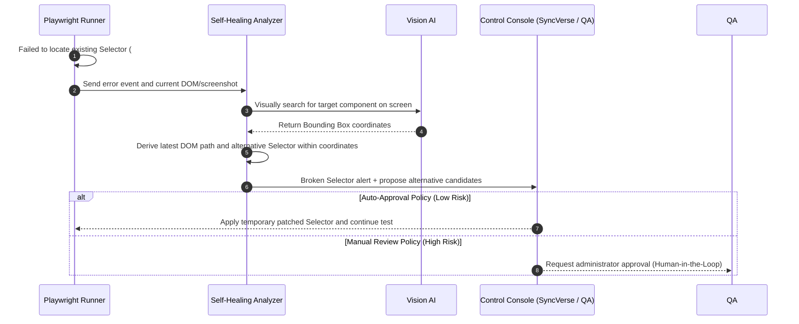

# Visual Regression Verification and Selector Self-Healing

In continuous deployment environments for web applications, subtle changes in DOM structure or CSS layout shifts frequently break existing test scripts (Flaky Tests) or introduce UI defects visible only to human users.

SyncETA systematically resolves these issues through its **Vision AI-based visual verification** and **Selector Self-Healing** pipeline.

---

## 1. Vision AI-Based Visual Regression Verification

Traditional pixel-by-pixel diff approaches suffer from false failures triggered by browser font anti-aliasing or 1-pixel rendering discrepancies. SyncETA integrates perceptual vision models to evaluate anomalies at the level actually perceived by end users.

### Key Visual Verification Checks
1. **Component Overlapping**: Detects cases where banners or popup layers obscure critical buttons such as Checkout or Add to Cart.
2. **Text Clipping**: Detects defects where button or label text overflows or gets clipped outside its container during responsive layout transitions.
3. **Ignored Regions**: Excludes dynamic areas that change on every run—such as current timestamps or live banner ads—from verification.

---

## 2. Selector Self-Healing Pipeline

When an existing identifier (XPath/CSS Selector) breaks due to frontend framework updates or class name obfuscation (Webpack/Vite hashes), SyncETA automatically searches for an alternative selector and proposes recovery.

---

## 3. Human-in-the-Loop Governance

To prevent false positives that could arise if AI arbitrarily modified test code, SyncETA enforces **administrator approval governance**.

- **Healing Queue**: Lists changed UI elements and proposed alternative XPath/Selectors in the administrator console.
- **Before/After Comparison View**: Displays side-by-side screenshots of the UI targeted by the previous selector and the newly proposed UI so reviewers can approve or reject with a single click.
- **Approval Audit Log**: Permanently records the reason for each selector change and the approver's identity in the system to preserve the integrity of test assets.
