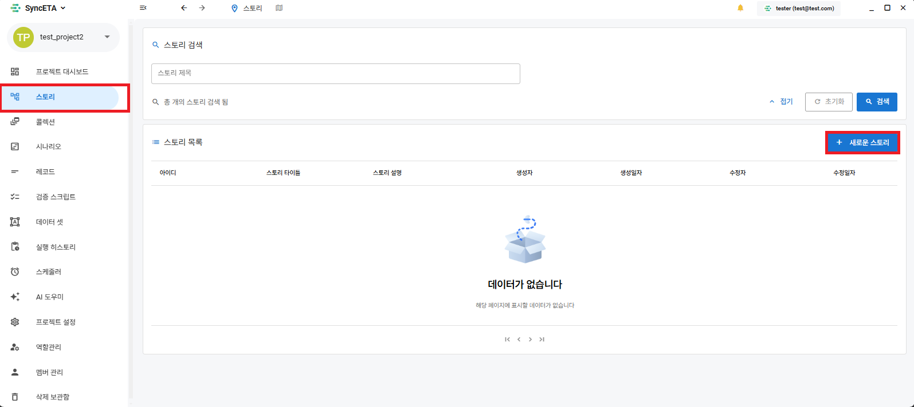
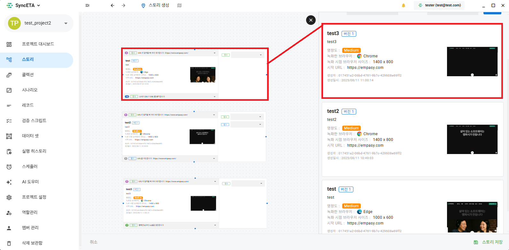
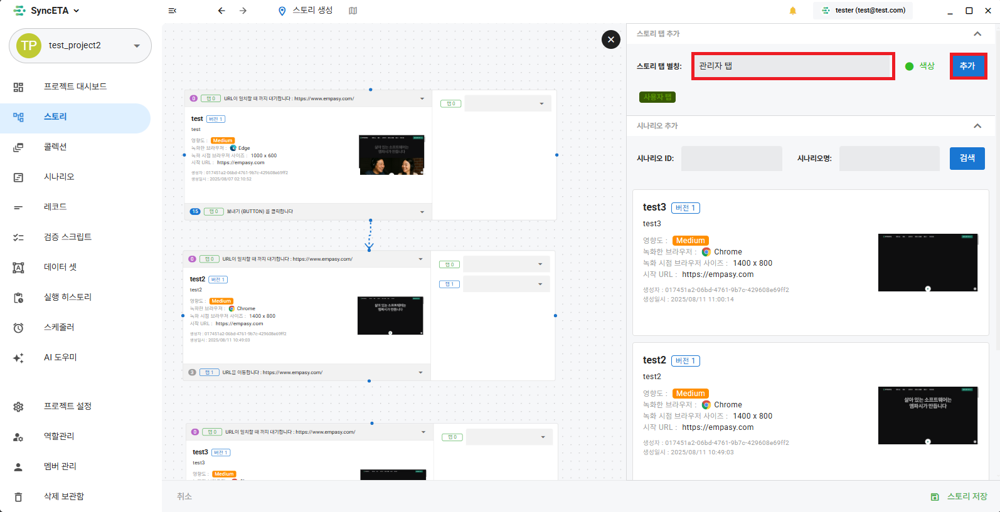
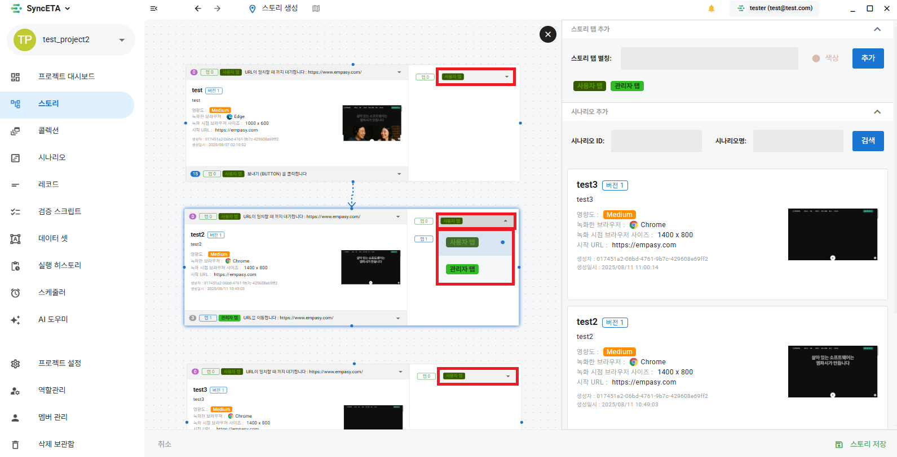
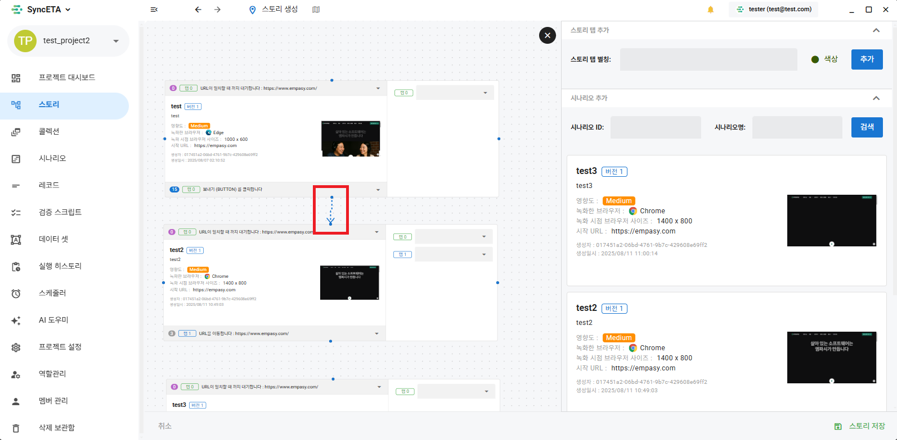
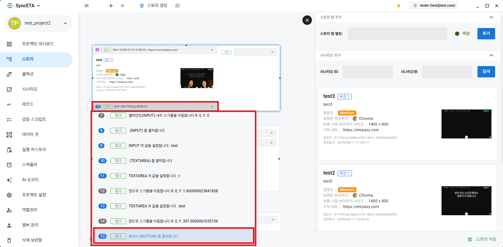

# Story Workflow (Flowchart Integration)

A **Story** is a higher-level workflow orchestration tool that combines individual scenarios into a visual flowchart and executes them continuously within a single browser session or a multi-tab environment.

---

## 1. Key Features of a Story

- **Single Browser Context Persistence**: Chains multiple scenarios step by step while preserving session cookies and login authentication state.
- **Multi-Tab Alias Control**: Assigns aliases to individual tabs in complex business flows that open multiple tabs or popup windows, shifting focus accurately to continue testing.
- **Step Range Selection (Start/End Record)**: Selectively connects only the required step range from an entire scenario.

---

## 2. Story Creation and Flowchart Composition Procedure

### Step 1: Open the Story Menu
Click the **Story** menu in the left sidebar and open a new Story canvas.

### Step 2: Place Scenarios onto the Canvas
From the right-hand scenario drawer, drag and drop the scenario blocks you want to include in the Story onto the center canvas.

### Step 3: Define and Apply Tab Aliases
When switching between tabs within the same browser is required, create unique tab aliases and map them to each scenario node.

### Step 4: Connect Scenario Nodes
Drag from the output port of a scenario block to the input port of the next scenario block to bind the execution order.

### Step 5: Specify Start and End Record Ranges
Click each scenario block to fine-tune the start record and end record range to include in actual execution.

