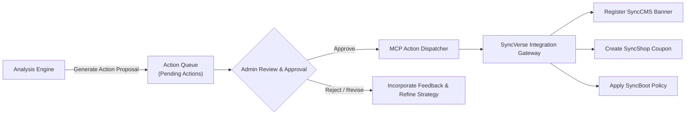
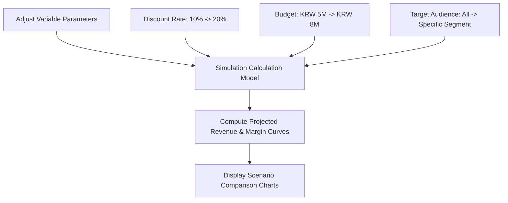
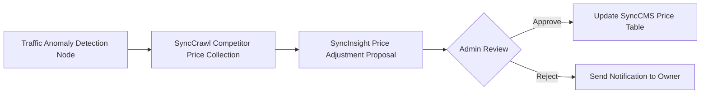

# Autonomous Action Approval & What-If Simulator

To turn data analysis findings into operational execution, SyncInsight provides an end-to-end workflow that **derives executable action plans**, validates them through **pre-execution simulation (What-If)**, and **applies them to target systems after administrator approval (HITL Execution)**.

---

## 1. Human-in-the-Loop (HITL) Action Approval Center (SI-009)

To safeguard operational stability, SyncInsight enforces a **Human-in-the-Loop (HITL)** approval workflow whenever critical system changes are proposed.

### 1.1. Key Review Items on an Action Approval Card
* **Before vs. After Comparison**: Displays current configuration values side by side with the proposed changes.
* **Risk Level**:
  - `LOW`: Read-only queries and minor UI copy updates
  - `MEDIUM`: Targeted banner publishing and coupon creation
  - `HIGH`: Enterprise-wide pricing policy updates and DB schema modifications (requires multi-party approval)
* **Expected Lift**: Presents quantitative impact estimates, such as projected order conversion rate shifts or estimated cost savings.
* **Rollback Support**: Indicates whether a compensating action is defined to restore the previous state if an anomaly occurs after execution.

---

## 2. What-If Simulator (SI-010)

Before committing changes to production systems, operators can adjust key parameters to simulate projected metric trajectories in advance.

* **Parameter Sliders**: Adjust discount rates, target audience size, promotional budgets, and other variables to recalculate projected trend graphs in real time.
* **Scenario Comparison**: Compare baseline, optimistic, and conservative scenarios side by side on a single screen.

---

## 3. Workflow Builder (SI-011)

Operators can compose and automate multi-step business pipelines by connecting modular nodes.

* **Data Flow Monitoring**: Visually inspect data propagation status between connected nodes.
* **Step-by-Step Testing**: Independently test and debug the input and output payloads of each node.

---

## 4. Emergency Stop & Safety Guardrails

SyncInsight provides safety controls to halt action execution and recover state whenever system anomalies occur.

1. **Global Kill Switch**: Activating the emergency stop immediately pauses all pending outbound integration actions.
2. **History-Based Recovery (Revert Action)**: Roll back to a previous configuration directly from the action execution history screen.
3. **Load-Based Throttling**: Automatically holds incoming action requests in the queue when server resource utilization exceeds configured thresholds.
