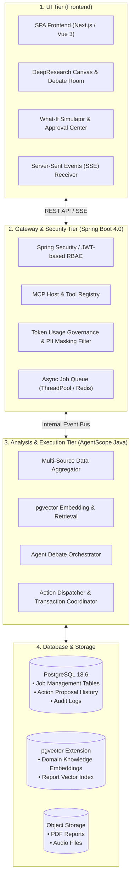
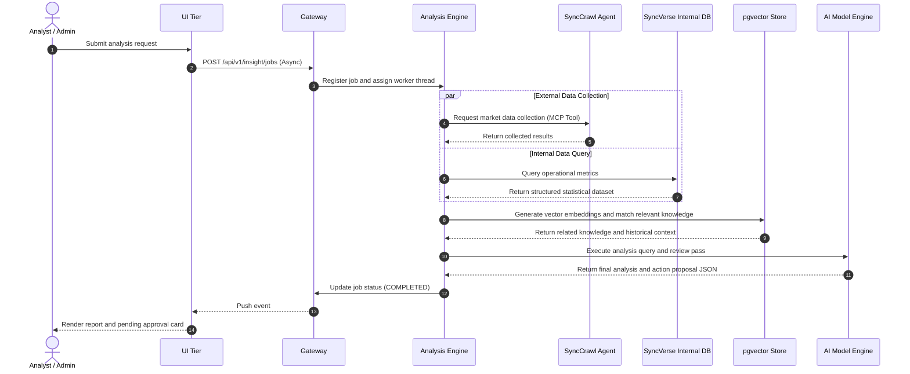

# System Architecture & MCP Integration (Architecture & Protocols)

SyncInsight adopts a 3-layer distributed architecture to perform multi-source data processing, LLM-based analytical reasoning, and administrator-approved action dispatching.

---

## 1. 3-Layer System Structure



### 1.1. UI Tier (Frontend)
- **Reactive Streaming**: Renders LLM reasoning steps and inter-agent debate streams in real time via Server-Sent Events (SSE).
- **Block-Based Document Editing**: Provides an interactive editor where generated analytical reports can be inspected and modified block by block.
- **Parameter Simulation**: Enables users to adjust variables with sliders and immediately observe projected metric changes on screen.

### 1.2. Gateway & Security Tier (Spring Boot 4.0)
- **Standard API Routing**: Handles REST API routing, tenant isolation, and fine-grained Role-Based Access Control (RBAC) enforcement.
- **Privacy Protection Filter**: Detects and masks Personally Identifiable Information (PII), such as national registration numbers and contact details, before queries reach internal or external analysis engines.
- **FinOps Controller**: Tracks token consumption by user and department and supports policy-driven fallback to lightweight models.

### 1.3. Analysis & Execution Tier (Core Backend)
- **Multi-Source Data Aggregation**: Connects internal operational logs (`SyncVerse`) with external market intelligence (`SyncCrawl`).
- **pgvector RAG Pipeline**: Embeds text and log records to perform semantic similarity search and knowledge-grounded retrieval.
- **Action Dispatcher**: Delivers administrator-approved actions to target systems using the Model Context Protocol (MCP) specification.

---

## 2. Data Processing & RAG Pipeline

SyncInsight's data pipeline progressively combines structured statistical datasets with unstructured text data.



---

## 3. Model Context Protocol (MCP) Integration Specification

SyncInsight supports the Model Context Protocol (MCP) to interoperate with peer agents and external tools.

### 3.1. Registered Core MCP Tools

| Tool Name (MCP Tool) | Description | Example Parameters |
| :--- | :--- | :--- |
| `insight_run_deep_research` | Starts an asynchronous Deep Research job from a natural language prompt | `{"prompt": "Analyze H2 market trends", "depth": "COMPREHENSIVE"}` |
| `insight_get_system_kpi` | Retrieves core system metrics and operational status | `{"target_metric": "REVENUE", "time_range": "LAST_7_DAYS"}` |
| `insight_simulate_what_if` | Simulates expected impact from variable adjustments | `{"base_entity": "PROMOTION", "variables": {"discount_rate": 0.15}}` |
| `insight_dispatch_approved_action`| Dispatches an approved action to the target agent | `{"action_id": "b1eebc99-...", "approval_token": "AUTH_XYZ"}` |

### 3.2. Action Proposal Payload Structure (JSON Schema)

```json
{
  "action_id": "b1eebc99-9c0b-4ef8-bb6d-6bb9bd380b22",
  "job_id": "a0eebc99-9c0b-4ef8-bb6d-6bb9bd380a11",
  "title": "Publish Summer Promotion Banner and Register Coupon",
  "target_agent": "SyncCMS",
  "risk_level": "LOW",
  "expected_lift": "+18.5% projected order increase",
  "payload": {
    "command": "PUBLISH_CAMPAIGN",
    "params": {
      "banner_title": "Summer Special Promotion",
      "target_route": "/events/summer-2026",
      "discount_coupon_code": "SUMMER_20",
      "discount_rate": 20,
      "auto_expire_dt": "2026-08-31T23:59:59Z"
    }
  },
  "rollback_strategy": {
    "can_rollback": true,
    "rollback_command": "UNPUBLISH_CAMPAIGN"
  }
}
```

---

## 4. Database Table Design

SyncInsight manages analysis jobs and action histories using PostgreSQL 18.6 and the pgvector extension.

```sql
-- 1. Analysis job management table
CREATE TABLE analysis_jobs (
    job_id UUID PRIMARY KEY DEFAULT gen_random_uuid(),
    requester_id VARCHAR(100) NOT NULL,
    prompt TEXT NOT NULL,
    status VARCHAR(20) NOT NULL DEFAULT 'PENDING',
    report_s3_url VARCHAR(500),
    created_at TIMESTAMP NOT NULL DEFAULT CURRENT_TIMESTAMP,
    completed_at TIMESTAMP,
    CONSTRAINT chk_analysis_jobs_status CHECK (status IN ('PENDING', 'PROCESSING', 'COMPLETED', 'FAILED'))
);

-- 2. Action proposal and approval history table
CREATE TABLE action_proposals (
    action_id UUID PRIMARY KEY DEFAULT gen_random_uuid(),
    job_id UUID NOT NULL,
    description TEXT NOT NULL,
    target_agent VARCHAR(50) NOT NULL,
    payload JSONB NOT NULL,
    status VARCHAR(20) NOT NULL DEFAULT 'PROPOSED',
    reviewed_by VARCHAR(100),
    updated_at TIMESTAMP NOT NULL DEFAULT CURRENT_TIMESTAMP,
    CONSTRAINT fk_action_proposals_job FOREIGN KEY (job_id) REFERENCES analysis_jobs(job_id) ON DELETE CASCADE,
    CONSTRAINT chk_action_proposals_status CHECK (status IN ('PROPOSED', 'APPROVED', 'REJECTED', 'EXECUTED'))
);

-- 3. Agent memory and knowledge table
CREATE TABLE SYNCINSIGHT_AGENT_MEMORY (
    memory_id VARCHAR(100) PRIMARY KEY,
    agent_name VARCHAR(100) NOT NULL,
    memory_type VARCHAR(50) NOT NULL,
    context_key VARCHAR(100) NOT NULL,
    context_value TEXT NOT NULL,
    confidence_score DECIMAL(5,2) DEFAULT 1.0,
    is_hallucination BOOLEAN DEFAULT false,
    reg_dt TIMESTAMP NOT NULL DEFAULT CURRENT_TIMESTAMP
);
```

---

## 5. Transaction Rollback & Compensating Actions

When an approved action is dispatched from SyncInsight to an external system, compensating transactions (Saga pattern) can be configured to handle execution failures.

1. **Pre-flight Validation**: Verifies the health and responsiveness of the target agent.
2. **Sequential Execution**: Executes each action step while recording intermediate outcomes.
3. **Compensating Transaction**: When an exception occurs during execution or an administrator requests recovery, executes predefined reverse operations to restore prior state.
