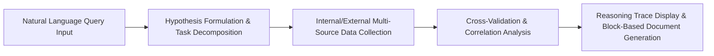
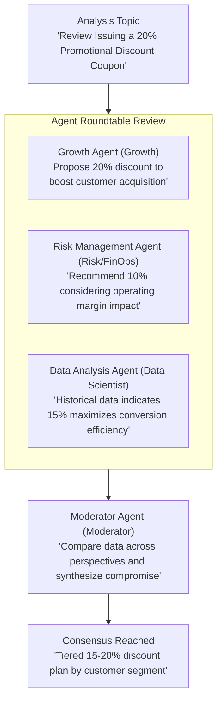

# Deep Research & Agent Roundtable Debate

Single-pass question-answering AI can easily produce biased conclusions.  
To support multi-angle analysis, **SyncInsight** provides the **Deep Research Engine** and **Agent Roundtable Debate** capabilities, generating analytical reports cross-validated from diverse perspectives.

---

## 1. DeepResearch Canvas (SI-005)

Generates structured, in-depth analytical reports from user-submitted topics (such as *"Analyze recent checkout drop-off drivers among customers in their 20s and competitor counter-strategies"*).

### 1.1. Key Capabilities
* **Chain-of-Thought Timeline**: Inspect the hypotheses formulated by the AI, executed SQL queries, and referenced web documents along a chronological timeline.
* **Block-Based Document Editing**: Reorder or edit paragraphs, tables, and charts in generated reports at the individual block level.
* **Citation & Grounding**: Footnotes directly link key quantitative figures and analytical conclusions back to their underlying source tables and reference URLs.

---

## 2. Agent Roundtable: Multi-Persona Debate (SI-006)

To mitigate single-model analytical bias, multiple agents configured with distinct evaluation criteria conduct structured review debates.

### 2.1. Three-Stage Roundtable Process
1. **Opening**: Each agent presents data-backed evidence aligned with its assigned role and criteria.
2. **Cross-Examination**: Agents scrutinize each other's data interpretation standards and underlying assumptions.
3. **Consensus**: The moderator agent synthesizes the data confidence and risk profile of each argument to incorporate a balanced recommendation into the final report.

> [!NOTE]
> **Real-Time Administrator Intervention**:  
> If an administrator injects a priority constraint mid-debate (for example, *"Preserving profitability is the top priority this quarter"*), the debate trajectory dynamically recalibrates to reflect that directive.

---

## 3. Collaborative Canvas & Approval Room (SI-019)

Provides a shared workspace where decision-makers and analysts can jointly review reports and complete sign-off workflows.

* **Concurrent Access & Annotation**: Multiple users can leave notes on specific report paragraphs and exchange feedback in parallel.
* **Multi-Signature Approval**: Supports configuring multi-party approval chains—such as marketing and finance leads—in accordance with corporate governance rules before actions are dispatched.

---

## 4. Audio Briefing (SI-013)

Delivers concise 2-to-3-minute spoken summary briefings so stakeholders can grasp key report takeaways quickly.

* **Conversational Summary Briefing**: Summarizes primary issues and debate outcomes in a Q&A dialogue format for audio playback.
* **Synchronized Text Script**: Highlights the corresponding section of the report as audio playback progresses.
* **Chapter Navigation**: Jump directly to specific segments such as background context, risk factors, or recommendations.
