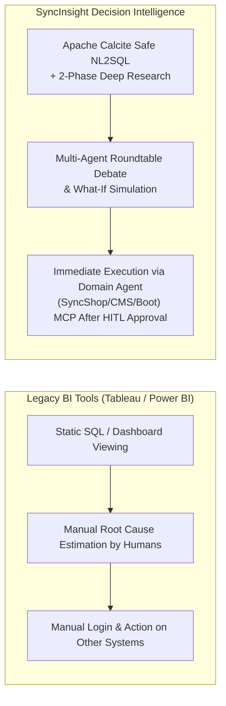

# SyncInsight Enterprise Adoption FAQ

Key questions and technical answers frequently asked by architects, data engineers, and security officers when adopting SyncInsight as an enterprise decision intelligence and data control platform.

---

## 1. Differentiation from Legacy BI Tools & Architecture



### Q1. We already use Tableau or Power BI. Why do we need SyncInsight?
- **Answer**: Legacy BI tools remain limited to descriptive analytics that visualize past data in charts, requiring humans to manually investigate root causes of metric drops, devise solutions, and apply changes to other systems.
- In contrast, SyncInsight is an end-to-end decision intelligence platform that combines **2-Phase Deep Research integrating internal DB metrics with external web market intelligence (`SyncCrawl`)**, **multi-agent roundtable debates across opposing perspectives (growth, risk, and customer experience)**, **pre-execution What-If profit-and-loss simulation**, and **automated deployment of execution strategies to domain systems (`SyncShop`, `SyncCMS`, `SyncBoot`, `SyncOps`) via the Model Context Protocol (MCP) immediately upon administrator approval (HITL), with guaranteed snapshot rollback**.

### Q2. Which databases and storage systems can be connected as analytical data sources?
- **Answer**: In addition to the enterprise standard **PostgreSQL 18.6 (`pgvector`)**, you can connect heterogeneous RDBMS and data warehouses operating in-house using read-only connectors.

| Data Source Category | Supported Engines & Protocols | Key Integration Method & Security Policy |
| :--- | :--- | :--- |
| **Enterprise Core RDBMS** | PostgreSQL 18.6 (`pgvector`, `pg_trgm`) | Read Replica JDBC connection, HNSW vector search, and automatic semantic dictionary sync |
| **Legacy Enterprise DBs** | Oracle, Tibero, MySQL, MariaDB, MS SQL Server | Read-only account (`SELECT`-Only), Apache Calcite relational algebra AST firewall applied |
| **External Market & Unstructured Knowledge** | `SyncCrawl` web collection pipeline, S3 / MinIO documents | Unified querying against the `sync-module-rag` Tri-Hybrid RAG knowledge base after Markdown chunking |
| **Real-Time Streams & Metrics** | Redis Stream, Prometheus, `SyncAPIM` traffic statistics | Real-time anomaly detection and automatic RCA triggering |

---

## 2. Data Governance & Safe NL2SQL Security Guardrails

### Q3. When AI translates natural language queries into SQL, is there a risk of arbitrarily modifying internal databases or causing overload failures?
- **Answer**: The **4-layer security firewall powered by Apache Calcite 1.37.0 and JSqlParser 4.9** in the `sync-module-nl2sql` module validates every AI-generated SQL statement before execution.
  1. **Strict Read-Only AST Validation**: Parses the query string into an Abstract Syntax Tree (AST) to permit only a single `SELECT` statement, blocking `INSERT`, `UPDATE`, `DELETE`, `DROP`, `ALTER`, `TRUNCATE`, `GRANT`, and multi-semicolon (`;`) chaining 100% at the parser level.
  2. **Automatic Tenant and RBAC Row/Column Isolation Injection**: Forces the requester's role (`sys_role`) and tenant (`tenant_id`) conditions into the AST `WHERE` clause, and immediately rejects execution if unauthorized sensitive columns (such as salary or national ID numbers) are referenced.
  3. **Query Cost and Timeout Guardrails**: Pre-emptively blocks Cartesian product joins and large unindexed full table scans, while automatically enforcing a maximum execution timeout (`10s`) and default result row limit (`LIMIT 1000`).

```json
{
  "requestQuestion": "Show me the top 5 products with the highest return rate by category and their main return reasons over the last 30 days",
  "validatedAst": {
    "statementType": "SELECT",
    "readOnlyVerified": true,
    "injectedTenantFilter": "tenant_id = 'empasy_prod'",
    "enforcedLimit": 1000,
    "timeoutMs": 10000
  },
  "generatedSql": "SELECT p.category_name, p.product_name, COUNT(r.return_id) AS return_cnt, ROUND(COUNT(r.return_id) * 100.0 / NULLIF(COUNT(o.order_id), 0), 2) AS return_rate FROM oms_order o JOIN pms_product p ON o.product_id = p.product_id LEFT JOIN oms_order_return r ON o.order_id = r.order_id WHERE o.tenant_id = 'empasy_prod' AND o.created_at >= CURRENT_TIMESTAMP - INTERVAL '30 days' GROUP BY p.category_name, p.product_name ORDER BY return_rate DESC LIMIT 5"
}
```

### Q4. If an executed business action produces unexpected results in the production system, how can it be reverted?
- **Answer**: Every domain-mutating action (`Action Proposal`) recommended by SyncInsight is never automatically executed without **prior Human-in-the-Loop (HITL) administrator approval**.
- Furthermore, the moment an action is approved and the target agent's (`SyncShop`, `SyncCMS`, `SyncBoot`) MCP tool is invoked, an **atomic data snapshot (`snapshotId`)** of the pre-change state and a compensating transaction (`rollback_command`) are automatically created. Administrators can click the **1-Click Rollback** button in the Action Approval Center to achieve lossless recovery to the prior production state in under 1 second.

---

## 3. On-Premises Air-Gapped Deployment & FinOps Cost Control

### Q5. Do Deep Research and NL2SQL still work in air-gapped environments (such as financial or public institutions) where external internet access is completely blocked?
- **Answer**: Yes, they operate systematically. SyncInsight deploys as containers on on-premises Kubernetes or bare-metal servers without external cloud SaaS dependencies, integrating with **on-premises LLMs (Llama-3.3-70B, Qwen-2.5-72B, etc. running on `vLLM` / `Ollama`)** deployed on internal GPU servers and the **`SyncLLM` gateway** to perform inference securely within the internal network.

### Q6. If employees across the enterprise heavily use natural language data exploration and Deep Research, won't LLM token costs spike?
- **Answer**: All LLM calls route through the `SyncLLM` FinOps gateway, which enforces the following three-tier cost optimization policy by default:
  1. **Semantic Caching**: Recurring metric queries or daily briefing requests with similarity \(\ge 0.95\) reuse cached SQL templates and analytical summary structures without re-invoking the LLM, reducing token costs by up to 45%.
  2. **Task-Complexity Model Tiering**: Simple NL2SQL translations and Smart Sheet cell assistance (`Cell Copilot`) are handled by lightweight Tier 1–2 models, routing only complex `Roundtable Debate` sessions to high-performance Tier 3–4 models.
  3. **Departmental Monthly Quota Guardrails**: Automatic downgrade to lightweight models and alert policies trigger based on monthly token budget consumption rates per department or project.

---

## 4. Recommended Infrastructure Specs & Standard API Endpoint Summary

| Category | Item | Standard Configuration & Specification |
| :--- | :--- | :--- |
| **Core Backend Server** | `sync-insight-server` | Java 25, Spring Boot 4.0, `AgentScope Java 2.0.2`, 4 vCPU / 8GB RAM or higher |
| **Database** | `PostgreSQL 18.6` | `pgvector/pgvector:pg18` (`vector`, `uuid-ossp`, `pg_trgm`), 6-File DB SSOT standard |
| **NL2SQL Safety Engine** | `sync-module-nl2sql` | Apache Calcite 1.37.0 + JSqlParser 4.9 (`SELECT`-Only AST firewall, default `LIMIT 1000`) |
| **Core REST APIs** | Canonical Prefix | `POST /api/v1/insight/nl2sql/query`<br>`POST /api/v1/insight/research/jobs`<br>`POST /api/v1/insight/debate/sessions`<br>`POST /api/v1/insight/actions/{actionId}/approve` |
| **MCP Server Endpoint** | A2A Tool Exposure | `POST /api/v1/insight/mcp` (`insight_run_deep_research`, `insight_simulate_what_if`, etc.) |

### 4.1 What-If Simulation MCP Tool Call Example

```json
{
  "jsonrpc": "2.0",
  "id": "insight-sim-108",
  "method": "tools/call",
  "params": {
    "name": "insight_simulate_what_if",
    "arguments": {
      "baseEntity": "CATEGORY_PROMOTION",
      "variables": {
        "discountRate": 0.12,
        "minMarginGuardrail": 0.15
      }
    }
  }
}
```
