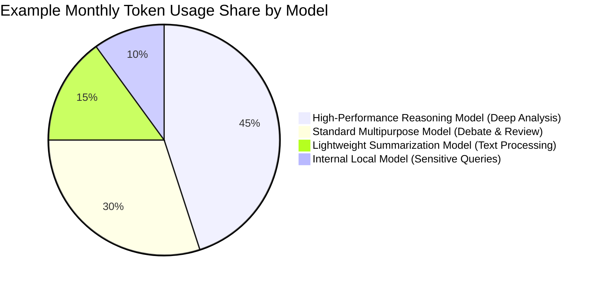
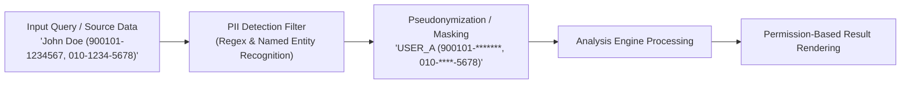
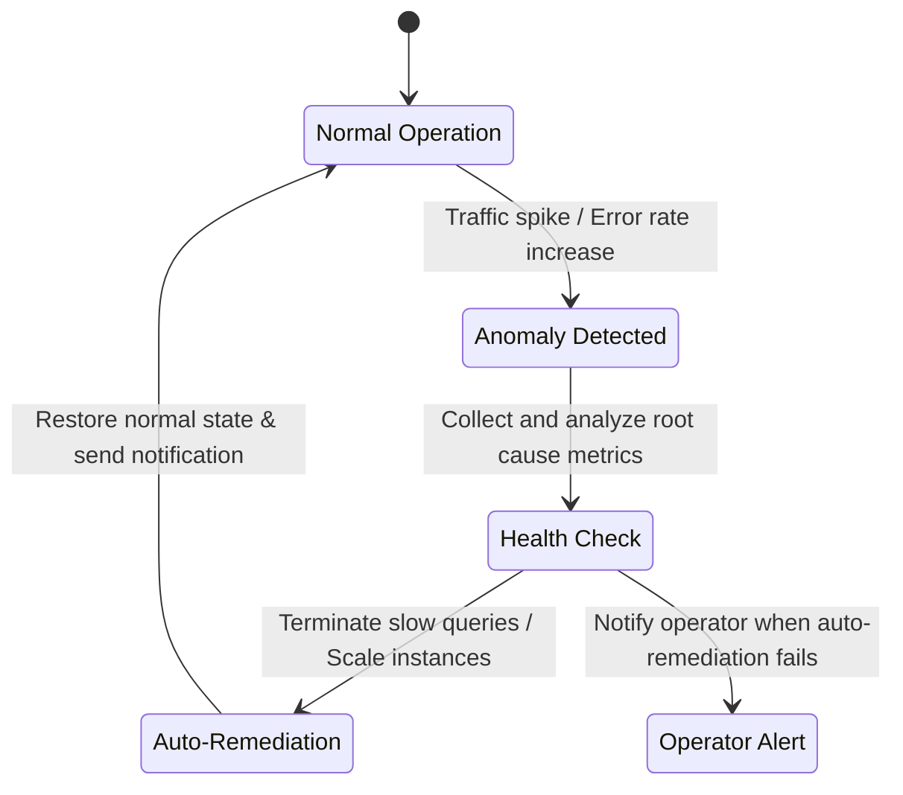

# AI FinOps, Governance & System Monitoring (Security & FinOps)

Key factors to consider when adopting generative AI models for internal enterprise workflows are **'managing LLM API token costs'** and **'protecting sensitive data (PII)'**.  
**SyncInsight** provides **FinOps**, **privacy guardrails**, and **Guardian system monitoring** to operate AI reliably and cost-effectively in enterprise environments.

---

## 1. AI FinOps & Token Usage Management (SI-004)

Aggregate model-by-model token usage across internal departments and agents and manage consumption within budget limits.

### 1.1. Key Cost Optimization Methods
1. **Model Routing**:
   - Route simple summarization or format conversion tasks to lightweight models, while allocating high-performance models to multi-agent debates and deep research to balance costs.
2. **Semantic Prompt Caching (Semantic Caching)**:
   - Reuse cached results for identical or similar query patterns to eliminate unnecessary duplicate calls.
3. **Departmental Token Quota Configuration**:
   - Set monthly usage limits per team or project, and automatically send alerts or switch to an approval workflow when thresholds are reached.

---

## 2. AI Governance & PII Masking (SI-017)

Perform pre-filtering so sensitive customer information and internal corporate data are never transmitted to external models.

* **Automatic PII Masking (Data Masking)**: Detects major personally identifiable information such as national ID numbers, phone numbers, email addresses, and bank account numbers, replacing them with non-identifiable tokens.
* **Compliance Auditing**: Manages data processing histories and audit logs in accordance with data privacy regulations.

---

## 3. Guardian Monitor & Automated Remediation (SI-003)

Detects anomalies across systems and data pipelines and executes pre-configured recovery scenarios.

* **Anomaly Pattern Detection**: Monitors fluctuations in key operational metrics—including processing latency and job failure rates—in addition to basic CPU/memory utilization.
* **Predefined Recovery Actions**: Executes prepared remediation scenarios such as terminating processes causing latency or failing over to fallback endpoints.

---

## 4. Inter-Agent Communication Logs & Replay (SI-018)

Records MCP request and response logs exchanged between agents within the system.

* **History Lookup & Replay (Log Replay)**: Sequentially inspect message flows (Request, Response, Payload) between agents at a specific point in time.
* **Response Latency Analysis**: Check processing time per segment to identify performance bottlenecks.
