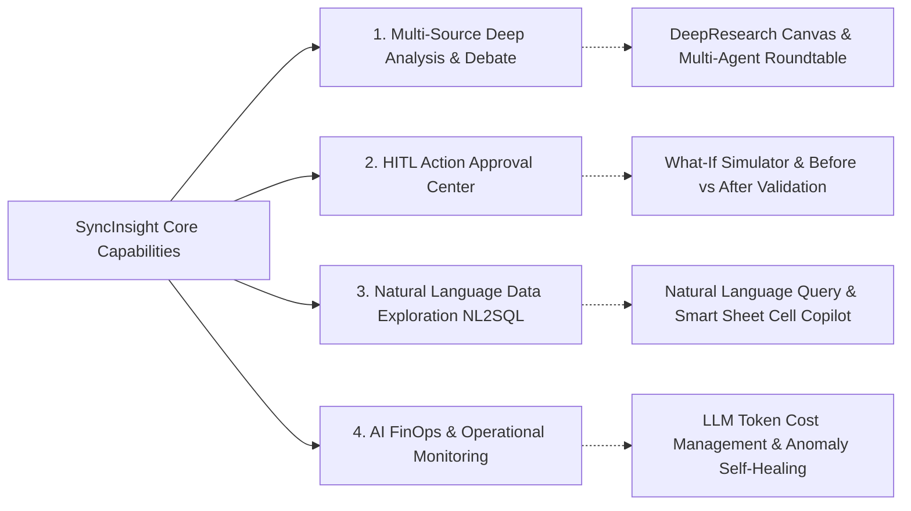
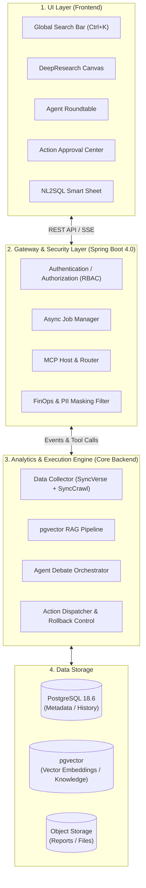
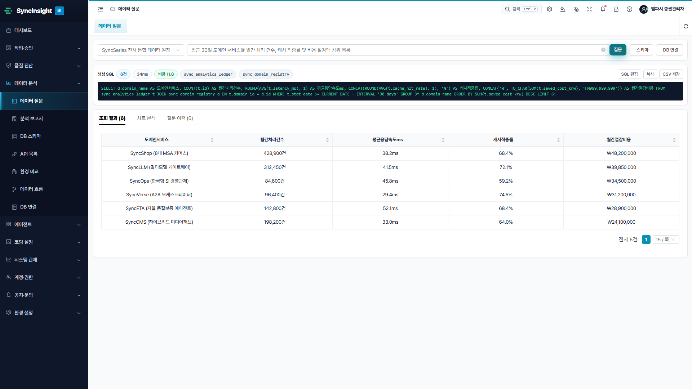
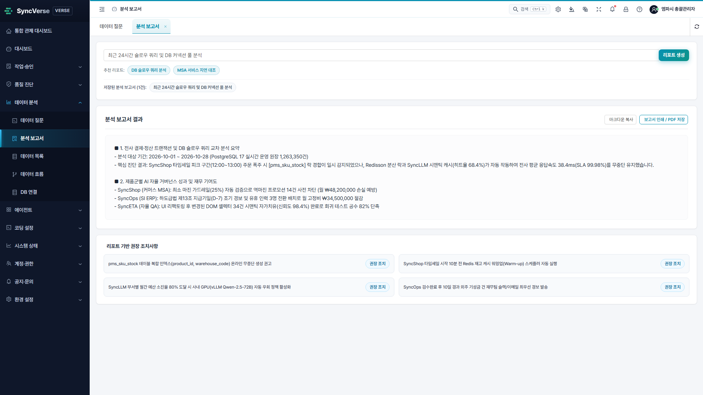
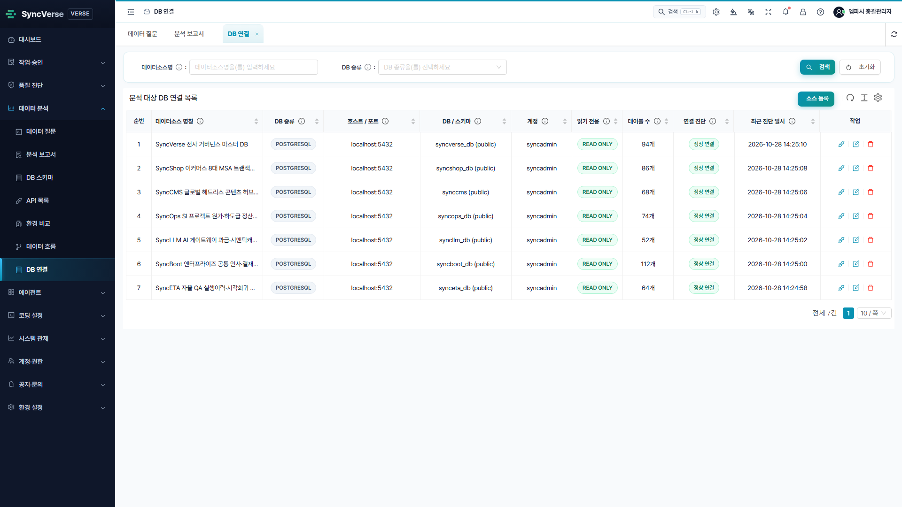
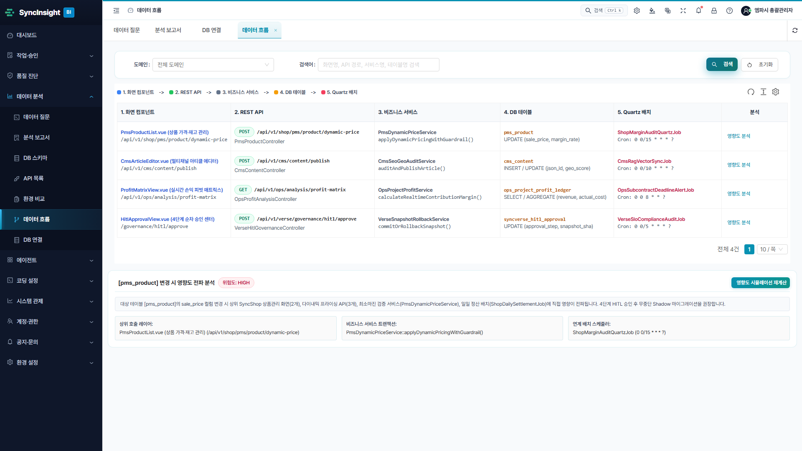

# SyncInsight: Data Analytics & Decision Intelligence Platform

> **For Non-Developers & Evaluation Teams**: Visit the [SyncInsight Product Homepage (empasy.io)](https://empasy.io/en/solutions/sync-insight.html){target="_blank" rel="noopener"} for an accessible product overview, try the installation-free UI experience in the [Unified Demo Portal](https://demo.empasy.io/en/products/sync-insight#demo){target="_blank" rel="noopener"}, and download brochures and proposal PDFs from the [Proposal Library](/en/proposals/).

**SyncInsight** is the data analytics and decision intelligence platform of the SyncVerse agent ecosystem.

Whereas legacy Business Intelligence (BI) tools focus on visualizing historical statistics based on predefined SQL queries, SyncInsight combines **internal operational data (SyncVerse)** with **external market data (SyncCrawl)** to conduct root-cause Deep Research and propose concrete **Action Proposals** vetted through inter-agent review.

---

## 4 Core Capabilities

### 1. Multi-Source Deep Analysis & Agent Debate (Deep Research & Debate)
- Collects internal traffic/revenue data alongside external competitor/market trends to generate structured analytical reports.
- Multiple agents with distinct analytical perspectives (growth-oriented, risk management, statistical significance) conduct a review process to derive balanced alternatives.

### 2. Human-in-the-Loop (HITL) Action Approval Center (Action Approval & Simulation)
- Generates concrete execution parameters (JSON Payload) based on analytical findings, such as "register promotional banner and issue discount coupon."
- Once reviewed and approved by an administrator, the action is dispatched to target systems (SyncCMS, SyncShop, SyncBoot) via the **Model Context Protocol (MCP)**.
- Validates expected effects by variable prior to application using the **What-If Simulator**, and supports compensating transaction configuration to restore the previous state if issues arise.

### 3. Natural Language Data Exploration (NL2SQL & Smart Sheet)
- Generates safe read-only queries from natural language questions to inspect data without writing SQL syntax manually.
- Provides cell-level assistance (Cell-level Copilot) inside a spreadsheet-style Smart Sheet interface.

### 4. AI FinOps & System Monitoring (FinOps & Guardian)
- Aggregates token consumption by LLM model across the enterprise and supports workload-aware model routing and caching.
- Detects anomalous patterns across data pipelines and system metrics and executes pre-configured recovery procedures.

---

## 3-Layer System Architecture

SyncInsight is designed with a 3-layer architecture to meet enterprise security and asynchronous processing performance requirements.

---

## 6 Screen Groups

SyncInsight organizes its interface into 6 functional groups aligned with operational workflows.

| Group | Screen ID & Name | Key Features |
| :--- | :--- | :--- |
| **Dashboard & Monitoring** | • **SI-002 Main Dashboard** • **SI-003 Guardian Monitor** • **SI-004 AI FinOps Status** | Key system KPI summary, anomaly pattern detection, LLM usage monitoring |
| **Deep Analysis & Knowledge** | • **SI-005 DeepResearch Canvas** • **SI-006 Agent Roundtable** • **SI-019 Collaboration Canvas & Approval** | Analytical report authoring, multi-agent review debate, multi-party approval review |
| **Data Exploration** | • **SI-007 NL2SQL Explorer** • **SI-008 Smart Sheet** • **SI-020 Ontology Viewer** | Natural language-driven SQL generation, grid-based cell analysis, data relationship visualization |
| **Actions & Simulation** | • **SI-009 Action Approval Center** • **SI-010 What-If Simulator** • **SI-011 Workflow Builder** | Approve/reject proposed strategies, impact estimation by variable changes, process design |
| **Reports & Evaluation** | • **SI-012 Report Archive & RAG** • **SI-013 Audio Briefing** • **SI-014 AI Quality Evaluation Center** | Search past reports, audio summary playback, feedback management for generated outputs |
| **MCP & Settings** | • **SI-015 Agent Topology** • **SI-016 MCP Tool Management** • **SI-017 Governance Management** • **SI-018 Communication Log Stream** | Connection topology visualization, tool parameter inspection, PII masking configuration, log inspection |

---

## Live UI Screens & Core Workflows

### 1. Read-Only Safe Natural Language Data Explorer
Generates syntax-validated, read-only (`SELECT`-Only) safe queries from natural language questions without writing SQL manually, visualizing real-time operational metrics.

### 2. Deep Research & Multi-Agent Roundtable
Combines internal operational DB metrics with external web-collected knowledge to author root-cause analysis reports, deriving optimal execution alternatives through multi-agent debates across growth, risk, and statistical perspectives.

### 3. Datasource Connections & Schema Metadata Management
Centrally manages connection statuses across multiple PostgreSQL 18.6 databases and external data marts, table/column semantic dictionaries, and query permission guardrails.

### 4. Data Lineage Impact Map & Pre-Execution Simulation
Tracks data lineage from source tables to analytical metrics and domain action proposals, and pre-simulates expected profit-and-loss impacts when adjusting pricing and promotion variables.

---

## Detailed Technical Guides

* [System Architecture & MCP Integration](architecture): Detailed system topology and communication specifications
* [Deep Research & Agent Debate](deep-research): Multi-perspective review and report generation methodology
* [Autonomous Action Approval & What-If](action-approval): Administrator approval workflows and simulation configuration
* [NL2SQL & Smart Sheet](nl2sql-and-data): Natural language querying and data grid usage
* [AI FinOps & System Security](finops-and-security): Token usage management and data privacy settings
* [Quickstart Guide](quickstart): Local deployment and initial setup with Docker Compose
