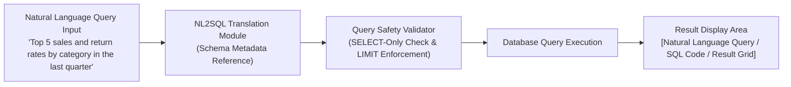
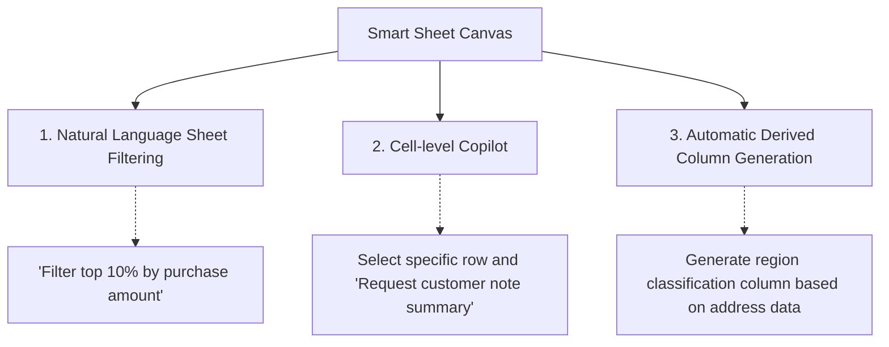

# NL2SQL Portal and Smart Sheet Data Explorer (Data Exploration)

Even in environments where writing raw SQL queries directly to retrieve and analyze data is difficult, **SyncInsight** supports efficient data exploration through the **NL2SQL Portal**, which converts natural language into database query statements, and the spreadsheet-style **Smart Sheet Canvas**.

---

## 1. NL2SQL Portal Explorer (SI-007)

When you enter a question in natural language, it generates a read query SQL statement based on pre-registered schema metadata and displays the results on screen.

### 1.1. Three-Pane Screen Layout
1. **Top Query Area**: Provides a natural language prompt input box along with chips for frequently used sample queries.
2. **Left SQL Verification Area**: Displays the generated SQL statement, execution plan (Explain Plan), and detailed explanations of query conditions.
3. **Right Data Visualization Area**: Visualizes query results using responsive grids and charts (bar charts, line graphs, etc.).

### 1.2. Query Safety Validation Criteria
* **Read-Only Enforcement**: Only `SELECT` statements are permitted; data modification or deletion statements such as `INSERT`, `UPDATE`, `DELETE`, and `DROP` are never executed.
* **Limit Protection**: A default `LIMIT` setting is applied to prevent database overload caused by large-scale data scans.
* **Parameter Binding**: Applies dynamic parameter binding to defend against SQL injection.

---

## 2. Smart Sheet Canvas (SI-008)

Enables data analysis and transformation tasks within a spreadsheet-style grid environment.

### 2.1. Key Features
* **Natural Language Sheet Filter**: Filter data using commands such as "Show only items whose growth rate declined month-over-month" without configuring complex filter dialogs.
* **Inline Cell Copilot**: When you select a specific cell or row and instruct a transformation, it considers the context of the entire row to populate summaries, classifications, or sentiment analysis results.
* **File Export**: Download processed data in CSV or Excel format.

---

## 3. Data Context and Ontology Viewer (SI-020)

Visualizes relationships and provenance across major database tables in the form of a knowledge graph.

* **Data Lineage Tracking**: Trace the step-by-step history of which source tables a specific metric or column was derived and transformed from.
* **Ontology Map**: Visualize the interconnection structure among business domain entities (members, orders, products, etc.) to inspect data consistency.
