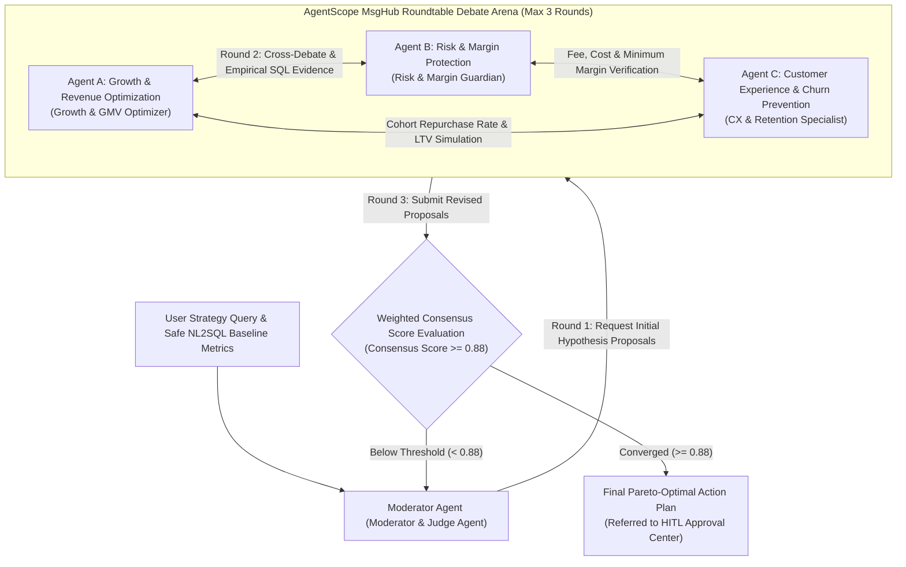

# SyncInsight Roundtable Agent Debate (Multi-Agent Roundtable Debate)

## 1. Multi-Perspective Consensus Mechanism (Roundtable Consensus)

Single-shot analytical outputs from a lone LLM are vulnerable to hallucination or confirmation bias, making them unsuitable for standalone use in critical enterprise decisions (price increases/decreases, promotional budget execution, resource reallocation, etc.).

To address this, `SyncInsight` operates a **Roundtable Debate Engine** built on the **`AgentScope Java` (`io.agentscope:agentscope-harness:2.0.2`) `MsgHub` multi-agent broadcast bus**, where multiple specialized analytical agents with competing objective functions cross-verify claims and converge on a consensus plan.



---

## 2. Objective Functions and Evaluation Weights by Persona

Each participating debate agent shares the same source data (`SyncInsight` Safe NL2SQL query results and `SyncCrawl` external market intelligence), while being assigned distinct evaluation metrics and constraints during the debate.

| Agent Role (`personaCode`) | Core Objective Function | Key Reference Data & Verification Constraints | Default Consensus Weight |
| :--- | :--- | :--- | :---: |
| **`GROWTH_OPTIMIZER`**<br>(Growth & Revenue Agent) | Maximize Gross Merchandise Value (GMV), inbound traffic, and conversion rate (CVR) | • Click-through rate and cart conversion trends by category<br>• Competitor promotional price index (`SyncCrawl`) | `0.35` |
| **`MARGIN_GUARDIAN`**<br>(Risk & Margin Guardian) | Protect contribution margin rate, prevent negative margins, enforce budget caps | • Purchase cost per SKU and minimum guaranteed margin rate (`>= 15%`)<br>• Promotional coupon budget ceiling and inventory turnover | `0.40` |
| **`CX_RETENTION_EXPERT`**<br>(CX & Retention Agent) | Prevent price-fairness dissatisfaction among existing VIPs, curb return rates, improve LTV | • 30-day buyer cohort revisit rate<br>• Correlation between sharp price swings and claim/cancellation rates | `0.25` |
| **`MODERATOR_JUDGE`**<br>(Moderator & Judge Agent) | Summarize issues per round, verify factual evidence (SQL), derive final consensus plan | • Reject agent claims lacking backing from actual DB queries<br>• Judge Pareto-optimal parameter convergence | Overall Mediation |

---

## 3. Three-Stage Debate Convergence Algorithm and Formula

1. **Round 1 — Hypothesis Proposal**:
   - Each agent proposes execution parameters optimized for its own objective function (e.g., `20% discount rate` from `GROWTH_OPTIMIZER`, `8% discount rate` from `MARGIN_GUARDIAN`) along with supporting SQL statistical metrics.
2. **Round 2 — Cross-Examination**:
   - After receiving peer proposals via `MsgHub`, each agent counters with quantitative evidence of risks violating its constraints (e.g., `"Applying a 20% discount drops margin rates to 9.2% across the bottom 14 SKUs, violating the 15% minimum margin guardrail"`) and proposes revised terms.
3. **Round 3 — Weighted Consensus Scoring**:
   - The Moderator Agent synthesizes the expected upside and risk-mitigation performance of each alternative to compute the consensus score \(S_{\text{consensus}}\):
     \[
     S_{\text{consensus}} = \sum_{i \in \{A,B,C\}} w_i \cdot U_i(\theta) - \lambda \cdot \text{Penalty}_{\text{constraint}}(\theta)
     \]
   - Once the consensus score reaches or exceeds the configured threshold (`0.88`), the debate concludes and issues a final `Action Proposal` card.

---

## 4. Roundtable Debate REST API and Streaming Payload

Roundtable debates are executed via the `/api/v1/insight/debate/sessions` endpoint, and statements and consensus scores from each round are streamed in real time to the frontend canvas over Server-Sent Events (SSE).

### 4.1 Start Debate Session Request (`POST /api/v1/insight/debate/sessions`)

```json
{
  "topic": "Design an optimal promotion to clear fall season outerwear inventory while protecting contribution margin",
  "targetDomain": "SYNC_SHOP",
  "maxRounds": 3,
  "consensusThreshold": 0.88,
  "constraints": {
    "minMarginRate": 0.15,
    "maxBudgetKrw": 25000000
  }
}
```

### 4.2 Debate Completion and Final Consensus Action Response Example

```json
{
  "sessionId": "deb-20261118-042",
  "status": "CONSENSUS_REACHED",
  "completedRounds": 3,
  "consensusScore": 0.924,
  "transcriptSummary": [
    {
      "round": 1,
      "speaker": "GROWTH_OPTIMIZER",
      "claim": "Running a 20% sitewide flash sale across all items yields an estimated +34.2% increase in order volume",
      "evidenceSqlId": "sql-ev-101"
    },
    {
      "round": 2,
      "speaker": "MARGIN_GUARDIAN",
      "claim": "Applying a 20% discount across all items causes 18 low-margin SKUs to fall below the minimum margin rate (15%). Propose a revised combination of a 12% discount limited to items with 45+ inventory aging days plus an additional 3% VIP coupon",
      "evidenceSqlId": "sql-ev-104"
    },
    {
      "round": 3,
      "speaker": "MODERATOR_JUDGE",
      "claim": "Consensus reached on targeting aged inventory with a 12% discount, improving overall contribution margin by +14.8% while preserving a minimum margin rate of 17.4%",
      "consensusScore": 0.924
    }
  ],
  "proposedAction": {
    "targetAgent": "SYNC_SHOP",
    "mcpTool": "shop_batch_price_update",
    "requiresHitlApproval": true,
    "arguments": {
      "action": "BATCH_UPDATE_PRICE",
      "categoryId": 104,
      "rate": 0.88,
      "minInventoryDays": 45
    }
  }
}
```
