# SyncLLM System Architecture

SyncLLM is designed as a **4-tier Inline Pipeline** that governs all client requests before they are forwarded to external LLM providers and after responses are returned.

---

## Pipeline Architecture Diagram

```mermaid
flowchart LR
    subgraph Layer1 ["1. Ingress Gateway Layer"]
        direction TB
        API["OpenAI-Compatible API Endpoint
/v1/chat/completions"]
        Auth["API Key Auth & Tenant Identification"]
        RateLimit["Token Bucket Rate Limiter"]
    end

    subgraph Layer2 ["2. Security Guardrail Layer"]
        direction TB
        PIIFilter["PII Regex / NER Masking"]
        InjectionDetect["Prompt Injection Defense"]
        SchemaValidate["Input JSON Schema Validation"]
    end

    subgraph Layer3 ["3. Semantic Cache & Routing"]
        direction TB
        Embedding["Lightweight Text Embedding Generation"]
        VectorSearch["Vector DB Cosine Similarity Search"]
        ModelRouter["Intent/Cost-Based Model Router"]
    end

    subgraph Layer4 ["4. FinOps & Provider Adapter"]
        direction TB
        Adapter["OpenAI / Anthropic / vLLM Adapter"]
        CostCalculator["Real-Time Token Cost Settlement"]
        AuditLog["Audit Log & Metric Emission"]
    end

    Layer1 --> Layer2 --> Layer3 --> Layer4
```

---

## Detailed Layer Descriptions

### 1. Ingress Gateway Layer
- **Full OpenAI Specification Compatibility**: Provides standard `/v1/chat/completions` and `/v1/embeddings` interfaces, enabling immediate adoption simply by changing the Base URL without modifying existing application code.
- **Multi-Tenant Authentication & Access Control**: Issues API keys and enforces granular permissions at the Organization (Org), Project, and Service Account (SA) levels.
- **Adaptive Traffic Throttling**: Controls excessive client burst traffic based on Requests Per Second (RPS) and Tokens Per Minute (TPM).

### 2. Security Guardrail Layer
- **Pre-Request PII Masking**: Before a request prompt is transmitted to an external cloud, sensitive items such as resident registration numbers, phone numbers, card numbers, and internal passwords are replaced in memory with `[REDACTED_PII]`.
- **Post-Response Re-hydration**: When a model's response requires the context of masked tokens, identifiers temporarily held in a secure session store are mapped back before delivery to the client.
- **Prompt Injection Guard**: Detects system prompt exfiltration and guardrail bypass (Jailbreak) patterns to block anomalous requests immediately.

### 3. Semantic Cache & Routing Layer
- **Semantic Embedding Search**: Extracts semantic vectors from the input prompt using a high-speed embedding model; if an existing Q&A entry meets or exceeds the similarity threshold (\(\ge 0.95\)), the cached response is returned without an external API call.
- **Task Complexity Classifier**:
  - Simple classification, formatting, translation, grammar correction: Routed to cost-effective lightweight models.
  - Complex mathematics, multi-step logical reasoning, intricate architectural code generation: Routed to top-tier flagship models.

### 4. FinOps & Provider Adapter Layer
- **Dynamic Provider Adapters**: Automatically translates proprietary API formats from each LLM provider (Anthropic Messages API, Google Vertex AI, vLLM local endpoints) into a unified standard specification.
- **Real-Time Token Ledger**: Converts Prompt Tokens, Completion Tokens, and Cached Tokens into real-time costs ($) according to per-model rate cards and records them in the database.
- **Automatic Failover**: When a primary provider experiences a 5xx outage or 429 Rate Limit, the request is transparently retried within milliseconds against a backup provider of the same tier.
