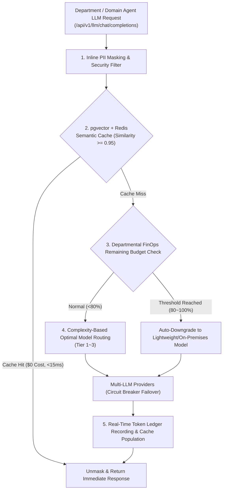

# SyncLLM Enterprise Adoption FAQ

These are the core questions and technical specifications frequently raised by infrastructure architects, information security teams, and finance/procurement departments when adopting `SyncLLM`, the enterprise AI model gateway and FinOps cost control platform.

---

## 1. Cost Reduction & FinOps Budget Control



### Q1. How much cost is actually saved by adopting the Semantic Cache?
- **Answer**: In environments with frequent standardized queries—such as enterprise internal work assistants, technical documentation search (RAG), automated regression testing (`SyncETA`), and repetitive code analysis—an **average LLM API token cost reduction of 35% to 55%** has been measured in practice.
- `SyncLLM`'s semantic cache does not rely on simple string matching; instead, it combines **PostgreSQL 18.6 `pgvector` HNSW indexes with Redis in-memory caching** to evaluate embedding vector cosine similarity (default threshold \(\ge 0.95\), configurable per domain). As a result, verified cached responses are returned immediately even when word endings, particles, or sentence order vary slightly.

### Q2. If a department exceeds its monthly budget limit, are enterprise AI services abruptly shut down?
- **Answer**: The default policy operates as a **Graduated Soft-Limit** guardrail to ensure business continuity, and can be configured with precision per department (`llm_budget_policy`).

| Budget Burn Range | Automated Gateway Control Behavior | Alerts & Governance Actions |
| :--- | :--- | :--- |
| **Normal (`0% ~ 79%`)** | Invokes the requested model tier or the optimal model selected by the intelligent router as-is | Recorded in real-time token ledger (`llm_usage_ledger`) |
| **Caution (`80% ~ 94%`)** | Automatically switches general summarization and classification requests from high-cost commercial models to lightweight models (Tier 1) | Dispatches Slack/email budget warnings to department managers and PMO |
| **Limit Reached (`95% ~ 100%`)** | Blocks external paid commercial API calls and **100% automatically falls back to internal on-premises vLLM models (zero marginal cost)** | Returns `429 Too Many Requests` (RFC 7807) only when `hardLimitEnabled: true` is configured |

---

## 2. Security & Personally Identifiable Information (PII) De-Identification Guardrails

### Q3. Is there any risk of leaking internal customer PII or confidential source code when calling external commercial LLMs (OpenAI, Anthropic, Google)?
- **Answer**: `SyncLLM`'s inline security pipeline intercepts the request payload immediately before packets leave the internal network and performs the following dual-layer protection:
  1. **Reversible Two-Way PII Tokenization**: Detects resident registration numbers, alien registration numbers, mobile phone numbers, credit card numbers, bank account numbers, email addresses, internal API secret keys (`sk-...`, `Bearer ...`), and JWT tokens in real time via regex and NER filters, substituting them with ephemeral placeholders such as `<PII_PHONE_01>` and `<PII_ACCOUNT_01>` before transmission to external LLMs.
  2. **In-Memory Unmasking & Zero-Retention Auditing**: When the response returns from the external LLM, original values are restored via an isolated in-memory session mapping table inside the gateway before delivery to the client, ensuring sensitive data is never exposed to external LLM vendors' training datasets or logs.
  3. **Confidentiality Classification Forced Routing**: If a prompt contains internal confidential keywords or source code blocks, transmission to external commercial APIs is automatically rejected and forcibly routed exclusively to internal air-gapped on-premises LLMs.

---

## 3. Infrastructure Performance, High Availability (HA) & Air-Gapped Deployment

### Q4. What is the network latency overhead introduced by routing through the gateway, and how are LLM vendor outages handled?
- **Answer**:
  - **On Semantic Cache Hit**: Completely bypasses external LLM inference time (`1,200ms ~ 3,500ms`) and responds directly from memory, reducing **total response time to within `5ms ~ 15ms`**.
  - **On Semantic Cache Miss**: Gateway overhead for inline PII masking and routing rule evaluation is **under `8ms ~ 12ms`**, and asynchronous SSE streaming (`text/event-stream`) passthrough built on Java 25 Virtual Threads ensures zero delay in Time to First Token (TTFT).
  - **Zero-Downtime Circuit Breaker Failover**: If consecutive `5xx` server errors, timeouts, or `429 Rate Limit` responses are detected from a specific cloud LLM provider (e.g., OpenAI), the circuit breaker automatically reroutes traffic to a secondary provider (e.g., Anthropic Claude, Azure OpenAI, or on-premises vLLM) within `50ms`.

```json
{
  "model": "sync-auto-tier2",
  "messages": [
    {
      "role": "user",
      "content": "Draft an order cancellation and refund notice message for customer John Doe (010-1234-5678)."
    }
  ],
  "metadata": {
    "departmentCode": "CS_OPS",
    "agentCode": "SYNC_SHOP",
    "piiMaskingApplied": true,
    "maskedEntities": ["PERSON_NAME", "PHONE_NUMBER"],
    "routedProvider": "anthropic-claude-3-5-haiku",
    "failoverStandby": "onprem-vllm-llama3-70b"
  }
}
```

### Q5. Can existing OpenAI SDK, LangChain, or AgentScope code be connected to SyncLLM without modification?
- **Answer**: Yes. `SyncLLM` 100% supports the **OpenAI-compatible standard REST API specification (`/api/v1/llm/chat/completions`, `/api/v1/llm/embeddings`)** and the `AgentScope Java` standard model client. In existing applications, simply changing the `baseUrl` to the `SyncLLM` gateway address and injecting a departmental virtual API key (`X-SyncLLM-Key`) immediately enables semantic caching, PII masking, and FinOps budget controls with zero code changes.

### Q6. Can SyncLLM be deployed standalone in completely air-gapped on-premises environments (finance, defense, public sector)?
- **Answer**: Yes. Even in closed networks with zero external internet connectivity, it can be deployed via `docker-compose-dev.yml` or Kubernetes Helm charts, operating systematically as a load balancer and security/audit control gateway for **vLLM, Ollama, and TGI (Text Generation Inference)** inference engines running on internal GPU clusters.

---

## 4. Core Gateway Operational Parameters & API Summary

| Configuration Key (`sys_config` / `application.yml`) | Default | Description |
| :--- | :---: | :--- |
| `sync.llm.cache.similarity-threshold` | `0.95` | Cosine similarity threshold for `PostgreSQL 18.6 pgvector` + Redis semantic cache hit evaluation |
| `sync.llm.cache.ttl-seconds` | `86400` | Default semantic cache entry TTL (24 hours; configurable per domain) |
| `sync.llm.pii.masking-enabled` | `true` | Enables real-time tokenization and unmasking for 8 major categories of inbound personal/financial PII |
| `sync.llm.circuit-breaker.failure-threshold` | `3` | Consecutive failure threshold for an LLM vendor before triggering immediate failover to a secondary provider |
| `sync.llm.finops.soft-limit-ratio` | `0.80` | Ratio against departmental monthly budget that triggers lightweight model auto-downgrade and warning alerts |
| **Standard Proxy & MCP Endpoints** | `/api/v1/llm/*` | `POST /api/v1/llm/chat/completions`, `POST /api/v1/llm/embeddings`, `POST /api/v1/llm/mcp` |
